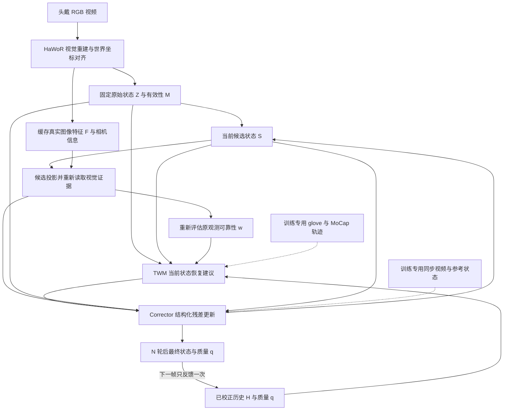

# HandLoop 项目记忆入口

更新日期：2026-10-13。研究工作名：HandLoop；论文标题仍为候选，以 **Are Gloves Necessary? Learning to Correct Visual Hand Reconstruction with Motion Priors** 为当前写作参考。

**核心 idea：将高精度 glove/MoCap 轨迹中学到的手部结构和运动知识，转移到头戴 RGB 的当前状态估计中。让当前可信的局部视觉观测帮助修复不可见或错误的关节，并通过帧内取证和跨帧反馈持续校正。**

“预测是为了学习运动过程，当前状态校正才是最终任务。”这是归档中用户最重要的纠偏。[原讨论 §15.11](HandLoop_Project/01_Conversation_Research_Archive.md#1511-最重要的一轮纠偏纠正当前状态不是预测未来)

## 当前真实进展

工作区原有材料为5份Markdown研究文档和1张早期PNG方法图；尚无模型实现、训练数据、权重或实验结果，处于**研究设计与论文草稿阶段**。2026-10-13按用户要求初始化Git仓库，目标为`origin/main`：`https://github.com/Junzhou-Chen/Hand_Reconstruction.git`；同步状态见[开发与远程约定](memory/08_DEVELOPMENT_AND_REMOTE.md)。

**已定工作分工：本机写代码、论文和文档；所有实验在`ssh hongfei`远程运行，项目位于`/data/hongfei/zhou/Hand_Reconstruction`。** 代码、论文、记忆和小型结果同步GitHub，数据集、权重与大文件依`.gitignore`排除。

已完成项目理解、来源核对、文件化记忆，以及针对TWM的公开数据集专项调研；尚未实现模型、下载完整训练数据或验证效果。原有材料完整保留。

**最新数据决定（2026-10-13）：** 用户优先使用无需申请、可直接下载的公开数据，并参考论文实际用法。此前GRAB+ARCTIC先开工、HOT3D首轮paired的建议不再作为默认；需注册/登记的路线暂降级，Lightwheel等人工审批资源留作调查背景。建议先验收OakInk2/DexCap/DexWild等直接发布的motion；paired协议参考DexYCB/HO3D，保留来源质量与目标域区别。最终混合未定。[数据与评测](memory/03_DATA_AND_EVALUATION.md)

**同日扩查修正：** 上述首轮清单偏学术，不是完整可用数据全景。新增SynData、Lightwheel EgoSuite、EgoVerse、OOJU、OpenGraph MANUS样本、Daimon DataDex及BeingBeyond UniHand Preview。SynData优先检查ITW骨架映射，Lightwheel/EgoVerse按手标签完整性与实际开放量筛选，UniHand按原来源去重。详见[产业数据补充](memory/09_INDUSTRY_HAND_DATASETS_2026-10-13.md)。

完整方法已整理为[方法框架](docs/METHOD_FRAMEWORK.md)：三个主体、两个闭环、单手69D、统一TWM输入提案、w/q分工和三阶段训练。统一槽位、残差坐标、初始化和单手共享参数等是明确标注的实现建议，尚未运行。

## 快速恢复上下文

| 需要做什么 | 阅读入口 |
|---|---|
| 理解总体方向和项目事实 | 本文件；[现行原始方案](HandLoop_Project/START_HERE.md) |
| 设计模块、状态接口、训练闭环 | [方法与接口](memory/01_METHOD.md) |
| 连贯阅读完整方法与训练/实验安排 | [完整方法框架](docs/METHOD_FRAMEWORK.md) |
| 判断某个想法是否已经定案或放弃 | [决策与演进](memory/02_DECISIONS.md) |
| 选择数据、设计实验和消融 | [数据与评测](memory/03_DATA_AND_EVALUATION.md) |
| 查找可用于TWM预训练的公开数据、下载和许可 | [数据集专项调研（2026-10-13）](memory/07_TWM_DATASET_SURVEY_2026-10-13.md) |
| 开始下一步工作、查接口缺口 | [进展与下一步](memory/04_STATUS_AND_NEXT_STEPS.md) |
| GitHub同步、服务器和实验位置 | [开发与远程约定](memory/08_DEVELOPMENT_AND_REMOTE.md) |
| 数采团队、商业厂商和大规模数据发布 | [产业手部数据补充调查](memory/09_INDUSTRY_HAND_DATASETS_2026-10-13.md) |
| 写 Introduction、定位贡献、引用论文 | [写作与外部核验](memory/05_WRITING_AND_REFERENCES.md) |
| 回溯原文、检查材料覆盖与版本 | [来源索引](memory/06_SOURCE_INDEX.md) |
| 了解记忆发生了什么变化 | [变更记录](memory/CHANGELOG.md) |

## 必须记住的项目约束

1. **输入和主干已选定。** 第一版是头戴 RGB + HaWoR，先冻结视觉权重。RGB-D 优先、EgoInfinity 为主干、WiLoR 单帧作为完整系统是历史路线。
2. **TWM 独立学状态关系。** 仅以 glove/MoCap 等高质量运动轨迹预训练，不用配对图像、不直接复用 WestWorld 机器人权重、不依赖真实控制 action。
3. **恢复当前状态为主。** TWM 结合历史和当前受损/部分状态；辅助短期预测用于学习时序规律。不是只依据历史预测未来，再按 confidence 拼接。
4. **可信观测可约束其他关节。** 不只是“看得见保留，看不见预测”。局部可信状态应通过结构关系帮助恢复其他部分。
5. **视觉和先验都可能出错。** 高 confidence 仍需检验；真实急停/转向应能推翻错误运动预期。
6. **两个闭环有不同作用。** 帧内候选改变图像证据查询位置；跨帧仅回灌最终校正状态及其可靠性。它们不是长短记忆双分支。
7. **状态与测量分开。** 固定原始观测 `Z_t`，更新候选 `S_t^(k)`；当前帧内历史 `H_t` 和参考系 `A_t` 固定。不能把中间输出当成新测量。
8. **建议表示是每手69D编码，非69个独立DoF。** wrist translation 3 + rotation6D 6 + 20非根关节60；残差66D也是编码长度。HaWoR原生MANO输出需adapter转换，视频支持双手，原infiller同时输入两手。具体骨架/字段转换尚未实现验收。
9. **有效性不等于正确性。** raw detection、joint availability、原观测可靠性 `w`、最终状态可靠性 `q` 含义不同。
10. **精度优先于平滑。** 报告 world/camera/local 几何误差及突变、遮挡、再可见恢复；不以平滑度或 PA-MPJPE 代替绝对世界精度。

设计依据：[START_HERE §1–6](HandLoop_Project/START_HERE.md)；[对话归档 §15.8–15.11、§15.23、§16](HandLoop_Project/01_Conversation_Research_Archive.md)。

## 方法关系图

这是依据现行文字方案重建的概念图，未代表已运行代码。HaWoR 可能使用时间上下文；闭环后端不意味着完整系统已满足严格在线/因果条件。

## 研究价值与证据边界

潜在贡献是 **当前部分状态条件恢复 + 候选引导的独立视觉取证 + 可靠性重估和时间反馈** 的有效配合，尚未证明优于已有方法。HMP、StableHand、PAD-Hand 和 HaWoR 自有 infiller 是必须认真比较的相关工作；不能声称首次使用运动先验或 confidence。

部署免手套不等于训练免手套；“学习动力学”目前指运动学结构与时序统计，不能据此宣称学会力、力矩或人的动作意图。长期完全遮挡的唯一真值、全局 SLAM gauge/漂移，均不能仅由手部运动先验保证恢复。

## 紧接着要回答的问题

**在统一时间戳、骨架、坐标和 GT 条件下，纯轨迹条件恢复能否降低真实 HaWoR 输出的几何误差，并优于 smoothing/Kalman/普通 temporal model？**

先完成一条可审计的数据链和最小 baseline，再增加独立视觉取证与反馈。完整步骤和阻塞项见[下一步](memory/04_STATUS_AND_NEXT_STEPS.md)。`K=8`、6 层、`d=256`、4 heads、`N=2`、约 16 帧 rollout 都是起始建议，不是实验结论。

## 记忆的效力与维护

用户的新决定优先；现行设计以 `START_HERE.md` 和有来源的后续决策为准。`memory/` 是可检索的派生记忆；原始历史归档用于溯源，不能因其中出现“最终”就覆盖较晚的决定。外部核验能纠正事实，不自动更改用户研究目标。

这套记忆保存在当前工作区，通过根目录 `AGENTS.md` 提示后续在此目录工作的 agent 先读取。它不等于账户级自动记忆；移交到其他目录或会话时，应同时带上 `AGENTS.md`、`MEMORY.md`、`memory/` 与 `HandLoop_Project/`。
