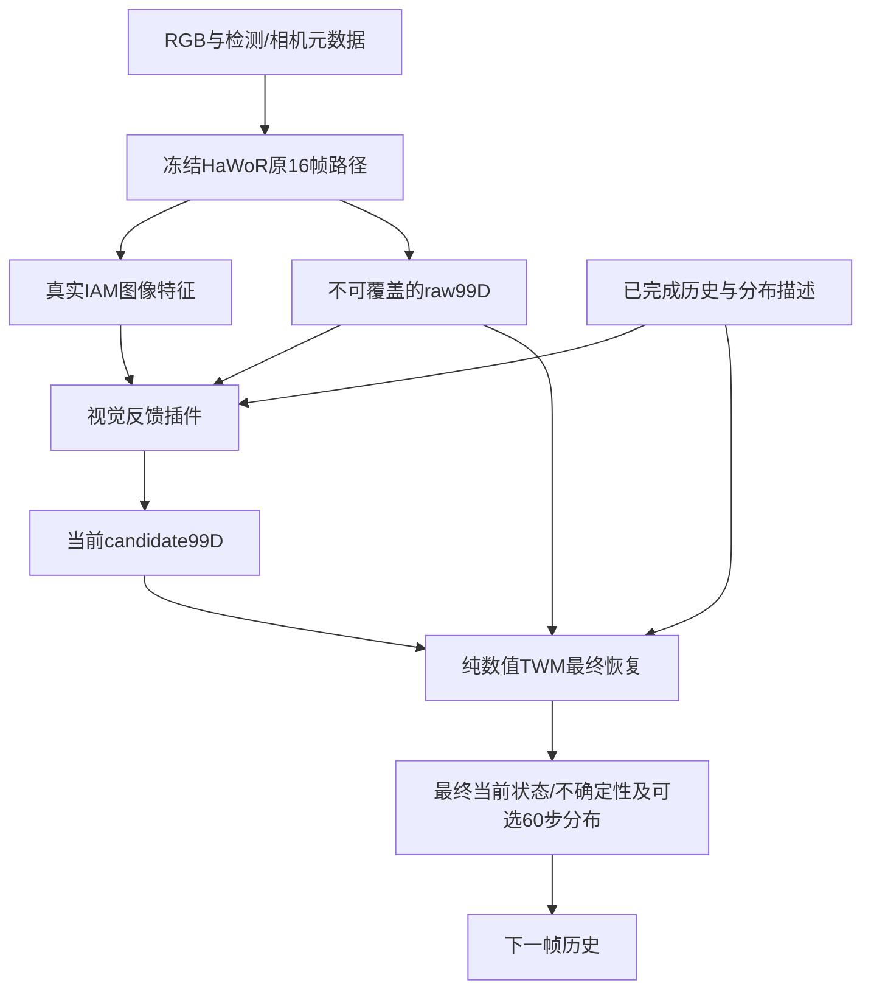

# HandLoop 项目记忆入口

**D37当前运行（2026-10-15纽约12:10验收）：** 用户要求新Pod `jchen57-fineturn-tl4zr` 从头训练10,000 step，历史只保留best；替代D36两epoch预算及旧latest/暂停快照全保留规则。修复后的v3噪声、位置feature尺度0.05m、13.53M结构、四库full-coverage循环、每卡512/global1024保持；warmup500/eval500/save100。源码87a2bcc于16:06:44UTC启动，已实际40/10,000更新（40,960窗口），四库五case均参与、每卡peak allocated约63.9GB；checkpoint10模型/AdamW finite、CPU与两rank hash一致，W&B[a9cb4888](https://wandb.ai/black-ant/handloop-twm/runs/a9cb4888)服务端到40。新步数预算下三遍历/尾批次/resume双卡检查通过。历史18份best finite＋SHA保留，22份非best权重已按授权删除2,511,839,588bytes，日志/配置/推理结果留存；当前新run的latest保留用于中断恢复。D36已纽约03:53正常完成两轮但短时漂移/clean仍有失败；更多步数不等于已证实改善。[新协议](docs/TWM_TRANSIENT_10K_RUN_2026-10-15.md)、[启动验收](reports/twm_transient_v3_10k_launch_20261015.json)、[清理清单](reports/twm_best_only_cleanup_20261015.json)。

**D36已启动（2026-10-15纽约02:56验收）：** 用户要求修复短时噪声并按2个epoch重跑。旧D34已保存停止5,519步，checkpoint/STOP保留且finite/sync通过。新v3显式局部plateau/ramp/scattered/jitter、因果缺失填充、encoder-only位置尺度0.05m；完整覆盖每轮636,610窗、622更新、最后每卡353，每卡512/global1024。25fee71在独立远程worktree从头启动，实际50更新=0.080426/2 epoch、51,200窗口；四库与五case均参与，每卡peak allocated约63.9GB。正式checkpoint10的322个model/963个AdamW浮点张量finite，CPU/两rank hash一致；W&B[58f012f8](https://wandb.ai/black-ant/handloop-twm/runs/58f012f8)服务端已收到step50及epoch曲线。13模式语义检查、全量索引并集/互斥、真实短片段1→4更新跨epoch续跑/尾批次，以及独立STOP保存通过。2epochs是pilot目标，非完成或已证实精度改善；自然样本占比改变旧等源权重，具体比例/尺度仍是假设，D35框架不改。[协议与失败修正](docs/TWM_TRANSIENT_EPOCH_RUN_2026-10-15.md)、[验收摘要](reports/twm_transient_epoch2_20261015.json)。

更新日期：2026-10-15 UTC（纽约10-15）。研究工作名：HandLoop；论文标题仍为候选，以 **Are Gloves Necessary? Learning to Correct Visual Hand Reconstruction with Motion Priors** 为当前写作参考。

**核心 idea：将高精度 glove/MoCap 轨迹中学到的手部结构和运动知识，转移到头戴 RGB 的当前状态估计中。让当前可信的局部视觉观测帮助修复不可见或错误的关节，并通过帧内取证和跨帧反馈持续校正。**

“预测是为了学习运动过程，当前状态校正才是最终任务。”这是归档中用户最重要的纠偏。[原讨论 §15.11](HandLoop_Project/01_Conversation_Research_Archive.md#1511-最重要的一轮纠偏纠正当前状态不是预测未来)

## 当前真实进展

**D34腕位置原因诊断（纽约2026-10-15 01:37；建议未实施）：** 在原7d53fa4源码快照、冻结checkpoint4,400上做四库各8窗只读扰动/梯度检查；模型/buffer前后相等，无optimizer，原10k继续（05:37UTC实际4,450步）。位置平均更新0.562mm，当前raw/candidate额外±10mm时残差平均反向响应仅0.005–0.034mm；FP32仍近似相同，属于很弱的位置纠错输入依赖，不是head/监督断开。current geometry位置头梯度norm0.411；weighted future geometry0.459，future NLL0.232且与current cosine−0.204，仅支持小样本牵制迹象。优先怀疑米单位位置未做feature尺度归一化、clean/near保护下identity策略和future直接经current均值回传；共同位置bias另有不可辨识边界，但不解释独立噪声全部失败。位置归一化/current-only是待验单因素建议，本轮未改训。 [证据、边界与建议](docs/TWM_WRIST_DIAGNOSIS_2026-10-15.md)、[诊断JSON](reports/twm_wrist_diagnosis_20261015.json)。

**2026-10-15 TWM微调讨论（建议，未执行）：** 用户询问真实HaWoR与合成噪声差异下的局部/全量适配，尚未定范围。建议正式数据扩大后，插件暖身→小LR全量TWM适配＋原motion恢复/长预测回放，局部作为对照；冻结future头不能保证保住预测，因为共享表征和当前积分起点都会变。当前仅adapter/current_readout两模式，后者只有2,570个TWM参数；未实施全量scope、未改权重/运行。D35的127帧/20步仍仅smoke。[源码、论文及保持能力边界](docs/VISUAL_FEEDBACK_FRAMEWORK_2026-10-15.md#2026-10-15twm真实误差适配与先验保持讨论建议未实施)。

**D35视觉反馈首版已实现并远程跑通（纽约2026-10-14）：** 用户要求搭建D33完整框架。已实现冻结官方HaWoR真实patch/raw99D→2,458,118参数视觉反馈插件→纯数值TWM最终当前分布→下一帧历史，以及单一current NLL训练、checkpoint/resume、RGB track推理。官方前向比对和16项反馈合同通过，127帧Dex s0 train/val真实缓存通过；1f842cf在独立checkout用D32已停step3110参考完成3→20步，395个model/216个AdamW浮点张量finite、TWM hash不变，W&B服务端[e00b708e](https://wandb.ai/black-ant/handloop-twm/runs/e00b708e)完成20步。16张真实RGB组合推理输出当前99D及4×60未来分布通过。此smoke采用GT crop/固定camera gauge/标称30Hz，只有1 train＋1 val录制；val腕95.029→65.048mm，但root4.936→5.856°、finger6.779→8.493°退化，90% xyz coverage为0，不能声称整体提升或不确定性已校准。检测/SLAM由原前端提供，未实现任意原始视频自动入口；D34纯轨迹run保持原样。[框架与验收](docs/VISUAL_FEEDBACK_FRAMEWORK_2026-10-15.md)、[完整摘要](reports/visual_feedback_framework_20261015.json)。

**D33视觉反馈方向（纽约2026-10-14）：** 用户要求在HaWoR官方预训练权重上增加反馈接口，使视觉侧读取TWM已校正信息，并反对多项手工加权loss。新推荐：保留原16帧双向路径，在其后加小型视觉读出插件，读取真实图像特征与已完成历史；raw/candidate分槽后交TWM输出最终当前状态与不确定性。视觉阶段先冻结两主干、只训练插件，用单一最终当前state NLL；当时具体插点/目标/冻结范围仍为建议；后续D35已按此搭建首版，独立Corrector是否永久删除仍未定案。D33讨论时D32未改。[逻辑、梯度与验收§11](docs/TWM_DIRECT_REFINEMENT_PROPOSAL_2026-10-14.md#11-d33预训练hawor读出侧反馈插件与单一视觉训练目标)。

**D34当前效果检查（纽约2026-10-15 01:25）：** 最新训练快照4,180/10,000步，完整fixed validation为4,000步；每卡512/global1024及原模型/GT/split保持，训练继续。四库各256窗等权：ordinary/noisy腕7.158→7.180mm，root3.999→2.373°、finger3.224→1.561°，旋转改善40.7%/51.6%但腕位置未有效纠错。clean腕引入0.688mm，14.26%窗口>1mm退化；当前clean/历史错为0.571mm、4.39%。同轮3k→4k score0.012730→0.012216，仍降约4.03%、速度放缓；1s预测腕103.568mm优于hold120.242mm，2s（三库有有效窗）150.508mm尚差于hold148.162mm。90%当前xyz椭球覆盖82.03%，未校准。本轮只读既有验证日志、远程CPU绘图，不暂停或改训；这些是拟合MANO参考下的合成验证，非真实HaWoR或独立GT效果。 [详细效果与曲线](docs/TWM_B512_PROGRESS_2026-10-15.md)、[摘要](reports/twm_b512_progress_20261015_0521.json)。

**D34启动历史：每卡512、global1024，从头训练10,000步。** 用户要求检查约3k步曲线并加大batch重新跑；D32已于02:02:24UTC共同保存停止3,110步，latest/best原件及额外快照保留，模型/AdamW finite、CPU与两rank hash一致。新run `twm_four_sources_moe_mixed_v2_b512_10k_20261015` 以7d53fa4于02:09:50UTC在原GPU0/1从头启动；02:12:13UTC验收实际20步/20,480样本、四库与五类均参与，W&B12cc0781服务端step20已收到标量。正式checkpoint10的322个model/963个AdamW浮点张量finite、两rank与CPU一致；当时每卡峰值allocated约63.9GB。保留13.53M架构、四库GT/split和mixed_v2；LR2e-4/warmup500不变，cosine改10k结束。旧1k→3k加权恢复score0.02225→0.01281、finger3.22→1.77°仍改善，但腕位置输出7.21mm未优于输入7.16mm，不能保证仅加步数解决。10k是目标、非完成；本轮不改D33视觉方案。 [运行记录](docs/TWM_MOE_LONG_HORIZON_RUN_2026-10-15.md#d34每卡512从头训练10000步)、[验收摘要](reports/twm_batch512_10k_20261015.json)、[W&B](https://wandb.ai/black-ant/handloop-twm/runs/12cc0781)。

**D32启动历史（D34已保存停止3,110步）：用户此前要求按D31混合设置实现并跑起。** 新sampler、active profile、12种分层/legacy验证与实际类别计数已接入，保留13.53M MoE＋60步分布架构。0d83a54于00:54:45UTC在原两卡从头启动独立run，每卡256/global512；00:57:06UTC验收实际50步、四库累计25,600样本、五类均参与，loss/梯度finite。正式checkpoint10的322个model/963个AdamW浮点张量finite，CPU完整模型hash与两rank一致；W&B服务端step40已收到训练标量。旧D29停止814步及D28停止32,783步均保留STOP，不恢复。混合比例20/20/35/20/5，实际位移范数与SO(3)总角有界，quality unknown；尚无最终精度或真实HaWoR纠错结论。[执行记录](docs/TWM_MOE_LONG_HORIZON_RUN_2026-10-15.md#d32混合有界噪声训练已启动)、[验收摘要](reports/twm_mixed_v2_20261015_launch.json)、[W&B](https://wandb.ai/black-ant/handloop-twm/runs/cd487764)。

**D31暂停与混合设计历史（D32已另启新run）：用户要求先暂停正在跑的训练，因另一个聊天正在修改架构；混合高质量干净轨迹和受损条件，轻中噪为主，强异常少量，不把真实HaWoR误差标定当开工前置。** D29已在814步共同保存退出，latest814/best500原件与额外快照hash一致，模型/AdamW finite、两rank一致，STOP保留不自动resume。建议输入混合20%全净/20%当前近准历史错/35%轻中噪/20%局部缺失/5%强异常；位移按范数分档，quality默认unknown。具体比例为待验证建议，未接入trainer或修改另一聊天架构。[暂停摘要](reports/twm_moe_pause_20261015.json)、[混合设计§9](docs/TWM_DIRECT_REFINEMENT_PROPOSAL_2026-10-14.md#9-d31先暂停混合干净轨迹与适量受损条件)。

**D29模型与启动历史（随后D31暂停）：用户明确要求当前恢复＋较长未来轨迹分布、MoE、输出不确定性，并修改模型、启动训练及配置W&B。** 已实现13,530,032参数纯轨迹模型：6层d256结构化Mamba，每层4个dense MLP experts，物理秒Fourier时间编码；当前99D恢复＋4个整段模式、最多60步约2秒预测，xyz Gaussian＋SO(3) isotropic matrix Fisher。新run从头训练，保留四库GT/split和β另存/conditioning关闭；旧D28 run保持暂停。4798b62于00:19:13 UTC启动既有两卡，每卡256/global512；00:20:51 UTC实际40步、四库均参与，W&B服务器已收到同step标量。正式checkpoint10的322个model浮点张量和963个AdamW浮点张量finite，CPU重算hash与两rank一致。FP32/BF16、概率归一化、因果/padding、完整目标mask、双卡3步＋resume至5步均通过。新key只存远程私有文件，W&B为[943f9c0c](https://wandb.ai/black-ant/handloop-twm/runs/943f9c0c)。时域/模式数/权重是工程起点，尚无新模型最终精度或视觉闭环收益。[架构、数学与运行](docs/TWM_MOE_LONG_HORIZON_RUN_2026-10-15.md)、[启动摘要](reports/twm_moe_long_horizon_20261015.json)。

**D28旧dense模型历史状态（2026-10-14）：用户要求暂停当前运行、保留checkpoint并先验证效果。** 已通过STOP共同保存，双卡训练于23:53:53 UTC（纽约19:53）停止在32,783步，rank2968/2969退出，原latest/best保留；不自动resume。冻结checkpoint固定/全量validation及当前输入干预均已完成；结果与限制见下文和暂停评测报告。下文D27启动快照保留为历史。

工作区已有研究记忆、四库数据转换、结构化Mamba训练与冻结评测源码，其中旧dense模型已完成**D28暂停与验证**。D27 dense TWM已在32,783步保存停止，latest与best28,000均finite且另存快照；不自动resume。两模型固定3,466窗及全量61,370窗/模式评测完成，best原训练fixed指标复现最大差0。latest全量noisy腕48.703→5.435mm（上一历史保持8.961mm）、finger15.444→1.808°，clean腕退化0.454mm；但固定窗中不提供当前观测为5.451mm，与正常5.476mm近似，当前GT＋带噪历史仍有5.317mm腕误差。结果提示历史先验占主导、可靠当前观测利用不足，未证明真实HaWoR、独立joint/mesh或物理正确性。旧D23/D25/D26产物保留；[暂停与评测](docs/TWM_PAUSED_EVAL_2026-10-14.md)、[摘要](reports/twm_paused_eval_20261014.json)。GitHub为origin/main：`https://github.com/Junzhou-Chen/Hand_Reconstruction.git`；该次评测不代表随后D29新模型的效果。

**已定工作分工：本机写代码、论文和文档，实验全部远程。D19起改用`ssh ds`的SciClone Kubernetes，用户于2026-10-15切换至新Pod `jchen57-fineturn-tl4zr`（旧debug Pod已不存在）；hongfei原checkout保留备用。** 代码、论文、记忆和小型结果同步GitHub，数据集、权重与大文件依`.gitignore`排除。

已完成项目理解、来源核对、文件化记忆，以及TWM公开数据专项调研。Oak/HOT/Ume/Dex四库原包已完成，634/2461/1021/13文件全部verified、failed0，合计531.87GB，不重复下载。D23/D25使用Oak64 train/8 val子集；D26已取得用户官网注册、许可确认后授权下载的MANO资产，并通过Meta/Dex有限样本源解码和99D几何一致性检查。全量数据准备与正式训练状态分别记录，原有材料完整保留。

**ds实测与数据获取：** namespace jchen57；现有Pod分配12CPU/128Gi/2×约96GiB Blackwell。默认Torch2.6/cu126运行CUDA失败，zhou环境Torch2.12/cu130两卡极小计算通过；D25起模型使用独立Torch2.10/cu130＋官方Mamba runtime，zhou未改，新exec须明确选环境。Pod约10月15日16:37 UTC到期。ds代码checkout在home/project/Hand_Reconstruction，数据在data10/jchen57/Hand_Reconstruction/datasets。四库下载已结束，进程退出且phase=complete属正常完成；不重下载、不自动申请新Job。D26授权四库联合预训练，D27授权两卡一起训练并调高batch；旧D23/D25及D26单卡run保留，新双卡run另存。[下载记录](docs/TWM_DATA_DOWNLOADS.md)、[服务器操作](docs/DS_SERVER_OPERATIONS.md)

**D23首轮预训练（2026-10-14）：** 用户要求从已下四库选一库睡前跑起，数学暂缓。已选OakInk2官方64 train/8 val录制，204,502/18,032单手状态，99D＋β另存；821,516参数纯轨迹TWM，当前恢复主任务＋0.1s预测辅助，计划50,000步。D24于09:16UTC要求暂停，PID805已退出，latest.pt=28,213步、best.pt=27,500步均可读；末次step28,000 noisy腕49.090→5.980mm、finger15.421→1.601°，clean退化3.626mm/0.998°。这不是MPJPE、真实HaWoR或物理保证。代码4cb1da8，checkpoint/data仅远程；[单库运行记录](docs/TWM_OAKINK2_PILOT_RUN_2026-10-14.md)。

**D24暂停与架构方向（2026-10-14）：** 用户暂停原tiny pilot，随后澄清“不是完全参考”，要认真借鉴WestWorld架构与参数理由，输入输出仍配合手部当前恢复任务。原模型/数据/权重保留作对照；D25随后明确要求按参考方案实现并启动新训练，具体容量作为本轮起始配置而非最优结论。方向记录见[参考方案](docs/TWM_WESTWORLD_GUIDED_DESIGN_2026-10-14.md)。

**D25新结构实施（2026-10-14）：** 用户要求按刚才方案重做并跑起后再结束。已实现MANO树embedding＋同帧attention/FFN＋逐关节官方Mamba，6blocks/d256/4heads、SSM64/4/2，6,330,892参数，完整99D恢复＋0.1s辅助预测。完全独立runtime Torch2.10/cu130匹配Mamba wheel，zhou未改；fused CUDA、完整12项数值检查及真实Oak3步smoke通过。代码378deda，新run纽约08:57正常完成50,000步，latest50k/best49.5k均可读且finite；最终noisy腕49.090→4.594mm、finger15.421→1.254°，clean退化1.276mm/0.500°；仅合成受损，旧run保留。[新运行记录](docs/TWM_STRUCTURED_MAMBA_RUN_2026-10-14.md)。

**D26四库准备与单卡阶段历史（2026-10-14）：** 用户要求OakInk2/HOT3D/UmeTrack/DexYCB统一训练，保持结构化Mamba、纯轨迹当前恢复与完整99D；用户已自行注册MANO、确认非商业研究许可并授权官网下载。Meta官方decoder18帧等价、Dex左右各6帧及bounded train/val几何检查通过；真实四库3步smoke（2913f28）loss/梯度有限，24个训练样本分别Dex3/HOT6/Oak9/Ume6。loader叶manifest SHA防变更与FD检查通过。Oak full_v2、HOT/Ume full_v3、Dex full_v1均complete，合计8,418手序列、train/val状态2,788,135/271,100；可训练窗口636,610/61,370，Dex两条train序列无足够连续窗口。HOT最后于17:45:27 UTC完成；coordinator完成collection检查后，17:51:39 UTC以2b40aa9在GPU0/PID2599从头正式启动。19:02:32 UTC已17,250步；后续19:05:47 UTC核18,075步，loss0.0269482/梯度1.10944有限。19:02一次CPU检查latest17,000/best16,000可读，163个浮点模型张量全finite。随后为D27迁移已SIGTERM保存并停止于26,346步，旧run保留，**尚未完成50k**。[正式启动验收](reports/twm_four_source_20261014_launch.json)、[联合协议](docs/TWM_FOUR_SOURCE_RUN_2026-10-14.md)、[adapter摘要](reports/twm_four_source_adapters_20261014.json)。

**D27双卡与大batch（2026-10-14）：** 用户要求“两张卡一起跑、batch调高”，仅替代D26单卡执行配置，四库、99D、当前恢复、shape/GT/split不变。GPU1实际batch128/256/512/768/1024探针均finite；工程选择每卡512（峰值allocated34.16GiB/reserved34.79GiB、单卡探针240.7样本/s），不是最优batch结论。正式验证仍64×16上限，Dex实际394窗；LR及原50,000优化步计划不变，剩余23,654×1024=24,221,696次样本抽取，是旧batch64剩余预算的16倍。smoke26346→26446、实际resume后仅rank1 SIGTERM共同保存stopped26498，163个model浮点张量及499个Adam递归浮点项（含超参，非499个张量）finite且两rank完整模型hash相等。正式run `runs/twm_four_sources_structured_mamba_ddp_20261014` 于19:47:53 UTC以10aa983启动，launcher2963、ranks2968/2969、GPU0/1；19:52:33 UTC step26450，迁移后104更新/106,496样本。checkpoint26350的CPU检查163个model及489个AdamW浮点张量finite、Adam step26350，CPU重算模型hash与两rank replica audit一致；迁移重建rank RNG/采样，不宣称逐样本精确续跑。[双卡记录](docs/TWM_DUAL_GPU_RUN_2026-10-14.md)、[双卡验收摘要](reports/twm_dual_gpu_20261014.json)。

本轮库间等概率、库内窗口均匀采样是工程起点，非最优混合结论；仅完整17组MANO参考mask进入当前trainer，native/raw joints未伪造成完整99D。Meta NPY写入瓶颈促成lossless NPZ存储试验，约9.2×仅为局部保存测试，不代表全管线吞吐。实际β约定审计发现左手同腕joint差3.74–19.81mm、mesh差5.60–24.28mm；right/zeroβ差0，full-pose旋转参数差0。root据此选择本轮`condition_on_beta=false`，模型输入`beta_valid=false`但源β及真实validity仍另存，99D动态GT不变；这是工程选择，非用户指定永久关闭，也未统一shape语义。D26替代单库作为当前执行范围，D18 glove/MoCap精度优先及D22 ARCTIC暂缓仍有效。精确产物路径见[进展](memory/04_STATUS_AND_NEXT_STEPS.md)。

**HaWoR对比数据复核：** 用户希望在其训练/测试库比较。其视觉训练HOT573K/ARCTIC165K/DexYCB169K/HO3D66K，infiller只HOT；主定量为HOT3D Aria27 validation与DexYCB test，EPIC定性。建议主HOT＋补Dex，不把四库全部写成原测试。发布HOT evaluator有GT crop/visibility、右手、100帧/含scale对齐且未调infiller；Dex fork默认s0_test但专用推理/依赖尚待补。当前HOT预训练包不含349个评测来源clips，完整27VRS需另准备。[数据与对比协议](docs/HAWOR_DATA_AND_COMPARISON_PROTOCOL.md)

**D21获取与D22安排：** Dex已在04:15:58 UTC（纽约10-14 00:15）完成，13分包全verified/failed0，127.61GB；不要重复启动。用户尚未注册ARCTIC，本轮先Dex，ARCTIC暂缓，不继续索要凭据或自动注册/启动。ARCTIC343包清单与SHA保留，无数据包下载。[下载与安排](docs/COMPARISON_DATA_DOWNLOADS.md)

**四库TWM适用审计：** 初始字段抽查之后，D26已验证Meta PCA15/Dex PCA45源basis＋mean展开、解剖腕位置及99D转换；不能把PCA系数当轴角，或把MANO transl直接当wrist。Meta官方18帧等价与Dex有限几何对照属于实现一致性，非独立参考精度；Ume native缺而MANO有的帧独立保留mask，Dex数字排序并固定单view避免多视角重复计时序。Oak full已做每序列32帧、共30,080帧FK往返，joint/mesh最大差1.49e-7/1.88e-7 m；四库full/collection工程验收已完成，Meta全部TAR严格重解码，仍不能把实现一致性当独立传感器精度。[实际字段与条件](docs/TWM_FOUR_DATASETS_AUDIT_2026-10-14.md)

**数据原则D18（2026-10-13，仍有效）：** 用户强调TWM无视觉，优先更准确的手姿态，恢复初始glove/MoCap导向；论文用库作参考，不主导训练池。v2建议MoCap高优先GRAB/ARCTIC/OakInk2/HOT3D＋新增UmeTrack，主要glove候选HumanTouch/DexWild，DexCap/OpenGraph小样本验映射；Re/EgoDex降为后续视觉来源扩展。免申请偏好仍有效，注册资源有授权再接入；本轮四库由后续D26选定，后续候选比例未定。主候选具备完整任务字段条件；glove需验映射/腕质量，OpenGraph只确认局部补充，尚无本项目适配验收，不将候选全称为“完全适配”。[传感器精度专题](memory/11_SENSOR_FIRST_PRETRAIN_2026-10-13.md)、[v2计划](docs/TWM_PRETRAIN_PLAN.md)

**当前执行与后续建议：** D34已按用户要求另启每卡512/global1024、10k步新run；D32保存停止3,110步，不恢复。当前只读检查D34进度与分层验证，不重复启动。D31暂停的旧D29仍保持814步，旧D28同样保留。D29此前以同一四库启动独立MoE＋长轨迹概率模型，替代旧短单点执行设计，D28旧模型仍暂停。D26已明确本轮联合训练Oak/HOT/Ume/Dex四库，D27进一步改为双卡大batch；D26取代D23/D25单库执行范围，D27只替代单卡执行配置；它不证明Dex拟合参考与MoCap等精度，也未否定glove候选。此前v2.1的HumanTouch/DexWild共同验收、GRAB/ARCTIC授权后接入等保留为后续建议；ARCTIC当前仍按D22暂缓。glove local/world映射与质量需分别验收，不因本轮四库已可用而取消。[v2.1历史建议](docs/TWM_PRETRAIN_PLAN.md#0-当前推荐的预训练组合)

**同日扩查修正：** 上述首轮清单偏学术，不是完整可用数据全景。新增SynData、Lightwheel EgoSuite、EgoVerse、OOJU、OpenGraph MANUS样本、Daimon DataDex及BeingBeyond UniHand Preview。SynData优先检查ITW骨架映射，Lightwheel/EgoVerse按手标签完整性与实际开放量筛选，UniHand按原来源去重。详见[产业数据补充](memory/09_INDUSTRY_HAND_DATASETS_2026-10-13.md)。

原始完整方法保留于[方法框架](docs/METHOD_FRAMEWORK.md)。D35当前可运行首版以[视觉反馈框架](docs/VISUAL_FEEDBACK_FRAMEWORK_2026-10-15.md)为准：冻结HaWoR＋视觉读出插件＋纯数值TWM最终恢复，raw/candidate/history分槽、每帧一次、单一NLL。原w/q/独立Corrector/帧内多轮不是已实现模块，仍为历史设计或后续对照。

**2026-10-14架构重新评估：** 用户提出删除独立Corrector，让TWM直接修正并联合微调；助手推荐先验证统一99D恢复及真实HaWoR误差适配，保留必要的数值几何证据而非仅quality。已记录[讨论方案](docs/TWM_DIRECT_REFINEMENT_PROPOSAL_2026-10-14.md)；尚非用户最终采纳的架构替代，不自动解冻HaWoR；随后D23仅启动纯轨迹pretrain。

**同日物理依据讨论：** 用户进一步要求从WestWorld/其他world model寻找数学保证与验证方式。[数学与验证方案](docs/TWM_PHYSICAL_GUARANTEES_AND_VALIDATION_2026-10-14.md)区分SO(3)/FK/指定关节范围/参考系等变的条件性保证、重建目标下降和真实动力学；推荐先落实几何约束与独立GT测试。WestWorld/OneWorld未提供普遍物理正确性定理，HNN守恒需无输入/耗散，不能直接用于主动手；修正轮次不是物理时间。本轮数学仍为讨论，无新增已选物理模块；D23随后明确数学暂缓、先跑pretrain。

**已选表示D16：** 用户明确“我们使用99D”，本轮再次要求TWM预测完整99D；部分关节点/手套标签不改变模型输出维数，也不自动成为完整99D真值。每手p3＋root rotation6D6＋15×finger rotation6D90，β10另存；69D只留历史/可选对照。MANO标签通常拟合得到，99是编码长度而非99个物理DoF；Oak/Meta/Dex adapter已有上述范围的数值与FK一致性检查，HaWoR adapter尚未验。本轮β conditioning因源shape约定差异关闭，不改存储契约。[表示调查及后续决定](memory/10_MANO_REPRESENTATION_AND_ANNOTATION.md)

**采集标注核验：** [八库来源报告](docs/DATASET_CAPTURE_AND_ANNOTATION.md)记录marker/扫描/模型拟合与glove/独立腕追踪的区别。HumanTouch团队系统VIVE腕追踪已核，公开episode版本待验；DexWild固定处理路径的world组合有待核实，不能凭world_abs文件名当GT；DexCap原人体21点与四指robot action分开。仅资料/源码事实，无轨迹实验。

**v2证据与边界：** StableHand v1 QN读数值但标签仍需视觉prediction/reference误差，Enhanced另有depth cues；八库不决定pure-motion GT质量。HumanTouch许可已核实CC BY-NC4.0，十份meta累计约132.75h非QC净量，pose可单取；UmeTrack独立marker集补自由手势/pinch，real/synthetic motion需去重。native→99D误差与finger/wrist来源分别保存，不能只以平滑或品牌宣称精度。原HOT/Oak split约束保留；D23 Oak首轮训练采用官方recording split子集。

## 快速恢复上下文

| 需要做什么 | 阅读入口 |
|---|---|
| 理解总体方向和项目事实 | 本文件；[现行原始方案](HandLoop_Project/START_HERE.md) |
| 设计模块、状态接口、训练闭环 | [方法与接口](memory/01_METHOD.md) |
| 连贯阅读完整方法与训练/实验安排 | [完整方法框架](docs/METHOD_FRAMEWORK.md) |
| 判断某个想法是否已经定案或放弃 | [决策与演进](memory/02_DECISIONS.md) |
| 选择数据、设计实验和消融 | [数据与评测](memory/03_DATA_AND_EVALUATION.md) |
| 查找可用于TWM预训练的公开数据、下载和许可 | [数据集专项调研（2026-10-13）](memory/07_TWM_DATASET_SURVEY_2026-10-13.md) |
| 查八库采集硬件、标定、人工步骤与标签来源 | [采集与标注报告](docs/DATASET_CAPTURE_AND_ANNOTATION.md) |
| 按手姿态精度选glove/MoCap、核HumanTouch与UmeTrack | [传感器优先预训练](memory/11_SENSOR_FIRST_PRETRAIN_2026-10-13.md) |
| 决定首轮数据、训练任务和输出契约 | [TWM首轮预训练方案](docs/TWM_PRETRAIN_PLAN.md) |
| 查规划对应的论文训练职责及替代理由 | [TWM数据论文依据](docs/TWM_DATA_PAPER_EVIDENCE.md) |
| 开始下一步工作、查接口缺口 | [进展与下一步](memory/04_STATUS_AND_NEXT_STEPS.md) |
| 使用ds登录入口、现有GPU Pod、环境及持久存储 | [ds服务器操作](docs/DS_SERVER_OPERATIONS.md) |
| 查询新结构化Mamba TWM、依赖、验证及运行 | [新运行记录](docs/TWM_STRUCTURED_MAMBA_RUN_2026-10-14.md) |
| 查询D26四库数据、单卡历史、合法MANO资产与全量验收 | [四库执行协议](docs/TWM_FOUR_SOURCE_RUN_2026-10-14.md)、[正式启动验收](reports/twm_four_source_20261014_launch.json)、[adapter摘要](reports/twm_four_source_adapters_20261014.json) |
| 查询D34历史MoE＋长轨迹分布及10k启动记录 | [架构与运行](docs/TWM_MOE_LONG_HORIZON_RUN_2026-10-15.md)、[当前摘要](reports/twm_batch512_10k_20261015.json)、[W&B](https://wandb.ai/black-ant/handloop-twm/runs/12cc0781) |
| 查询当前D36短时噪声修复、每卡512/2epochs与验收 | [运行协议](docs/TWM_TRANSIENT_EPOCH_RUN_2026-10-15.md)、[完整摘要](reports/twm_transient_epoch2_20261015.json)、[W&B](https://wandb.ai/black-ant/handloop-twm/runs/58f012f8) |
| 查询历史D27双GPU、大batch迁移与验收 | [双卡运行记录](docs/TWM_DUAL_GPU_RUN_2026-10-14.md)、[双卡验收摘要](reports/twm_dual_gpu_20261014.json) |
| 查询Oak单库TWM预训练、checkpoint、配置和合成验证 | [单库运行记录](docs/TWM_OAKINK2_PILOT_RUN_2026-10-14.md) |
| 查询三库后台下载、实际范围、路径与续传 | [数据下载与检查](docs/TWM_DATA_DOWNLOADS.md) |
| 查询DexYCB下载、配置ARCTIC官方账号与启动 | [对比数据下载](docs/COMPARISON_DATA_DOWNLOADS.md) |
| 判断四个已下载库如何监督99D、查实际标注抽查 | [四库TWM适用审计](docs/TWM_FOUR_DATASETS_AUDIT_2026-10-14.md) |
| 复现HaWoR训练/测试数据角色、HOT/Dex评测入口 | [HaWoR数据与对比协议](docs/HAWOR_DATA_AND_COMPARISON_PROTOCOL.md) |
| GitHub同步、服务器和实验位置 | [开发与远程约定](memory/08_DEVELOPMENT_AND_REMOTE.md) |
| 数采团队、商业厂商和大规模数据发布 | [产业手部数据补充调查](memory/09_INDUSTRY_HAND_DATASETS_2026-10-13.md) |
| 主流表示、MANO标签来源及69D比较 | [表示与标注核验](memory/10_MANO_REPRESENTATION_AND_ANNOTATION.md) |
| 写 Introduction、定位贡献、引用论文 | [写作与外部核验](memory/05_WRITING_AND_REFERENCES.md) |
| 精读 WestWorld 与主流视觉手重建方法 | [论文方法对照](docs/WESTWORLD_AND_HAND_RECONSTRUCTION_REVIEW.md) |
| 讨论TWM的物理保证、数学证明与独立验证 | [数学与验证方案](docs/TWM_PHYSICAL_GUARANTEES_AND_VALIDATION_2026-10-14.md) |
| 回溯原文、检查材料覆盖与版本 | [来源索引](memory/06_SOURCE_INDEX.md) |
| 了解记忆发生了什么变化 | [变更记录](memory/CHANGELOG.md) |

## 必须记住的项目约束

1. **输入和主干已选定。** 第一版是头戴 RGB + HaWoR，先冻结视觉权重。RGB-D 优先、EgoInfinity 为主干、WiLoR 单帧作为完整系统是历史路线。
2. **TWM 独立学状态关系。** 仅以 glove/MoCap 等高质量运动轨迹预训练，不用配对图像、不直接复用 WestWorld 机器人权重、不依赖真实控制 action。
3. **恢复当前状态为主。** TWM 结合历史和当前受损/部分状态；D29新增较长未来轨迹分布（本轮60步约2秒）用于学习时序关系，并加入MoE及输出不确定性。当前恢复仍单独监督与验收，不按confidence硬拼接。
4. **可信观测可约束其他关节。** 不只是“看得见保留，看不见预测”。局部可信状态应通过结构关系帮助恢复其他部分。
5. **视觉和先验都可能出错。** 高 confidence 仍需检验；真实急停/转向应能推翻错误运动预期。
6. **视觉反馈和时间反馈分开。** D35首版每帧一次：校正历史条件化真实图像读取，candidate交TWM，最终状态及分布描述只在下一帧回灌；不等同已实现帧内多轮或已校准质量q。
7. **状态与测量分开。** 固定原始观测 `Z_t`，更新候选 `S_t^(k)`；当前帧内历史 `H_t` 和参考系 `A_t` 固定。不能把中间输出当成新测量。
8. **每手99D已定。** p3＋root6＋15个finger rotation6D90，β另存；不是99个独立物理DoF。HaWoR输出需经hand mean/腕偏移等adapter统一，视频支持双手；Oak/Meta/Dex已在各自记录范围验证codec/FK一致性，HaWoR adapter和独立GT几何精度尚未验。
9. **有效性不等于正确性。** raw detection、joint availability、原观测可靠性 `w`、最终状态可靠性 `q` 含义不同。
10. **精度优先于平滑。** 报告 world/camera/local 几何误差及突变、遮挡、再可见恢复；不以平滑度或 PA-MPJPE 代替绝对世界精度。

设计依据：[START_HERE §1–6](HandLoop_Project/START_HERE.md)；[对话归档 §15.8–15.11、§15.23、§16](HandLoop_Project/01_Conversation_Research_Archive.md)。

## 方法关系图

这是D35已实现首版，不代表正式效果已通过。原16帧HaWoR仍有lookahead；RGB入口要求外部检测与相机轨迹，本轮以GT crop和固定camera小样本验收。旧独立Corrector/w/q/帧内多轮图保留在Git历史与原方法文档，不能当首版代码事实。[实现与边界](docs/VISUAL_FEEDBACK_FRAMEWORK_2026-10-15.md)。

## 研究价值与证据边界

潜在贡献是 **当前部分状态条件恢复 + 候选引导的独立视觉取证 + 可靠性重估和时间反馈** 的有效配合，尚未证明优于已有方法。[2026-10-13精读](docs/WESTWORLD_AND_HAND_RECONSTRUCTION_REVIEW.md)补充：DIP 已有纯运动受损条件恢复及序列内预测反馈；DIR/WiLoR/GeoHand 已有候选引导图像查询，HMP/StableHand/PAD-Hand/HaWoR infiller 也须正面对照。不能把当前恢复、重取证或反馈分别宣称首次。

评测新增核验：HaWoR 的 W/WA 含 similarity/scale 对齐；StableHand v1 与增强版指标同名但实现不同。不能直接将其表格解释成未经对齐的绝对世界精度；详见[评测专题](memory/03_DATA_AND_EVALUATION.md)。

部署免手套不等于训练免手套；“学习动力学”目前指运动学结构与时序统计，不能据此宣称学会力、力矩或人的动作意图。长期完全遮挡的唯一真值、全局 SLAM gauge/漂移，均不能仅由手部运动先验保证恢复。

## 紧接着要回答的问题

**在统一时间戳、骨架、坐标和 GT 条件下，纯轨迹条件恢复能否降低真实 HaWoR 输出的几何误差，并优于 smoothing/Kalman/普通 temporal model？**

当前执行D37：修复后的v3＋位置feature尺度保持，完整遍历循环采样，从头10,000步、每卡512/global1024；D36两轮已正常完成。历史所有训练checkpoint按用户最新要求改为best-only，旧latest/暂停快照已清理，历史数值与日志保留；具体配比/幅度/尺度不是已验证最优。后续同架构验证分布设计、长预测是否优于hold/常速度及当前恢复是否受益；旧模型可靠当前观测利用不足仍是必须复查的问题，不能假定加MoE/长预测已解决。D25的Oak子集50k结果保留；D26单卡26,346步与D27双卡32,783步均已保存停止。D28的冻结全量验证与输入控制已完成，发现当前可靠观测在带噪历史下未被充分保留；下一步先复查历史/当前噪声与质量提示的训练设计，再验证真实HaWoR误差和自身历史闭环，不能把合成降噪收益直接当完整方法成功。[评测证据](docs/TWM_PAUSED_EVAL_2026-10-14.md)。当前旧dense run保持暂停，不自动resume。

## 记忆的效力与维护

用户的新决定优先；现行设计以 `START_HERE.md` 和有来源的后续决策为准。`memory/` 是可检索的派生记忆；原始历史归档用于溯源，不能因其中出现“最终”就覆盖较晚的决定。外部核验能纠正事实，不自动更改用户研究目标。

这套记忆保存在当前工作区，通过根目录 `AGENTS.md` 提示后续在此目录工作的 agent 先读取。它不等于账户级自动记忆；移交到其他目录或会话时，应同时带上 `AGENTS.md`、`MEMORY.md`、`memory/` 与 `HandLoop_Project/`。
