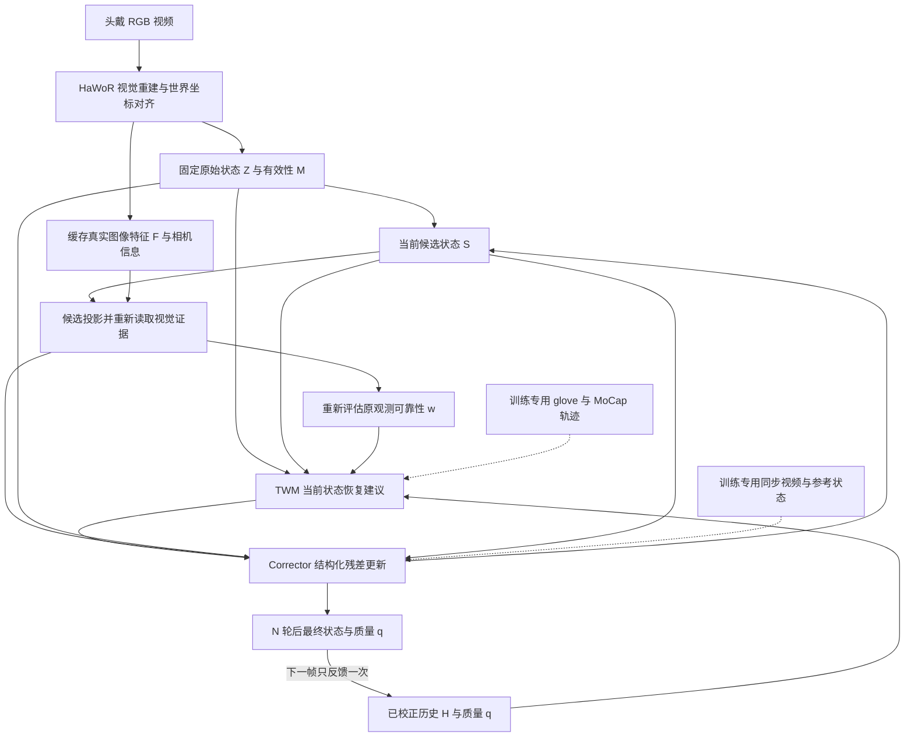

# HandLoop 项目记忆入口

更新日期：2026-10-14。研究工作名：HandLoop；论文标题仍为候选，以 **Are Gloves Necessary? Learning to Correct Visual Hand Reconstruction with Motion Priors** 为当前写作参考。

**核心 idea：将高精度 glove/MoCap 轨迹中学到的手部结构和运动知识，转移到头戴 RGB 的当前状态估计中。让当前可信的局部视觉观测帮助修复不可见或错误的关节，并通过帧内取证和跨帧反馈持续校正。**

“预测是为了学习运动过程，当前状态校正才是最终任务。”这是归档中用户最重要的纠偏。[原讨论 §15.11](HandLoop_Project/01_Conversation_Research_Archive.md#1511-最重要的一轮纠偏纠正当前状态不是预测未来)

## 当前真实进展

工作区原有材料为5份Markdown研究文档和1张早期PNG方法图；当前已增加研究记忆、数据获取/转换与模型训练源码，进入**D26四库联合纯轨迹正式预训练**。旧flat模型按D24暂停于28,213步；D25的Oak子集结构化Mamba已正常完成50,000步，已有合成验证最终结果。D26四库全量准备、collection与启动验收通过，2b40aa9已从头正式训练；19:02:32 UTC验收为17,250步，后续19:05:47 UTC已18,075步，尚未完成计划50k。19:02一次CPU检查latest17,000/best16,000可读且模型浮点张量finite。已有MANO编码/FK一致性验收，但没有独立GT的模型joint/mesh指标、真实HaWoR纠错或完整视觉闭环结果。GitHub为`origin/main`：`https://github.com/Junzhou-Chen/Hand_Reconstruction.git`；同步状态见[开发与远程约定](memory/08_DEVELOPMENT_AND_REMOTE.md)。

**已定工作分工：本机写代码、论文和文档，实验全部远程。最新D19改用`ssh ds`的SciClone Kubernetes，用户已授权复用Pod `jchen57-debug-mpd5p`；hongfei原checkout保留备用。** 代码、论文、记忆和小型结果同步GitHub，数据集、权重与大文件依`.gitignore`排除。

已完成项目理解、来源核对、文件化记忆，以及TWM公开数据专项调研。Oak/HOT/Ume/Dex四库原包已完成，634/2461/1021/13文件全部verified、failed0，合计531.87GB，不重复下载。D23/D25使用Oak64 train/8 val子集；D26已取得用户官网注册、许可确认后授权下载的MANO资产，并通过Meta/Dex有限样本源解码和99D几何一致性检查。全量数据准备与正式训练状态分别记录，原有材料完整保留。

**ds实测与数据获取：** namespace jchen57；现有Pod分配12CPU/128Gi/2×约96GiB Blackwell。默认Torch2.6/cu126运行CUDA失败，zhou环境Torch2.12/cu130两卡极小计算通过；D25起模型使用独立Torch2.10/cu130＋官方Mamba runtime，zhou未改，新exec须明确选环境。Pod约10月15日16:37 UTC到期。ds代码checkout在home/project/Hand_Reconstruction，数据在data10/jchen57/Hand_Reconstruction/datasets。四库下载已结束，进程退出且phase=complete属正常完成；不重下载、不自动申请新Job。D26已授权四库联合预训练，旧D23/D25 run及checkpoint保留，新联合run另存。[下载记录](docs/TWM_DATA_DOWNLOADS.md)、[服务器操作](docs/DS_SERVER_OPERATIONS.md)

**D23首轮预训练（2026-10-14）：** 用户要求从已下四库选一库睡前跑起，数学暂缓。已选OakInk2官方64 train/8 val录制，204,502/18,032单手状态，99D＋β另存；821,516参数纯轨迹TWM，当前恢复主任务＋0.1s预测辅助，计划50,000步。D24于09:16UTC要求暂停，PID805已退出，latest.pt=28,213步、best.pt=27,500步均可读；末次step28,000 noisy腕49.090→5.980mm、finger15.421→1.601°，clean退化3.626mm/0.998°。这不是MPJPE、真实HaWoR或物理保证。代码4cb1da8，checkpoint/data仅远程；[单库运行记录](docs/TWM_OAKINK2_PILOT_RUN_2026-10-14.md)。

**D24暂停与架构方向（2026-10-14）：** 用户暂停原tiny pilot，随后澄清“不是完全参考”，要认真借鉴WestWorld架构与参数理由，输入输出仍配合手部当前恢复任务。原模型/数据/权重保留作对照；D25随后明确要求按参考方案实现并启动新训练，具体容量作为本轮起始配置而非最优结论。方向记录见[参考方案](docs/TWM_WESTWORLD_GUIDED_DESIGN_2026-10-14.md)。

**D25新结构实施（2026-10-14）：** 用户要求按刚才方案重做并跑起后再结束。已实现MANO树embedding＋同帧attention/FFN＋逐关节官方Mamba，6blocks/d256/4heads、SSM64/4/2，6,330,892参数，完整99D恢复＋0.1s辅助预测。完全独立runtime Torch2.10/cu130匹配Mamba wheel，zhou未改；fused CUDA、完整12项数值检查及真实Oak3步smoke通过。代码378deda，新run纽约08:57正常完成50,000步，latest50k/best49.5k均可读且finite；最终noisy腕49.090→4.594mm、finger15.421→1.254°，clean退化1.276mm/0.500°；仅合成受损，旧run保留。[新运行记录](docs/TWM_STRUCTURED_MAMBA_RUN_2026-10-14.md)。

**D26四库联合预训练（2026-10-14）：** 用户要求OakInk2/HOT3D/UmeTrack/DexYCB统一训练，保持结构化Mamba、纯轨迹当前恢复与完整99D；用户已自行注册MANO、确认非商业研究许可并授权官网下载。Meta官方decoder18帧等价、Dex左右各6帧及bounded train/val几何检查通过；真实四库3步smoke（2913f28）loss/梯度有限，24个训练样本分别Dex3/HOT6/Oak9/Ume6。loader叶manifest SHA防变更与FD检查通过。Oak full_v2、HOT/Ume full_v3、Dex full_v1均complete，合计8,418手序列、train/val状态2,788,135/271,100；可训练窗口636,610/61,370，Dex两条train序列无足够连续窗口。HOT最后于17:45:27 UTC完成；coordinator完成collection检查后，17:51:39 UTC以2b40aa9在GPU0/PID2599从头正式启动。19:02:32 UTC已17,250步；后续19:05:47 UTC核18,075步，loss0.0269482/梯度1.10944有限。19:02一次CPU检查latest17,000/best16,000可读，163个浮点模型张量全finite，**尚未完成50k**。[正式启动验收](reports/twm_four_source_20261014_launch.json)、[联合协议](docs/TWM_FOUR_SOURCE_RUN_2026-10-14.md)、[adapter摘要](reports/twm_four_source_adapters_20261014.json)。

本轮库间等概率、库内窗口均匀采样是工程起点，非最优混合结论；仅完整17组MANO参考mask进入当前trainer，native/raw joints未伪造成完整99D。Meta NPY写入瓶颈促成lossless NPZ存储试验，约9.2×仅为局部保存测试，不代表全管线吞吐。实际β约定审计发现左手同腕joint差3.74–19.81mm、mesh差5.60–24.28mm；right/zeroβ差0，full-pose旋转参数差0。root据此选择本轮`condition_on_beta=false`，模型输入`beta_valid=false`但源β及真实validity仍另存，99D动态GT不变；这是工程选择，非用户指定永久关闭，也未统一shape语义。D26替代单库作为当前执行范围，D18 glove/MoCap精度优先及D22 ARCTIC暂缓仍有效。精确产物路径见[进展](memory/04_STATUS_AND_NEXT_STEPS.md)。

**HaWoR对比数据复核：** 用户希望在其训练/测试库比较。其视觉训练HOT573K/ARCTIC165K/DexYCB169K/HO3D66K，infiller只HOT；主定量为HOT3D Aria27 validation与DexYCB test，EPIC定性。建议主HOT＋补Dex，不把四库全部写成原测试。发布HOT evaluator有GT crop/visibility、右手、100帧/含scale对齐且未调infiller；Dex fork默认s0_test但专用推理/依赖尚待补。当前HOT预训练包不含349个评测来源clips，完整27VRS需另准备。[数据与对比协议](docs/HAWOR_DATA_AND_COMPARISON_PROTOCOL.md)

**D21获取与D22安排：** Dex已在04:15:58 UTC（纽约10-14 00:15）完成，13分包全verified/failed0，127.61GB；不要重复启动。用户尚未注册ARCTIC，本轮先Dex，ARCTIC暂缓，不继续索要凭据或自动注册/启动。ARCTIC343包清单与SHA保留，无数据包下载。[下载与安排](docs/COMPARISON_DATA_DOWNLOADS.md)

**四库TWM适用审计：** 初始字段抽查之后，D26已验证Meta PCA15/Dex PCA45源basis＋mean展开、解剖腕位置及99D转换；不能把PCA系数当轴角，或把MANO transl直接当wrist。Meta官方18帧等价与Dex有限几何对照属于实现一致性，非独立参考精度；Ume native缺而MANO有的帧独立保留mask，Dex数字排序并固定单view避免多视角重复计时序。Oak full已做每序列32帧、共30,080帧FK往返，joint/mesh最大差1.49e-7/1.88e-7 m；四库full/collection工程验收已完成，Meta全部TAR严格重解码，仍不能把实现一致性当独立传感器精度。[实际字段与条件](docs/TWM_FOUR_DATASETS_AUDIT_2026-10-14.md)

**数据原则D18（2026-10-13，仍有效）：** 用户强调TWM无视觉，优先更准确的手姿态，恢复初始glove/MoCap导向；论文用库作参考，不主导训练池。v2建议MoCap高优先GRAB/ARCTIC/OakInk2/HOT3D＋新增UmeTrack，主要glove候选HumanTouch/DexWild，DexCap/OpenGraph小样本验映射；Re/EgoDex降为后续视觉来源扩展。免申请偏好仍有效，注册资源有授权再接入；本轮四库由后续D26选定，后续候选比例未定。主候选具备完整任务字段条件；glove需验映射/腕质量，OpenGraph只确认局部补充，尚无本项目适配验收，不将候选全称为“完全适配”。[传感器精度专题](memory/11_SENSOR_FIRST_PRETRAIN_2026-10-13.md)、[v2计划](docs/TWM_PRETRAIN_PLAN.md)

**当前执行与后续建议：** D26已明确本轮联合训练Oak/HOT/Ume/Dex四库，取代D23/D25单库执行范围；它不证明Dex拟合参考与MoCap等精度，也未否定glove候选。此前v2.1的HumanTouch/DexWild共同验收、GRAB/ARCTIC授权后接入等保留为后续建议；ARCTIC当前仍按D22暂缓。glove local/world映射与质量需分别验收，不因本轮四库已可用而取消。[v2.1历史建议](docs/TWM_PRETRAIN_PLAN.md#0-当前推荐的预训练组合)

**同日扩查修正：** 上述首轮清单偏学术，不是完整可用数据全景。新增SynData、Lightwheel EgoSuite、EgoVerse、OOJU、OpenGraph MANUS样本、Daimon DataDex及BeingBeyond UniHand Preview。SynData优先检查ITW骨架映射，Lightwheel/EgoVerse按手标签完整性与实际开放量筛选，UniHand按原来源去重。详见[产业数据补充](memory/09_INDUSTRY_HAND_DATASETS_2026-10-13.md)。

完整方法已整理为[方法框架](docs/METHOD_FRAMEWORK.md)：三个主体、两个闭环、用户已选单手99D、统一TWM输入、w/q分工和三阶段训练。完整视觉闭环仍为方案；首轮TWM已实现独立raw/candidate/history、17组mask、51D内部更新、单手共享参数，不能将pilot等同全框架已实现。

**2026-10-14架构重新评估：** 用户提出删除独立Corrector，让TWM直接修正并联合微调；助手推荐先验证统一99D恢复及真实HaWoR误差适配，保留必要的数值几何证据而非仅quality。已记录[讨论方案](docs/TWM_DIRECT_REFINEMENT_PROPOSAL_2026-10-14.md)；尚非用户最终采纳的架构替代，不自动解冻HaWoR；随后D23仅启动纯轨迹pretrain。

**同日物理依据讨论：** 用户进一步要求从WestWorld/其他world model寻找数学保证与验证方式。[数学与验证方案](docs/TWM_PHYSICAL_GUARANTEES_AND_VALIDATION_2026-10-14.md)区分SO(3)/FK/指定关节范围/参考系等变的条件性保证、重建目标下降和真实动力学；推荐先落实几何约束与独立GT测试。WestWorld/OneWorld未提供普遍物理正确性定理，HNN守恒需无输入/耗散，不能直接用于主动手；修正轮次不是物理时间。本轮数学仍为讨论，无新增已选物理模块；D23随后明确数学暂缓、先跑pretrain。

**已选表示D16：** 用户明确“我们使用99D”，本轮再次要求TWM预测完整99D；部分关节点/手套标签不改变模型输出维数，也不自动成为完整99D真值。每手p3＋root rotation6D6＋15×finger rotation6D90，β10另存；69D只留历史/可选对照。MANO标签通常拟合得到，99是编码长度而非99个物理DoF；Oak/Meta/Dex adapter已有上述范围的数值与FK一致性检查，HaWoR adapter尚未验。本轮β conditioning因源shape约定差异关闭，不改存储契约。[表示调查及后续决定](memory/10_MANO_REPRESENTATION_AND_ANNOTATION.md)

**采集标注核验：** [八库来源报告](docs/DATASET_CAPTURE_AND_ANNOTATION.md)记录marker/扫描/模型拟合与glove/独立腕追踪的区别。HumanTouch团队系统VIVE腕追踪已核，公开episode版本待验；DexWild固定处理路径的world组合有待核实，不能凭world_abs文件名当GT；DexCap原人体21点与四指robot action分开。仅资料/源码事实，无轨迹实验。

**v2证据与边界：** StableHand v1 QN读数值但标签仍需视觉prediction/reference误差，Enhanced另有depth cues；八库不决定pure-motion GT质量。HumanTouch许可已核实CC BY-NC4.0，十份meta累计约132.75h非QC净量，pose可单取；UmeTrack独立marker集补自由手势/pinch，real/synthetic motion需去重。native→99D误差与finger/wrist来源分别保存，不能只以平滑或品牌宣称精度。原HOT/Oak split约束保留；D23 Oak首轮训练采用官方recording split子集。

## 快速恢复上下文

| 需要做什么 | 阅读入口 |
|---|---|
| 理解总体方向和项目事实 | 本文件；[现行原始方案](HandLoop_Project/START_HERE.md) |
| 设计模块、状态接口、训练闭环 | [方法与接口](memory/01_METHOD.md) |
| 连贯阅读完整方法与训练/实验安排 | [完整方法框架](docs/METHOD_FRAMEWORK.md) |
| 判断某个想法是否已经定案或放弃 | [决策与演进](memory/02_DECISIONS.md) |
| 选择数据、设计实验和消融 | [数据与评测](memory/03_DATA_AND_EVALUATION.md) |
| 查找可用于TWM预训练的公开数据、下载和许可 | [数据集专项调研（2026-10-13）](memory/07_TWM_DATASET_SURVEY_2026-10-13.md) |
| 查八库采集硬件、标定、人工步骤与标签来源 | [采集与标注报告](docs/DATASET_CAPTURE_AND_ANNOTATION.md) |
| 按手姿态精度选glove/MoCap、核HumanTouch与UmeTrack | [传感器优先预训练](memory/11_SENSOR_FIRST_PRETRAIN_2026-10-13.md) |
| 决定首轮数据、训练任务和输出契约 | [TWM首轮预训练方案](docs/TWM_PRETRAIN_PLAN.md) |
| 查规划对应的论文训练职责及替代理由 | [TWM数据论文依据](docs/TWM_DATA_PAPER_EVIDENCE.md) |
| 开始下一步工作、查接口缺口 | [进展与下一步](memory/04_STATUS_AND_NEXT_STEPS.md) |
| 使用ds登录入口、现有GPU Pod、环境及持久存储 | [ds服务器操作](docs/DS_SERVER_OPERATIONS.md) |
| 查询新结构化Mamba TWM、依赖、验证及运行 | [新运行记录](docs/TWM_STRUCTURED_MAMBA_RUN_2026-10-14.md) |
| 查询D26四库正式训练、合法MANO资产与全量验收 | [四库执行协议](docs/TWM_FOUR_SOURCE_RUN_2026-10-14.md)、[正式启动验收](reports/twm_four_source_20261014_launch.json)、[adapter摘要](reports/twm_four_source_adapters_20261014.json) |
| 查询Oak单库TWM预训练、checkpoint、配置和合成验证 | [单库运行记录](docs/TWM_OAKINK2_PILOT_RUN_2026-10-14.md) |
| 查询三库后台下载、实际范围、路径与续传 | [数据下载与检查](docs/TWM_DATA_DOWNLOADS.md) |
| 查询DexYCB下载、配置ARCTIC官方账号与启动 | [对比数据下载](docs/COMPARISON_DATA_DOWNLOADS.md) |
| 判断四个已下载库如何监督99D、查实际标注抽查 | [四库TWM适用审计](docs/TWM_FOUR_DATASETS_AUDIT_2026-10-14.md) |
| 复现HaWoR训练/测试数据角色、HOT/Dex评测入口 | [HaWoR数据与对比协议](docs/HAWOR_DATA_AND_COMPARISON_PROTOCOL.md) |
| GitHub同步、服务器和实验位置 | [开发与远程约定](memory/08_DEVELOPMENT_AND_REMOTE.md) |
| 数采团队、商业厂商和大规模数据发布 | [产业手部数据补充调查](memory/09_INDUSTRY_HAND_DATASETS_2026-10-13.md) |
| 主流表示、MANO标签来源及69D比较 | [表示与标注核验](memory/10_MANO_REPRESENTATION_AND_ANNOTATION.md) |
| 写 Introduction、定位贡献、引用论文 | [写作与外部核验](memory/05_WRITING_AND_REFERENCES.md) |
| 精读 WestWorld 与主流视觉手重建方法 | [论文方法对照](docs/WESTWORLD_AND_HAND_RECONSTRUCTION_REVIEW.md) |
| 讨论TWM的物理保证、数学证明与独立验证 | [数学与验证方案](docs/TWM_PHYSICAL_GUARANTEES_AND_VALIDATION_2026-10-14.md) |
| 回溯原文、检查材料覆盖与版本 | [来源索引](memory/06_SOURCE_INDEX.md) |
| 了解记忆发生了什么变化 | [变更记录](memory/CHANGELOG.md) |

## 必须记住的项目约束

1. **输入和主干已选定。** 第一版是头戴 RGB + HaWoR，先冻结视觉权重。RGB-D 优先、EgoInfinity 为主干、WiLoR 单帧作为完整系统是历史路线。
2. **TWM 独立学状态关系。** 仅以 glove/MoCap 等高质量运动轨迹预训练，不用配对图像、不直接复用 WestWorld 机器人权重、不依赖真实控制 action。
3. **恢复当前状态为主。** TWM 结合历史和当前受损/部分状态；辅助短期预测用于学习时序规律。不是只依据历史预测未来，再按 confidence 拼接。
4. **可信观测可约束其他关节。** 不只是“看得见保留，看不见预测”。局部可信状态应通过结构关系帮助恢复其他部分。
5. **视觉和先验都可能出错。** 高 confidence 仍需检验；真实急停/转向应能推翻错误运动预期。
6. **两个闭环有不同作用。** 帧内候选改变图像证据查询位置；跨帧仅回灌最终校正状态及其可靠性。它们不是长短记忆双分支。
7. **状态与测量分开。** 固定原始观测 `Z_t`，更新候选 `S_t^(k)`；当前帧内历史 `H_t` 和参考系 `A_t` 固定。不能把中间输出当成新测量。
8. **每手99D已定。** p3＋root6＋15个finger rotation6D90，β另存；不是99个独立物理DoF。HaWoR输出需经hand mean/腕偏移等adapter统一，视频支持双手；Oak/Meta/Dex已在各自记录范围验证codec/FK一致性，HaWoR adapter和独立GT几何精度尚未验。
9. **有效性不等于正确性。** raw detection、joint availability、原观测可靠性 `w`、最终状态可靠性 `q` 含义不同。
10. **精度优先于平滑。** 报告 world/camera/local 几何误差及突变、遮挡、再可见恢复；不以平滑度或 PA-MPJPE 代替绝对世界精度。

设计依据：[START_HERE §1–6](HandLoop_Project/START_HERE.md)；[对话归档 §15.8–15.11、§15.23、§16](HandLoop_Project/01_Conversation_Research_Archive.md)。

## 方法关系图

这是依据现行文字方案重建的概念图，未代表已运行代码。HaWoR 官方源码已核验使用非因果时间上下文；闭环后端不意味着完整系统严格在线。代码版本及16/120帧范围见[论文精读](docs/WESTWORLD_AND_HAND_RECONSTRUCTION_REVIEW.md)。

## 研究价值与证据边界

潜在贡献是 **当前部分状态条件恢复 + 候选引导的独立视觉取证 + 可靠性重估和时间反馈** 的有效配合，尚未证明优于已有方法。[2026-10-13精读](docs/WESTWORLD_AND_HAND_RECONSTRUCTION_REVIEW.md)补充：DIP 已有纯运动受损条件恢复及序列内预测反馈；DIR/WiLoR/GeoHand 已有候选引导图像查询，HMP/StableHand/PAD-Hand/HaWoR infiller 也须正面对照。不能把当前恢复、重取证或反馈分别宣称首次。

评测新增核验：HaWoR 的 W/WA 含 similarity/scale 对齐；StableHand v1 与增强版指标同名但实现不同。不能直接将其表格解释成未经对齐的绝对世界精度；详见[评测专题](memory/03_DATA_AND_EVALUATION.md)。

部署免手套不等于训练免手套；“学习动力学”目前指运动学结构与时序统计，不能据此宣称学会力、力矩或人的动作意图。长期完全遮挡的唯一真值、全局 SLAM gauge/漂移，均不能仅由手部运动先验保证恢复。

## 紧接着要回答的问题

**在统一时间戳、骨架、坐标和 GT 条件下，纯轨迹条件恢复能否降低真实 HaWoR 输出的几何误差，并优于 smoothing/Kalman/普通 temporal model？**

D25的Oak子集结构化Mamba已完成50k并保留clean退化结果；当前D26四库正式run已通过启动验收，19:02:32 UTC验收为17,250步、后续19:05:47 UTC为18,075步；50k完成与最终分库效果仍待真实记录。随后补真实HaWoR误差、自身历史及独立几何验证，再增加视觉取证与反馈。完整步骤和阻塞项见[下一步](memory/04_STATUS_AND_NEXT_STEPS.md)。6层、`d=256`、4 heads是本轮实现的起始配置，非最优结论；`K=8`、`N=2`、约16帧rollout仍是后续建议。

## 记忆的效力与维护

用户的新决定优先；现行设计以 `START_HERE.md` 和有来源的后续决策为准。`memory/` 是可检索的派生记忆；原始历史归档用于溯源，不能因其中出现“最终”就覆盖较晚的决定。外部核验能纠正事实，不自动更改用户研究目标。

这套记忆保存在当前工作区，通过根目录 `AGENTS.md` 提示后续在此目录工作的 agent 先读取。它不等于账户级自动记忆；移交到其他目录或会话时，应同时带上 `AGENTS.md`、`MEMORY.md`、`memory/` 与 `HandLoop_Project/`。
