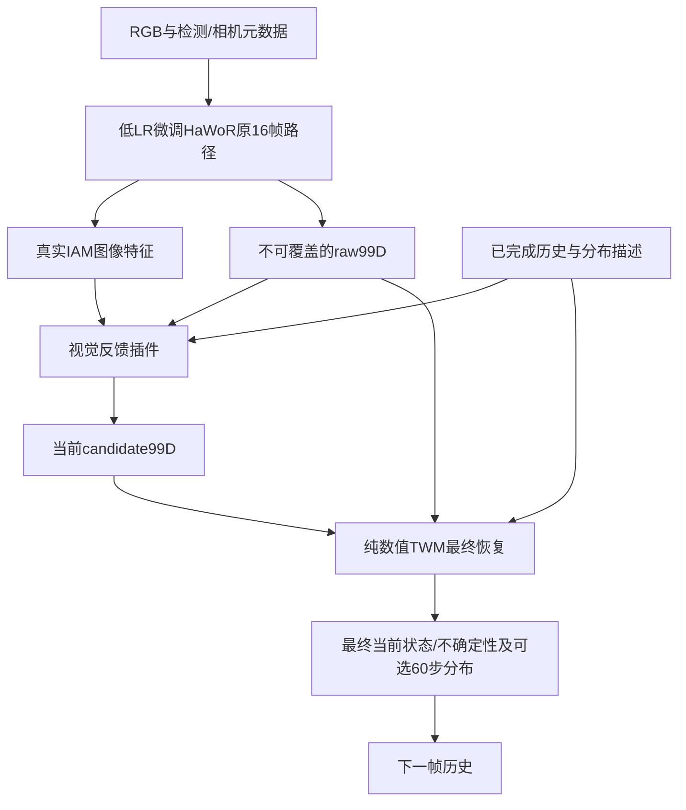

# HandLoop 项目记忆入口

**2026-10-17九库30k中期只读验效：** 纽约14:28 W&B实际14,370/30,000（47.9%）、双卡正常；固定验证截至14k，当前几何best13.5k，10k→best score0.005151→0.004526（−12.1%），14k0.004665小幅回弹。九源等权／2,102固定合成扰动窗：noisy腕4.706→2.667mm、finger1.062→0.545°；missing腕6.239→3.274、strong16.978→4.102，三类腕九源均改善，但missing部分库finger退化。clean0→0.708mm／16.55%窗恶化>1mm，reanchor0.277→1.319／29.04%，误改仍在。普通未来腕0.1/0.5/1/2s为9.249/42.279/75.586/118.236mm，相对hold降34.0/23.2/15.8/3.0%；2s仅七源1,408窗，只有HOT/Oak优于hold，低运动组过预测。当前90%覆盖noisy83.13%、位置四帧60.28%，未校准。代码e759bb1、原九库manifest／split不变，仅Pod CPU读日志／汇总／绘图；未改训，训练继续。非全量val、独立物理GT或新RGB闭环结果。[结果与边界](docs/TWM_NINE_SOURCE_30K_PROGRESS_2026-10-17.md)、[可审计数值](reports/twm_nine_source_30k_progress_20261017.json)。

**2026-10-17用户改30k并已实际重启：** 九库10k旧run按指令在816步合作保存停止，model／Adam finite、双rank和真实字节hash一致，optimizer／RNG／sampler／日志完整保留。采用fresh完整30k cosine日程重跑（非改strict resume），warmup500、每卡512／global1024、九库固定manifest／split／QC、99D＋future60及模型／loss／噪声均不变。纽约2026-10-17 01:37:31 EDT已实际到step20，checkpoint10、九源采样及W&B服务端记录验收通过；新codee759bb1，新run为runs/twm_nine_sources_moe_transient_v3_b512_30k_20261017，deadline保持10-20 01:10EDT。此决定替代此前10k目标，旧启动验收为历史；不代表30k已完成或已证实精度收益。[当前运行](docs/TWM_NINE_SOURCE_30K_RESTART_2026-10-17.md)、[验收](reports/twm_nine_source_30k_restart_20261017.json)。

**2026-10-16截图五指标全量补算完成：** 同一冻结DexYCB s0 test的1280视角／78768状态，官方baseline→best4200.final→last4311.final：W155.109→120.343→120.556mm；WA26.405→19.680→19.672mm；Dex O(3) PA5.867→5.161→5.167mm；加速度16.600→8.531→8.518m/s²；RTE4.107→2.634→2.635%。HaWoR轨迹函数迁移到Dex21／固定相机，不能与HOT3D paper直接拼表；W前2帧拟合、WA整段拟合，均不是此前绝对／腕对齐换名。加速度按30Hz／T−4中心73648项含32帧reset，RTE全有效。13自测＋37官方函数对照及12旧几何复现通过；初次TF32精度失败查明后保持严格阈值修复。补算无新训练／神经推理，精选展示视频是另一选样范围。[结果与定义](docs/DEXYCB_WORLD_METRICS_2026-10-16.md)、[可审计JSON](reports/dexycb_world_metrics_20261016.json)。

**2026-10-16夜间用户最终确定九库联合TWM预训练：** 原OakInk2／HOT3D／独立UmeTrack／DexYCB全部保留，新增ARCTIC／InterHand30fps／TACO／GigaHands／HO-3D v2。此明确决定替代本轮七库／八库和暂不加HO-3D的中间范围；HumanTouch退出并已对匹配PID6739发送SIGTERM、保留已下载文件，DexWild继续暂缓。旧四库prepared manifest路径与原固定SHA必须一致，不因扩充删库、换库或重分旧split。 InterHand四JSON约394.87MB已下载，真实时序index与8手序列FK smoke通过；ARCTIC双录制／双手384状态逐帧FK smoke通过，03:50UTC两库完整CPU预处理PID7186／7187启动。TACO15.23GB和Giga11.30GB数值包已在Pod后台下载／验hash／解压，真实字段已抽查，尚未完成整库适配验收。HO-3D按物理录制去重，并从motion train排除与evaluation相同SB1组；参考来源精度、转换一致性和真实模型收益分开，不把任何脚本存在或下载中称为已训练。 [九库执行与契约](docs/TWM_NINE_SOURCE_PRETRAIN_2026-10-16.md)。

**2026-10-16手部渲染升级与精选优势test案例已交付：** 用户明确要求更好看的手模型并挑明显优于HaWoR的test案例，替代旧demo不看误差取最长片段的展示规则。全1280视角粗排、159候选／9768状态解码，选三被试右／左／左各45帧；绝对MPJPE60.441→27.231、83.625→17.725、142.091→32.117mm，三段均45/45帧投影误差改善。平滑法线／柔光／2×AA／直接高清crop／默认去骨架，腕口仅追加14个显示端面、不动778顶点或指标几何；v2与open v1投影变化0px、原RGB视频SHA一致。四视频完整解码／本机SHA／首中末帧验收通过，原速4.5s、慢放8.967s，本机outputs/demos/dexycb_showcase_20261016/render_v2。主动挑优势、非整库均值；GTcrop／真实K／ownβ与物体透视叠加边界保留，无新神经推理或训练。[选样与复现](docs/HAND_SHOWCASE_2026-10-16.md)、[小型报告](reports/hand_showcase_20261016.json)。

**2026-10-16夜间用户暂缓DexWild，明确改查可直下、适配99D的人手运动数据：** 新[完整参数／sensor选库核查](docs/TWM_DIRECT_HUMAN_MOTION_DATA_2026-10-16.md)确认InterHand30fps train MANO＋joint约326.64MB、TACO官方手参数15.23GB、GigaHands姿态11.30GB、ReInterHand七train fits5.52GB均有独立公开入口；已有ARCTIC／HO3Dv2应先适配。新增UNOC0.918GB／CeTI3.099GB公开sensor BVH需MANO轴／腕映射。没有取消glove/MoCap精度原则，未选混合或开训。HumanTouch数值35,246文件／110.42GB已在Pod下载；429后限速续传PID6739，03:28UTC17.42GB、5418verified／failed0。DexWild实测公开pour仅71列／10点short，单episode558KB通过；随后批量五task HTTPRangeError、0完整episode，用户要求暂缓后确认无进程并不续跑，未假称full25点到手。[下载、失败与状态](docs/SENSOR_TRAJECTORY_DOWNLOADS_2026-10-16.md)。

**2026-10-16夜间重训前再次扩查TWM数据（先总结，未开训）：** 实际motion仍Oak／HOT／独立Ume／Dex四库2788135手状态／636610重叠窗；ARCTIC343包已全部下载、未adapter入训，267 train有384780 QC前双手状态，建议先补完整参数池。大规模glove仍优先HumanTouch约100h与DexWild原人体7917episodes／2924588transitions；只有前者1597帧native样本过结构检查，partial trainer未实现，不冒称完整99D GT。新增MySign公开5000FBX／5人可补自由手势；DexCap、DexterHand为小补充；SynData glove-origin95383clips／793volumes是10Hz重定向骨架。GRAB源访问未取得，HandX只计自采，视觉估计扩展另列。ARCTIC source MANO nonflat mean、subject_vtemplates供SMPL-X勘误已存；HOI4D现有独立标注直链但未核包。没有新数据准备、下载或训练，混合比例未定。[完整选库与状态](docs/TWM_PRETRAIN_EXPANSION_SUMMARY_2026-10-16.md)。

**2026-10-16已交付真实手部重建叠加视频：** 按用户要求把预测mesh／骨架投影回原视频，已在Pod复用完整Dex测试的官方baseline与best4200.final，固定最长连续片段并按ID破同分选左右各74帧，未按误差挑样；原速148帧4.933秒、0.5×慢放295帧9.833秒，三列原RGB／HaWoR／HandLoop＋同一逐帧手部放大。自身β＋真实K投影，无PA／GT腕移位／尺度修正，GT crop标定受控例，不冒称任意野外detector部署。v1固定并集zoom不清晰，v2仅改共同观看裁切，原RGB及单独overlay视频SHA相同。四H264完整解码／本机SHA及左右手中帧视觉验收通过；本机outputs/demos/dexycb_overlay_20261016/v2，媒体不进Git。[效果与复现](docs/HAND_OVERLAY_DEMO_2026-10-16.md)、[小型验收](reports/hand_overlay_demo_20261016.json)。

**2026-10-16精度报告口径广泛文献复核：** 已核11篇手部论文及Ego-Exo4D官方协议，包含2026 Hand3R／ScaleHP／InfiniHand。单图主表普遍突出PA；时序恢复并报PA／非PA或腕对齐及GT动态误差；world方法并报局部与轨迹。助手修正前轮“PA仅辅助”的笼统建议，推荐本项目局部几何与绝对位置并列，未改协议或成为用户新决定。ScaleHP明确CS无对齐／R腕平移／P为PA；InfiniHand无对齐W不同于HaWoR／StableHand开头对齐W，StableHand16joint不同本项目21joint。当前速度／加速度GT误差和PA-MPVPE尚未测。[全文、主表与边界核验](docs/HAND_ACCURACY_REPORTING_SURVEY_2026-10-16.md)。

**2026-10-16完整DexYCB三模型测试已完成：** 纽约20:28（UTC10-17 00:28）controller complete；每模型1280视角／2992 clips／78768有效状态，逐帧键／hash／manifest／分母三方一致，W&B均finished且终值吻合。官方baseline→best4200 final→last4311 final：绝对MPJPE65.522→30.558→30.365mm；PA-MPJPE5.867→5.161→5.167mm；PA-AUC88.273→89.682→89.671%。best绝对误差下降53.36%、PA下降12.02%，但finger10.143→10.203→10.228°略退化；联合微调raw已约30.6mm，不能将全部收益单独归因TWM。论文DexYCB整体4.76mm／90.5%仅参考，未做物体遮挡分组或完全复现作者输入流程。此条替代完整测试运行中快照，旧test1015仍是不同模型／子集历史。[完整结果](docs/DEXYCB_FULL_TEST_RESULTS_2026-10-16.md)、[最终小型JSON](reports/dexycb_full_test_final_20261016.json)。

**2026-10-16最新用户决定：先用已验收Dex＋HOT跑5000步，其他数据继续后台准备。** 用户明确效果优先、不必完全复现HaWoR，可增加与测试隔离的来源；当前指定此前63652独立RGB／73524 train手状态池立即重训5k。本条替代等四库就绪才启动、tiny Dex-only及前轮等用户回来再训练的安排。固定6314ec2…混源清单／2773train窗，原fixed8验证、两主干全量低LR／每卡8段／两轮／history30／噪声与geometry目标均保持；5000总更新＝3750视觉＋1250 motion回放。从官方HaWoR＋D37重新初始化，全新Adam和5000步cosine；不续用旧100步优化器。ARCTIC／HO3D下载与HOT全clips预处理继续，新来源不在本run中自动入池；旧best与旧100步保存。已于08:25UTC／纽约04:25正式双卡开训，源码a642e6e，08:40实测30/5000。step4的1076 model／3135 Adam浮点张量finite且CPU／双rank hash一致，step8两rank14组梯度seen非零／代表参数改变均通过，每卡peak63.50GiB，W&B ff3108fd online。HO3D下载校验与HOT全clips预处理随后complete，ARCTIC仍下载；本run数据不变。见[两库5k协议](docs/VISUAL_DEX_HOT_GEOMETRY_5K_2026-10-16.md)；启动通过不代表新精度结论。

**2026-10-16最新用户澄清：视觉联合数据对齐HaWoR四库，保留几何监督与5000步。** 本条替代刚准备且从未启动的“原1128帧Dex-only 5k”数据选择；按官方§8.1使用HOT3D／ARCTIC／DexYCB／HO3D来源，作者573K／165K／169K／66K是其选帧数，未公开完整训练清单／混合概率，不声称完全复现约1M帧。TWM motion仍原四库／D37；双主干低LR全量、每卡8段、3:1／两轮／history30／噪声与raw J0＋final自身β直接几何均保持。新增5k配置显式要求四个visual train sources，真实Dex＋HOT清单的缺库拒绝与旧配置不变已在Pod验证；ARCTIC／HO3D adapter尚未完成，5k未开训。HOT已按86f25ec在Pod展开全部已下载1167 Aria clips，原父录制split及27评测排除保持，补齐既有cv2依赖路径后07:44实测320clips；metadata的99父录制不等于论文110完整train视频。用户直接提供账号后已用SSH管道保存远程600权限私有文件、无凭据值入源码／日志／Git，ARCTIC官方小ZIP SHA验收通过，07:43启动343包后台下载，07:44 verified2／failed0。Dex全包已有，扩大单视角50861 train有效状态不是作者169K；HO3D官方v2获取流程处理中，版本对应66K仅工程推断，尚非已接训练。旧混源正常停100且CPU checkpoint审计通过，旧best保留。[当前协议与准备状态](docs/HAWOR_ALIGNED_VISUAL_TRAINING_2026-10-16.md)。

**2026-10-16新用户决定：撤回扩展数据，原Dex几何监督5000步。** 用户要求取消当前扩大数据，只先检验第2项直接几何监督，并从1000提高到约4000／5000步；实现选5000上限。本条替代前轮扩大数据＋1000步安排，第3／4项条件／历史／噪声／回放不改。混源run已07:14:26UTC正常stopped100/1000，checkpoint100与双rank hash3fff5e8f…保存；不删数据或旧best。新视觉source恢复原67462dce…清单：16train录制／1128帧／46窗，val8录制／577帧／24窗；不用扩大Dex或HOT RGB。原四库motion与D37仍保持，从官方HaWoR＋D37＋新插件、全新Adam重新起训，不载入混源权重。保留NLL1e-4＋raw腕／final自身β绝对joint距离各/0.05m；同LR／batch8／3:1／两轮／history30。实现另将同一原val每50步覆盖全24窗，非新增训练标签；cosine按5000从头安排，非旧1k简单续跑。当前新配置与协议已准备，启动待验，尚无新精度结论。[本轮协议](docs/VISUAL_GEOMETRY_ORIGINAL_DEX_5K_2026-10-16.md)。

**2026-10-16数据／几何v3启动验收（本聊天远程实测）：** 用户只采纳数据扩展与直接几何监督，原第3／4／5项暂缓。86f25ec于06:50:51UTC在授权Pod启动新联合run，验收快照16/1000更新；两rank首8步14组累计梯度finite／非零及代表参数更新通过，每卡peak allocated63.50GiB，checkpoint4的1076model／3135Adam浮点张量finite、CPU与双rank hash一致，W&B98ff0737在线。Dex＋HOT train73524手状态／63652独立RGB／2773窗、val4037／143窗，67182文件SHA／split／旧Dex val577字节通过。motion仍原四库／D37；新增HumanTouch1597帧native结构通过但标定／mapping未验，不入完整99D训练。新raw J0＋final自身β几何与NLL相对初值已启用，LR／batch8／3:1／噪声／历史／1000步不改。初始化final腕109.227mm差于raw46.412mm已保留，启动通过不等于精度收益。[协议](docs/VISUAL_DATA_GEOMETRY_V3_2026-10-16.md)、[启动小摘要](reports/visual_joint_v3_launch_20261016.json)。下方其他聊天的本地同步及“未启动／HOT待修”为其记录时点，不覆盖本条实测。

**2026-10-16本轮只推进前两项（用户决定＋实现验收，尚未启动新训练）：** 用户明确扩大预训练／视觉联合数据，并采纳直接几何监督，暂缓原建议第3项raw/candidate条件、第4项历史／motion回放、第5项加步预算。本轮保持1000步、batch8、LR、3:1及原架构。Dex视觉train已由1128帧扩大至10主体800录制／50861有效帧，原val577字节不变；HOT Aria真实RGB烟测与相机／GT隔离／梯度通过，99clip完整准备被投影精度自检拦截，修复验收后再入池。四库motion与D37保持；新增HumanTouch原生glove固定1597帧结构通过但tracker→根标定／partial mapping未验，ready_for_training=false，不填造完整99D。源码41bf150新增raw J0与final自身β解码绝对joint监督，双rank归约／masked NaN／手别映射通过（DDP fixture修复7e1535c）。新配置NLL1e-4＋raw/0.05m＋final/0.05m，train-only无optimizer梯度作为初值依据，未证明最优或训练收益。此前“修改未选／未实现”是历史阶段。[执行协议](docs/VISUAL_DATA_GEOMETRY_V3_2026-10-16.md)、[新增来源与职责](docs/DATA_EXPANSION_SOURCE_AUDIT_2026-10-16.md)。

**2026-10-16 AUC补测完成：** 同test1015保存预测，官方HaWoR→预选best300 final的PA-AUC **89.83933%→90.62120%（+0.78187个百分点）**；绝对AUC13.59279%→33.08518%，仅腕平移对齐71.10035%→77.20214%。last1000 PA90.73607%仅终点对照；val577 PA89.40736%→best91.32986%。沿作者0–50mm／100阈值、逐joint PCK≤与梯形积分归一化；官方EvalUtil每split69项独立核对AUC／曲线差均0，原五项几何均值与上轮CPU结果最大差8.882e-16mm。论文PA-AUC90.5%为不同完整集合，当前小子集不作排名。Pod CPU仅FK／指标，无视觉前向、训练、权重或best选择改变。[协议与结果](docs/HAWOR_BASELINE_METRIC_AUDIT_2026-10-16.md)、[小型摘要](reports/hawor_auc_audit_20261016.json)。

**2026-10-16 HaWoR论文指标差距核查完成：** 论文DexYCB Table1的4.76mm是PA-MPJPE，原报告70.532mm是绝对MPJPE，均为毫米，不能直接比较。Pod CPU重解码同一保存预测后，test1015原官方HaWoR PA **5.08159mm**、预选best300 final **4.68934mm**（同集PA下降7.719%）；baseline比论文数值高6.756%，非十倍。仍16录制／单视角prefix128子集，不能据4.689<4.76宣称胜过论文完整test。新增可选PA评测，原四项逐帧差<0.001mm，无训练／视觉前向或best重选。[核查与来源](docs/HAWOR_BASELINE_METRIC_AUDIT_2026-10-16.md)、[小摘要](reports/hawor_paper_metric_audit_20261016.json)。

**下一轮训练讨论（2026-10-16，建议未实施）：** 用户明确以“最终输出相对原生HaWoR的平均纠正收益”为主，不要求每帧改善或固定提升幅度；要求分析预训练／联合微调及增加预算，尚未授权本轮启动新训练。复核已有20点fixed8曲线：300→1000腕37.300→37.297mm、finger7.433→7.587°、原score0.282064→0.290009，非持续单调变好；RGB仅1128独立帧／46clips／16录制两主体，batch8后每三次视觉更新已遍历小池。建议优先扩大unique train与单因素加raw绝对腕／final绝对joint监督；预训练可用group的raw=candidate是源码事实，与视觉多轮条件不匹配，但未证为主因。短／自身历史、motion回放曝光及低LR延至3k/5k均待验；现resume不能直接改steps而声称仅加步。保留双主干全量低LR和99D；未改代码／权重／训练，旧best300不重选。[依据、论文、候选对照](docs/NEXT_TRAINING_ANALYSIS_2026-10-16.md)。

**联合微调深诊断完成（2026-10-16，用户要求先分析再决定修改）：** 远程冻结D37 pretrain10000／joint best300／last1000，四源×左右手各128val窗共1024、五模式严格同输入；pretrain noisy腕L/R 2.782/2.945mm→jointbest3.548/3.689mm，手指0.641/0.633→0.871/0.878°，两侧部分保持下降，非缺左手或全部能力失效。固定真实best raw/candidate/H换TWM，jointbest腕62.512/26.561mm反优于pretrain70.849/29.069，直接换回旧先验不是已验证修复。深度反算确认最坏left subject06/fr14拟合参考隐含s16.827/z1.134m→last.raw s3.5/z5.454m，官方z=2f/(bs)倒数放大，final腕4.201m；best/last左>500mm为5/6帧，baseline0，全部保留。camera局部final/raw梯度部分冲突，但无统一left反号；四eval loss均值rotation head占TWM平方norm约best89.6%/last77.0%，/51后仍饱和裁剪，不能只凭1020系数改loss。GT99D+predβ残差约2.9mm含codec差，固定J0替换shape未救大定位，但β上游训练路径未排除。短H、TWM quality仍unknown、fixedval左19%与末轮误改是现行接口风险；未坐实唯一优化根因。无optimizer／全hash通过，未改loss/架构/采样/权重/Job或重选best；旧“无新增推理”条目仅历史。[主诊断](docs/JOINT_FAILURE_DEEP_DIAGNOSIS_2026-10-16.md)、[TWM专项](docs/TWM_HAND_RETENTION_DIAGNOSTIC_2026-10-16.md)、[小型聚合](reports/joint_failure_deep_diagnosis_20261016.json)。

**左手原因核查（2026-10-16，实测＋源码审计，未改训）：** D37实际loader train windows左317,226（49.83%）／右319,384（50.17%），四库均含左手；full coverage已完成16遍，排除“预训练没见左手”。视觉train亦左8录制575帧／右8录制553帧；TWM显式handedness embedding，左右侧PCA/镜像还原/SE(3)路径未发现确定bug。定位到test左绝对MPJPE原HaWoR61.602→联合权重raw109.754→最后candidate60.209→final63.735mm，raw腕72.013→114.508mm，后续整体补偿；candidate含前轮TWM，不是独立模块消融。最终左腕与腕对齐仍改善（72.013→62.515／17.831→11.923mm），不是所有左手能力都失效。原fixed8选择左仅40states、右170，存在权重不均；test左9录制5改善4退化，右7均改善，主体/动作与手别混杂。联合定位适配、模块补偿/末轮误改、β缺乏直接几何监督是待验证因素，不能唯一归因为TWM或已坐实shape/符号bug；未调整loss/采样或重训。[诊断](docs/LEFT_HAND_COVERAGE_AND_FAILURE_DIAGNOSIS_2026-10-16.md)、[实数与来源](reports/left_hand_diagnosis_20261016.json)。

**D40已完成与最终baseline评测（2026-10-16 04:32UTC／纽约00:32）：** 联合训练正常complete1000（03:49:16UTC），预选best300与终点last1000身份／双rankhash均核，W&B finished。远程新推理完成原始HaWoR、best、last在完整val24clips/577states及独立s0 test16录制/37clips/1015states的同输入对照；test best腕76.335→46.187mm（下降39.49%）、绝对MPJPE21 70.532→48.194mm（31.67%）、仅腕平移对齐MPJPE21 14.480→11.414mm（21.17%）。终点last为45.093/47.238/10.742mm，独立报告，不据test改选best。**收益不均衡：左手绝对MPJPE61.602→63.735mm退化，右手81.263→29.517mm改善；27.68%states绝对MPJPE恶化>1mm。** best末轮candidate→final也退化，但candidate已含首轮TWM／历史，不是整TWM消融；90%椭球覆盖仅60.49%。MANO使用自身预测β，参考FK均通过；GT crop、固定camera、拟合MANO参考、预定prefix128小集，非完整HaWoR官方/ego benchmark。未改损失/权重/Job或新训练；终点motion保持未另测。[最终协议、所有分支与限制](docs/VISUAL_JOINT_FINAL_EVALUATION_2026-10-16.md)、[可复现数值](reports/visual_joint_final_comparison_20261016.json)。下列训练中快照保留作历史。

**D40联合训练效果检查（2026-10-16 01:32UTC／纽约10-15 21:32）：** 只读远程记录，训练253/1000、完整fixedval/best250；8clips/210states，同一GT crop固定camera拟合MANO参考。腕原HaWoR88.250→当前HaWoR65.478→最终48.598mm（较原始低44.9%、较当前raw低25.8%）；root最终8.591°、finger7.530°，finger较当前raw仅低0.78%。最后候选49.590mm/8.452°/7.561°已含首轮TWM/历史，不能将最后一轮腕2%追加收益当整个TWM贡献。训练有波动；37.1%states腕较当前raw差>1mm，90%椭球覆盖仅40%（std32.622mm），NLL回升。相同四源各16窗motion保持noisy腕2.959→3.514mm、finger0.696→0.896°；1s腕100.370→94.874mm改善，2s（三源）152.983→172.615mm且差于hold169.452，不能称先验完全保持。best/latest250双rankhash一致；未改训练/损失或新增推理。[完整效果](docs/VISUAL_JOINT_PROGRESS_2026-10-16.md)、[数值](reports/visual_joint_progress_20261016_0132.json)。

**D40联合训练改为每卡8段（2026-10-16 00:59UTC／纽约10-15 20:59验收）：** 按用户占用反馈，旧batch4在65步完整保存停止，eb8d0b9仅放行RGB batch4→8后续跑；clip32/global16、motion32、LR与3:1任务及总1000不变。实际76/1000，checkpoint69已落盘、双rankhash9455c4b9…一致；两rank在73步14组梯度finite/非零seen/代表参数改变全通过。每卡peak allocated63.498GiB，单时刻nvidia-smi79446MiB，非稳态吞吐证明。W&B同[3abfc864](https://wandb.ai/black-ant/handloop-twm/runs/3abfc864)服务端running/75，runtimebatch8与resume_start65已核。optimizer/scheduler/rank RNG恢复，loader/sampler游标重建；旧阶段归档保留，无精度提升断言。[新批次摘要](reports/visual_joint_batch8_resume_20261016.json)、[协议](docs/VISUAL_JOINT_FINETUNE_2026-10-16.md)。

**D39双主干全量联合微调已启动（2026-10-16 00:43UTC／纽约10-15 20:43验收）：** 用户明确HaWoR与TWM都低LR全量适配，替代D35双冻结首版范围。eeac1fc在线RGB＋2轮MANO16候选投影取证，固定帧内raw/H/anchor、只末轮commit，TWM仍不读图像。adapter/TWM/HaWoR目标LR1e-4/1e-5/1e-6；视觉单current NLL与D37原motion任务3:1独立更新，loss重设计延后。D37已complete10k/best10000；新Dex1128train＋577val帧、16/8录制、两主体左右手，仍GT crop/固定camera gauge。正式两卡每卡4×32帧/motion32，实际10/1000更新、peak37.742GiB/卡、14组参数真实更新、checkpoint4两rankhash一致；W&B[3abfc864](https://wandb.ai/black-ant/handloop-twm/runs/3abfc864)服务端running/step8。CPU/AMP/RGB及独立smoke4→8恢复通过，1076model/3135Adam浮点张量finite。尚无训练后fixedval收益，初始化两轮腕121.616mm差于raw88.250mm、coverage0已保留。[协议](docs/VISUAL_JOINT_FINETUNE_2026-10-16.md)、[启动摘要](reports/visual_joint_launch_20261016.json)。

**D37最新效果／D38延后loss（2026-10-15纽约18:22）：** 用户明确loss调整留到下版本，本轮原六项不变，未启动新方案。训练快照8,010/10k，完整验证8,000；同run固定val普通腕4.652→2.881mm/root1.990→1.316°/finger1.058→0.637°，位置四帧6.520→4.539mm。5k→8k score0.00731648→0.00577622（下降21.05%），仍改善但放缓。clean0→0.601mm、12.60% >1mm退化；近准当前/错误历史0.267→1.296mm、30.96% >1mm退化，仍未解决。未来腕1s96.954对hold119.461mm、2s140.930对147.506mm；2s仅三源，HOT已略优、Ume仍退化；1s root及2s finger较5k略退。当前90%xyz覆盖普通78.81%/位置事件54.49%，未校准。最近1000更新2.799s/步，剩1990约93min，估计纽约19:55（吞吐持续条件）。只读远程CPU汇总绘图，当前/未来同一validation SHA、宏平均和固定输入检查通过；仍是拟合MANO/合成观测历史，非闭环或真实HaWoR。[8k报告与曲线](docs/TWM_TRANSIENT_8K_PROGRESS_2026-10-15.md)、[对照摘要](reports/twm_progress_comparison_20261015_2220.json)。

**2026-10-15损失论文复核（建议，未改训）：** 用户质疑六项加权并要求广泛对照；已核12篇原文/补充及官方关键实现：WestWorld CE，Dreamer/TD-MPC2明确多项加权；StableHand v1为FM＋0.1 smooth＋5 wrist，HaWoR infiller也分组带权，不能以项数判错。当前优先建议保持99D/SO(3)/现架构，建立current/future conditional NLL主线并逐项消融几何/速度/MoE，独立检查future起点stopgrad；共享encoder仍受future梯度。任务采样/长度归约仍含权衡，现future不传播完整current posterior；DF/条件RFM为后续备选，改动采样/不确定性接口，不是仅换loss。未认定六项是D37失败原因、未选新系数/新方案或启动实验。DIP等已有纯运动受损恢复先例，创新性需具体界定。[完整对照与建议](docs/TWM_LOSS_LITERATURE_REVIEW_2026-10-15.md)。

**D37未来预测专项（2026-10-15纽约16:09）：** 运行快照5,150/10k，完整验证5,000；只读已有日志，远程CPU汇总/绘图，未改训。普通噪声最高权重整段分支腕终点误差0.1/0.5/1/2s为10.116/51.376/102.369/145.775mm，对应恢复当前后hold15.717/68.938/119.369/147.556mm，下降35.6/25.5/14.2/1.2%。1s root27.288对33.061°、finger9.120对9.500°；2s三源无Dex，HOT/Ume腕退化、Oak改善，不能称稳定长时优势。干净输入2s腕141.923对147.422mm，仅改善3.7%；low_motion整段腕ADE6.228对hold5.114mm退化。未来逐轴90%边缘覆盖95.09%，1s/2s总每轴std94.620/127.241mm，宽区间不等于精确。混合熵1.315nat不证明模式质量；selected ADE75.625与oracle minADE47.452权重不同，差值非纯分支选择损失。所有future宏平均/各步时域counts一致已验；非真实HaWoR或闭环。[完整预测报告](docs/TWM_FORECAST_PROGRESS_2026-10-15.md)、[摘要与曲线](reports/twm_forecast_progress_20261015_2012.json)。

**D37效果检查（2026-10-15纽约15:48）：** 当前训练快照4,700/10,000步，最近完整fixed validation4,500步；保持每卡512/global1024、原v3/GT/split，训练继续。每源固定256窗等权宏平均，普通噪声腕4.652→3.331mm（下降28.4%）、root1.990→1.578°、finger1.058→0.821°；仅腕位置四帧事件6.520→5.244mm（19.6%）。3.5k→4.5k加权几何score0.012521→0.008403，下降32.9%，尚无明显平台。clean仍0→0.884mm、30.66%窗口退化>1mm；当前近准/历史受损0.267→1.471mm、44.04%退化>1mm。1s预测腕103.236mm优于hold119.462mm，2s仅三源146.895对147.650mm、优势很小；普通当前90%xyz coverage75.98%，位置事件46.39%，未校准。这是拟合MANO参考下合成观测历史的单次当前恢复，非十步滚动/闭环/真实HaWoR效果；旧64clip对照未复跑。本次只读日志＋远程CPU绘图，无改训。[效果及曲线](docs/TWM_TRANSIENT_10K_PROGRESS_2026-10-15.md)、[摘要](reports/twm_transient_v3_progress_20261015_1944.json)。

**D37启动验收历史（2026-10-15纽约12:10）：** 用户要求新Pod `jchen57-fineturn-tl4zr` 从头训练10,000 step，历史只保留best；替代D36两epoch预算及旧latest/暂停快照全保留规则。修复后的v3噪声、位置feature尺度0.05m、13.53M结构、四库full-coverage循环、每卡512/global1024保持；warmup500/eval500/save100。源码87a2bcc于16:06:44UTC启动，已实际40/10,000更新（40,960窗口），四库五case均参与、每卡peak allocated约63.9GB；checkpoint10模型/AdamW finite、CPU与两rank hash一致，W&B[a9cb4888](https://wandb.ai/black-ant/handloop-twm/runs/a9cb4888)服务端到40。新步数预算下三遍历/尾批次/resume双卡检查通过。历史18份best finite＋SHA保留，22份非best权重已按授权删除2,511,839,588bytes，日志/配置/推理结果留存；当前新run的latest保留用于中断恢复。D36已纽约03:53正常完成两轮但短时漂移/clean仍有失败；更多步数不等于已证实改善。[新协议](docs/TWM_TRANSIENT_10K_RUN_2026-10-15.md)、[启动验收](reports/twm_transient_v3_10k_launch_20261015.json)、[清理清单](reports/twm_best_only_cleanup_20261015.json)。

**D36启动历史（已完成两epoch；2026-10-15纽约02:56验收）：** 用户要求修复短时噪声并按2个epoch重跑。旧D34已保存停止5,519步，checkpoint/STOP保留且finite/sync通过。新v3显式局部plateau/ramp/scattered/jitter、因果缺失填充、encoder-only位置尺度0.05m；完整覆盖每轮636,610窗、622更新、最后每卡353，每卡512/global1024。25fee71在独立远程worktree从头启动，实际50更新=0.080426/2 epoch、51,200窗口；四库与五case均参与，每卡peak allocated约63.9GB。正式checkpoint10的322个model/963个AdamW浮点张量finite，CPU/两rank hash一致；W&B[58f012f8](https://wandb.ai/black-ant/handloop-twm/runs/58f012f8)服务端已收到step50及epoch曲线。13模式语义检查、全量索引并集/互斥、真实短片段1→4更新跨epoch续跑/尾批次，以及独立STOP保存通过。2epochs是pilot目标，非完成或已证实精度改善；自然样本占比改变旧等源权重，具体比例/尺度仍是假设，D35框架不改。[协议与失败修正](docs/TWM_TRANSIENT_EPOCH_RUN_2026-10-15.md)、[验收摘要](reports/twm_transient_epoch2_20261015.json)。

更新日期：2026-10-16 UTC（纽约10-16）。研究工作名：HandLoop；论文标题仍为候选，以 **Are Gloves Necessary? Learning to Correct Visual Hand Reconstruction with Motion Priors** 为当前写作参考。

**核心 idea：将高精度 glove/MoCap 轨迹中学到的手部结构和运动知识，转移到头戴 RGB 的当前状态估计中。让当前可信的局部视觉观测帮助修复不可见或错误的关节，并通过帧内取证和跨帧反馈持续校正。**

“预测是为了学习运动过程，当前状态校正才是最终任务。”这是归档中用户最重要的纠偏。[原讨论 §15.11](HandLoop_Project/01_Conversation_Research_Archive.md#1511-最重要的一轮纠偏纠正当前状态不是预测未来)

## 当前真实进展

**D34腕位置原因诊断（纽约2026-10-15 01:37；建议未实施）：** 在原7d53fa4源码快照、冻结checkpoint4,400上做四库各8窗只读扰动/梯度检查；模型/buffer前后相等，无optimizer，原10k继续（05:37UTC实际4,450步）。位置平均更新0.562mm，当前raw/candidate额外±10mm时残差平均反向响应仅0.005–0.034mm；FP32仍近似相同，属于很弱的位置纠错输入依赖，不是head/监督断开。current geometry位置头梯度norm0.411；weighted future geometry0.459，future NLL0.232且与current cosine−0.204，仅支持小样本牵制迹象。优先怀疑米单位位置未做feature尺度归一化、clean/near保护下identity策略和future直接经current均值回传；共同位置bias另有不可辨识边界，但不解释独立噪声全部失败。位置归一化/current-only是待验单因素建议，本轮未改训。 [证据、边界与建议](docs/TWM_WRIST_DIAGNOSIS_2026-10-15.md)、[诊断JSON](reports/twm_wrist_diagnosis_20261015.json)。

**2026-10-15 TWM微调讨论（建议，未执行）：** 用户询问真实HaWoR与合成噪声差异下的局部/全量适配，尚未定范围。建议正式数据扩大后，插件暖身→小LR全量TWM适配＋原motion恢复/长预测回放，局部作为对照；冻结future头不能保证保住预测，因为共享表征和当前积分起点都会变。当前仅adapter/current_readout两模式，后者只有2,570个TWM参数；未实施全量scope、未改权重/运行。D35的127帧/20步仍仅smoke。[源码、论文及保持能力边界](docs/VISUAL_FEEDBACK_FRAMEWORK_2026-10-15.md#2026-10-15twm真实误差适配与先验保持讨论建议未实施)。

**D35视觉反馈首版已实现并远程跑通（纽约2026-10-14）：** 用户要求搭建D33完整框架。已实现冻结官方HaWoR真实patch/raw99D→2,458,118参数视觉反馈插件→纯数值TWM最终当前分布→下一帧历史，以及单一current NLL训练、checkpoint/resume、RGB track推理。官方前向比对和16项反馈合同通过，127帧Dex s0 train/val真实缓存通过；1f842cf在独立checkout用D32已停step3110参考完成3→20步，395个model/216个AdamW浮点张量finite、TWM hash不变，W&B服务端[e00b708e](https://wandb.ai/black-ant/handloop-twm/runs/e00b708e)完成20步。16张真实RGB组合推理输出当前99D及4×60未来分布通过。此smoke采用GT crop/固定camera gauge/标称30Hz，只有1 train＋1 val录制；val腕95.029→65.048mm，但root4.936→5.856°、finger6.779→8.493°退化，90% xyz coverage为0，不能声称整体提升或不确定性已校准。检测/SLAM由原前端提供，未实现任意原始视频自动入口；D34纯轨迹run保持原样。[框架与验收](docs/VISUAL_FEEDBACK_FRAMEWORK_2026-10-15.md)、[完整摘要](reports/visual_feedback_framework_20261015.json)。

**D33视觉反馈方向（纽约2026-10-14）：** 用户要求在HaWoR官方预训练权重上增加反馈接口，使视觉侧读取TWM已校正信息，并反对多项手工加权loss。新推荐：保留原16帧双向路径，在其后加小型视觉读出插件，读取真实图像特征与已完成历史；raw/candidate分槽后交TWM输出最终当前状态与不确定性。视觉阶段先冻结两主干、只训练插件，用单一最终当前state NLL；当时具体插点/目标/冻结范围仍为建议；后续D35已按此搭建首版，独立Corrector是否永久删除仍未定案。D33讨论时D32未改。[逻辑、梯度与验收§11](docs/TWM_DIRECT_REFINEMENT_PROPOSAL_2026-10-14.md#11-d33预训练hawor读出侧反馈插件与单一视觉训练目标)。

**D34当前效果检查（纽约2026-10-15 01:25）：** 最新训练快照4,180/10,000步，完整fixed validation为4,000步；每卡512/global1024及原模型/GT/split保持，训练继续。四库各256窗等权：ordinary/noisy腕7.158→7.180mm，root3.999→2.373°、finger3.224→1.561°，旋转改善40.7%/51.6%但腕位置未有效纠错。clean腕引入0.688mm，14.26%窗口>1mm退化；当前clean/历史错为0.571mm、4.39%。同轮3k→4k score0.012730→0.012216，仍降约4.03%、速度放缓；1s预测腕103.568mm优于hold120.242mm，2s（三库有有效窗）150.508mm尚差于hold148.162mm。90%当前xyz椭球覆盖82.03%，未校准。本轮只读既有验证日志、远程CPU绘图，不暂停或改训；这些是拟合MANO参考下的合成验证，非真实HaWoR或独立GT效果。 [详细效果与曲线](docs/TWM_B512_PROGRESS_2026-10-15.md)、[摘要](reports/twm_b512_progress_20261015_0521.json)。

**D34启动历史：每卡512、global1024，从头训练10,000步。** 用户要求检查约3k步曲线并加大batch重新跑；D32已于02:02:24UTC共同保存停止3,110步，latest/best原件及额外快照保留，模型/AdamW finite、CPU与两rank hash一致。新run `twm_four_sources_moe_mixed_v2_b512_10k_20261015` 以7d53fa4于02:09:50UTC在原GPU0/1从头启动；02:12:13UTC验收实际20步/20,480样本、四库与五类均参与，W&B12cc0781服务端step20已收到标量。正式checkpoint10的322个model/963个AdamW浮点张量finite、两rank与CPU一致；当时每卡峰值allocated约63.9GB。保留13.53M架构、四库GT/split和mixed_v2；LR2e-4/warmup500不变，cosine改10k结束。旧1k→3k加权恢复score0.02225→0.01281、finger3.22→1.77°仍改善，但腕位置输出7.21mm未优于输入7.16mm，不能保证仅加步数解决。10k是目标、非完成；本轮不改D33视觉方案。 [运行记录](docs/TWM_MOE_LONG_HORIZON_RUN_2026-10-15.md#d34每卡512从头训练10000步)、[验收摘要](reports/twm_batch512_10k_20261015.json)、[W&B](https://wandb.ai/black-ant/handloop-twm/runs/12cc0781)。

**D32启动历史（D34已保存停止3,110步）：用户此前要求按D31混合设置实现并跑起。** 新sampler、active profile、12种分层/legacy验证与实际类别计数已接入，保留13.53M MoE＋60步分布架构。0d83a54于00:54:45UTC在原两卡从头启动独立run，每卡256/global512；00:57:06UTC验收实际50步、四库累计25,600样本、五类均参与，loss/梯度finite。正式checkpoint10的322个model/963个AdamW浮点张量finite，CPU完整模型hash与两rank一致；W&B服务端step40已收到训练标量。旧D29停止814步及D28停止32,783步均保留STOP，不恢复。混合比例20/20/35/20/5，实际位移范数与SO(3)总角有界，quality unknown；尚无最终精度或真实HaWoR纠错结论。[执行记录](docs/TWM_MOE_LONG_HORIZON_RUN_2026-10-15.md#d32混合有界噪声训练已启动)、[验收摘要](reports/twm_mixed_v2_20261015_launch.json)、[W&B](https://wandb.ai/black-ant/handloop-twm/runs/cd487764)。

**D31暂停与混合设计历史（D32已另启新run）：用户要求先暂停正在跑的训练，因另一个聊天正在修改架构；混合高质量干净轨迹和受损条件，轻中噪为主，强异常少量，不把真实HaWoR误差标定当开工前置。** D29已在814步共同保存退出，latest814/best500原件与额外快照hash一致，模型/AdamW finite、两rank一致，STOP保留不自动resume。建议输入混合20%全净/20%当前近准历史错/35%轻中噪/20%局部缺失/5%强异常；位移按范数分档，quality默认unknown。具体比例为待验证建议，未接入trainer或修改另一聊天架构。[暂停摘要](reports/twm_moe_pause_20261015.json)、[混合设计§9](docs/TWM_DIRECT_REFINEMENT_PROPOSAL_2026-10-14.md#9-d31先暂停混合干净轨迹与适量受损条件)。

**D29模型与启动历史（随后D31暂停）：用户明确要求当前恢复＋较长未来轨迹分布、MoE、输出不确定性，并修改模型、启动训练及配置W&B。** 已实现13,530,032参数纯轨迹模型：6层d256结构化Mamba，每层4个dense MLP experts，物理秒Fourier时间编码；当前99D恢复＋4个整段模式、最多60步约2秒预测，xyz Gaussian＋SO(3) isotropic matrix Fisher。新run从头训练，保留四库GT/split和β另存/conditioning关闭；旧D28 run保持暂停。4798b62于00:19:13 UTC启动既有两卡，每卡256/global512；00:20:51 UTC实际40步、四库均参与，W&B服务器已收到同step标量。正式checkpoint10的322个model浮点张量和963个AdamW浮点张量finite，CPU重算hash与两rank一致。FP32/BF16、概率归一化、因果/padding、完整目标mask、双卡3步＋resume至5步均通过。新key只存远程私有文件，W&B为[943f9c0c](https://wandb.ai/black-ant/handloop-twm/runs/943f9c0c)。时域/模式数/权重是工程起点，尚无新模型最终精度或视觉闭环收益。[架构、数学与运行](docs/TWM_MOE_LONG_HORIZON_RUN_2026-10-15.md)、[启动摘要](reports/twm_moe_long_horizon_20261015.json)。

**D28旧dense模型历史状态（2026-10-14）：用户要求暂停当前运行、保留checkpoint并先验证效果。** 已通过STOP共同保存，双卡训练于23:53:53 UTC（纽约19:53）停止在32,783步，rank2968/2969退出，原latest/best保留；不自动resume。冻结checkpoint固定/全量validation及当前输入干预均已完成；结果与限制见下文和暂停评测报告。下文D27启动快照保留为历史。

工作区已有研究记忆、四库数据转换、结构化Mamba训练与冻结评测源码，其中旧dense模型已完成**D28暂停与验证**。D27 dense TWM已在32,783步保存停止，latest与best28,000均finite且另存快照；不自动resume。两模型固定3,466窗及全量61,370窗/模式评测完成，best原训练fixed指标复现最大差0。latest全量noisy腕48.703→5.435mm（上一历史保持8.961mm）、finger15.444→1.808°，clean腕退化0.454mm；但固定窗中不提供当前观测为5.451mm，与正常5.476mm近似，当前GT＋带噪历史仍有5.317mm腕误差。结果提示历史先验占主导、可靠当前观测利用不足，未证明真实HaWoR、独立joint/mesh或物理正确性。旧D23/D25/D26产物保留；[暂停与评测](docs/TWM_PAUSED_EVAL_2026-10-14.md)、[摘要](reports/twm_paused_eval_20261014.json)。GitHub为origin/main：`https://github.com/Junzhou-Chen/Hand_Reconstruction.git`；该次评测不代表随后D29新模型的效果。

**已定工作分工：本机写代码、论文和文档，实验全部远程。D19起改用`ssh ds`的SciClone Kubernetes，用户于2026-10-15切换至新Pod `jchen57-fineturn-tl4zr`（旧debug Pod已不存在）；hongfei原checkout保留备用。** 代码、论文、记忆和小型结果同步GitHub，数据集、权重与大文件依`.gitignore`排除。

已完成项目理解、来源核对、文件化记忆，以及TWM公开数据专项调研。Oak/HOT/Ume/Dex四库原包已完成，634/2461/1021/13文件全部verified、failed0，合计531.87GB，不重复下载。D23/D25使用Oak64 train/8 val子集；D26已取得用户官网注册、许可确认后授权下载的MANO资产，并通过Meta/Dex有限样本源解码和99D几何一致性检查。全量数据准备与正式训练状态分别记录，原有材料完整保留。

**ds实测与数据获取：** namespace jchen57；现有Pod分配12CPU/128Gi/2×约96GiB Blackwell。默认Torch2.6/cu126运行CUDA失败，zhou环境Torch2.12/cu130两卡极小计算通过；D25起模型使用独立Torch2.10/cu130＋官方Mamba runtime，zhou未改，新exec须明确选环境。Pod约10月15日16:37 UTC到期。ds代码checkout在home/project/Hand_Reconstruction，数据在data10/jchen57/Hand_Reconstruction/datasets。四库下载已结束，进程退出且phase=complete属正常完成；不重下载、不自动申请新Job。D26授权四库联合预训练，D27授权两卡一起训练并调高batch；旧D23/D25及D26单卡run保留，新双卡run另存。[下载记录](docs/TWM_DATA_DOWNLOADS.md)、[服务器操作](docs/DS_SERVER_OPERATIONS.md)

**D23首轮预训练（2026-10-14）：** 用户要求从已下四库选一库睡前跑起，数学暂缓。已选OakInk2官方64 train/8 val录制，204,502/18,032单手状态，99D＋β另存；821,516参数纯轨迹TWM，当前恢复主任务＋0.1s预测辅助，计划50,000步。D24于09:16UTC要求暂停，PID805已退出，latest.pt=28,213步、best.pt=27,500步均可读；末次step28,000 noisy腕49.090→5.980mm、finger15.421→1.601°，clean退化3.626mm/0.998°。这不是MPJPE、真实HaWoR或物理保证。代码4cb1da8，checkpoint/data仅远程；[单库运行记录](docs/TWM_OAKINK2_PILOT_RUN_2026-10-14.md)。

**D24暂停与架构方向（2026-10-14）：** 用户暂停原tiny pilot，随后澄清“不是完全参考”，要认真借鉴WestWorld架构与参数理由，输入输出仍配合手部当前恢复任务。原模型/数据/权重保留作对照；D25随后明确要求按参考方案实现并启动新训练，具体容量作为本轮起始配置而非最优结论。方向记录见[参考方案](docs/TWM_WESTWORLD_GUIDED_DESIGN_2026-10-14.md)。

**D25新结构实施（2026-10-14）：** 用户要求按刚才方案重做并跑起后再结束。已实现MANO树embedding＋同帧attention/FFN＋逐关节官方Mamba，6blocks/d256/4heads、SSM64/4/2，6,330,892参数，完整99D恢复＋0.1s辅助预测。完全独立runtime Torch2.10/cu130匹配Mamba wheel，zhou未改；fused CUDA、完整12项数值检查及真实Oak3步smoke通过。代码378deda，新run纽约08:57正常完成50,000步，latest50k/best49.5k均可读且finite；最终noisy腕49.090→4.594mm、finger15.421→1.254°，clean退化1.276mm/0.500°；仅合成受损，旧run保留。[新运行记录](docs/TWM_STRUCTURED_MAMBA_RUN_2026-10-14.md)。

**D26四库准备与单卡阶段历史（2026-10-14）：** 用户要求OakInk2/HOT3D/UmeTrack/DexYCB统一训练，保持结构化Mamba、纯轨迹当前恢复与完整99D；用户已自行注册MANO、确认非商业研究许可并授权官网下载。Meta官方decoder18帧等价、Dex左右各6帧及bounded train/val几何检查通过；真实四库3步smoke（2913f28）loss/梯度有限，24个训练样本分别Dex3/HOT6/Oak9/Ume6。loader叶manifest SHA防变更与FD检查通过。Oak full_v2、HOT/Ume full_v3、Dex full_v1均complete，合计8,418手序列、train/val状态2,788,135/271,100；可训练窗口636,610/61,370，Dex两条train序列无足够连续窗口。HOT最后于17:45:27 UTC完成；coordinator完成collection检查后，17:51:39 UTC以2b40aa9在GPU0/PID2599从头正式启动。19:02:32 UTC已17,250步；后续19:05:47 UTC核18,075步，loss0.0269482/梯度1.10944有限。19:02一次CPU检查latest17,000/best16,000可读，163个浮点模型张量全finite。随后为D27迁移已SIGTERM保存并停止于26,346步，旧run保留，**尚未完成50k**。[正式启动验收](reports/twm_four_source_20261014_launch.json)、[联合协议](docs/TWM_FOUR_SOURCE_RUN_2026-10-14.md)、[adapter摘要](reports/twm_four_source_adapters_20261014.json)。

**D27双卡与大batch（2026-10-14）：** 用户要求“两张卡一起跑、batch调高”，仅替代D26单卡执行配置，四库、99D、当前恢复、shape/GT/split不变。GPU1实际batch128/256/512/768/1024探针均finite；工程选择每卡512（峰值allocated34.16GiB/reserved34.79GiB、单卡探针240.7样本/s），不是最优batch结论。正式验证仍64×16上限，Dex实际394窗；LR及原50,000优化步计划不变，剩余23,654×1024=24,221,696次样本抽取，是旧batch64剩余预算的16倍。smoke26346→26446、实际resume后仅rank1 SIGTERM共同保存stopped26498，163个model浮点张量及499个Adam递归浮点项（含超参，非499个张量）finite且两rank完整模型hash相等。正式run `runs/twm_four_sources_structured_mamba_ddp_20261014` 于19:47:53 UTC以10aa983启动，launcher2963、ranks2968/2969、GPU0/1；19:52:33 UTC step26450，迁移后104更新/106,496样本。checkpoint26350的CPU检查163个model及489个AdamW浮点张量finite、Adam step26350，CPU重算模型hash与两rank replica audit一致；迁移重建rank RNG/采样，不宣称逐样本精确续跑。[双卡记录](docs/TWM_DUAL_GPU_RUN_2026-10-14.md)、[双卡验收摘要](reports/twm_dual_gpu_20261014.json)。

本轮库间等概率、库内窗口均匀采样是工程起点，非最优混合结论；仅完整17组MANO参考mask进入当前trainer，native/raw joints未伪造成完整99D。Meta NPY写入瓶颈促成lossless NPZ存储试验，约9.2×仅为局部保存测试，不代表全管线吞吐。实际β约定审计发现左手同腕joint差3.74–19.81mm、mesh差5.60–24.28mm；right/zeroβ差0，full-pose旋转参数差0。root据此选择本轮`condition_on_beta=false`，模型输入`beta_valid=false`但源β及真实validity仍另存，99D动态GT不变；这是工程选择，非用户指定永久关闭，也未统一shape语义。D26替代单库作为当前执行范围，D18 glove/MoCap精度优先及D22 ARCTIC暂缓仍有效。精确产物路径见[进展](memory/04_STATUS_AND_NEXT_STEPS.md)。

**HaWoR对比数据复核：** 用户希望在其训练/测试库比较。其视觉训练HOT573K/ARCTIC165K/DexYCB169K/HO3D66K，infiller只HOT；主定量为HOT3D Aria27 validation与DexYCB test，EPIC定性。建议主HOT＋补Dex，不把四库全部写成原测试。发布HOT evaluator有GT crop/visibility、右手、100帧/含scale对齐且未调infiller；Dex fork默认s0_test但专用推理/依赖尚待补。当前HOT预训练包不含349个评测来源clips，完整27VRS需另准备。[数据与对比协议](docs/HAWOR_DATA_AND_COMPARISON_PROTOCOL.md)

**D21获取与D22安排：** Dex已在04:15:58 UTC（纽约10-14 00:15）完成，13分包全verified/failed0，127.61GB；不要重复启动。用户尚未注册ARCTIC，本轮先Dex，ARCTIC暂缓，不继续索要凭据或自动注册/启动。ARCTIC343包清单与SHA保留，无数据包下载。[下载与安排](docs/COMPARISON_DATA_DOWNLOADS.md)

**四库TWM适用审计：** 初始字段抽查之后，D26已验证Meta PCA15/Dex PCA45源basis＋mean展开、解剖腕位置及99D转换；不能把PCA系数当轴角，或把MANO transl直接当wrist。Meta官方18帧等价与Dex有限几何对照属于实现一致性，非独立参考精度；Ume native缺而MANO有的帧独立保留mask，Dex数字排序并固定单view避免多视角重复计时序。Oak full已做每序列32帧、共30,080帧FK往返，joint/mesh最大差1.49e-7/1.88e-7 m；四库full/collection工程验收已完成，Meta全部TAR严格重解码，仍不能把实现一致性当独立传感器精度。[实际字段与条件](docs/TWM_FOUR_DATASETS_AUDIT_2026-10-14.md)

**数据原则D18（2026-10-13，仍有效）：** 用户强调TWM无视觉，优先更准确的手姿态，恢复初始glove/MoCap导向；论文用库作参考，不主导训练池。v2建议MoCap高优先GRAB/ARCTIC/OakInk2/HOT3D＋新增UmeTrack，主要glove候选HumanTouch/DexWild，DexCap/OpenGraph小样本验映射；Re/EgoDex降为后续视觉来源扩展。免申请偏好仍有效，注册资源有授权再接入；本轮四库由后续D26选定，后续候选比例未定。主候选具备完整任务字段条件；glove需验映射/腕质量，OpenGraph只确认局部补充，尚无本项目适配验收，不将候选全称为“完全适配”。[传感器精度专题](memory/11_SENSOR_FIRST_PRETRAIN_2026-10-13.md)、[v2计划](docs/TWM_PRETRAIN_PLAN.md)

**当前执行与后续建议：** D37在新Pod按原v3修复配置从头10k，最新运行快照8,010步/完整验证8,000；D36两epoch已完成，D34已停止5,519步，D32已停止3,110步。当前检查D37分层固定验证，不重复启动；历史模型仅保留best，旧latest不再作为恢复入口。D31暂停的旧D29仍保持814步，旧D28同样保留。D29此前以同一四库启动独立MoE＋长轨迹概率模型，替代旧短单点执行设计，D28旧模型仍暂停。D26已明确本轮联合训练Oak/HOT/Ume/Dex四库，D27进一步改为双卡大batch；D26取代D23/D25单库执行范围，D27只替代单卡执行配置；它不证明Dex拟合参考与MoCap等精度，也未否定glove候选。此前v2.1的HumanTouch/DexWild共同验收、GRAB/ARCTIC授权后接入等保留为后续建议；ARCTIC当前仍按D22暂缓。glove local/world映射与质量需分别验收，不因本轮四库已可用而取消。[v2.1历史建议](docs/TWM_PRETRAIN_PLAN.md#0-当前推荐的预训练组合)

**同日扩查修正：** 上述首轮清单偏学术，不是完整可用数据全景。新增SynData、Lightwheel EgoSuite、EgoVerse、OOJU、OpenGraph MANUS样本、Daimon DataDex及BeingBeyond UniHand Preview。SynData优先检查ITW骨架映射，Lightwheel/EgoVerse按手标签完整性与实际开放量筛选，UniHand按原来源去重。详见[产业数据补充](memory/09_INDUSTRY_HAND_DATASETS_2026-10-13.md)。

原始完整方法保留于[方法框架](docs/METHOD_FRAMEWORK.md)。D35当前可运行首版以[视觉反馈框架](docs/VISUAL_FEEDBACK_FRAMEWORK_2026-10-15.md)为准：冻结HaWoR＋视觉读出插件＋纯数值TWM最终恢复，raw/candidate/history分槽、每帧一次、单一NLL。原w/q/独立Corrector/帧内多轮不是已实现模块，仍为历史设计或后续对照。

**2026-10-14架构重新评估：** 用户提出删除独立Corrector，让TWM直接修正并联合微调；助手推荐先验证统一99D恢复及真实HaWoR误差适配，保留必要的数值几何证据而非仅quality。已记录[讨论方案](docs/TWM_DIRECT_REFINEMENT_PROPOSAL_2026-10-14.md)；尚非用户最终采纳的架构替代，不自动解冻HaWoR；随后D23仅启动纯轨迹pretrain。

**同日物理依据讨论：** 用户进一步要求从WestWorld/其他world model寻找数学保证与验证方式。[数学与验证方案](docs/TWM_PHYSICAL_GUARANTEES_AND_VALIDATION_2026-10-14.md)区分SO(3)/FK/指定关节范围/参考系等变的条件性保证、重建目标下降和真实动力学；推荐先落实几何约束与独立GT测试。WestWorld/OneWorld未提供普遍物理正确性定理，HNN守恒需无输入/耗散，不能直接用于主动手；修正轮次不是物理时间。本轮数学仍为讨论，无新增已选物理模块；D23随后明确数学暂缓、先跑pretrain。

**已选表示D16：** 用户明确“我们使用99D”，本轮再次要求TWM预测完整99D；部分关节点/手套标签不改变模型输出维数，也不自动成为完整99D真值。每手p3＋root rotation6D6＋15×finger rotation6D90，β10另存；69D只留历史/可选对照。MANO标签通常拟合得到，99是编码长度而非99个物理DoF；Oak/Meta/Dex adapter已有上述范围的数值与FK一致性检查，HaWoR adapter尚未验。本轮β conditioning因源shape约定差异关闭，不改存储契约。[表示调查及后续决定](memory/10_MANO_REPRESENTATION_AND_ANNOTATION.md)

**采集标注核验：** [八库来源报告](docs/DATASET_CAPTURE_AND_ANNOTATION.md)记录marker/扫描/模型拟合与glove/独立腕追踪的区别。HumanTouch团队系统VIVE腕追踪已核，公开episode版本待验；DexWild固定处理路径的world组合有待核实，不能凭world_abs文件名当GT；DexCap原人体21点与四指robot action分开。仅资料/源码事实，无轨迹实验。

**v2证据与边界：** StableHand v1 QN读数值但标签仍需视觉prediction/reference误差，Enhanced另有depth cues；八库不决定pure-motion GT质量。HumanTouch许可已核实CC BY-NC4.0，十份meta累计约132.75h非QC净量，pose可单取；UmeTrack独立marker集补自由手势/pinch，real/synthetic motion需去重。native→99D误差与finger/wrist来源分别保存，不能只以平滑或品牌宣称精度。原HOT/Oak split约束保留；D23 Oak首轮训练采用官方recording split子集。

## 快速恢复上下文

| 需要做什么 | 阅读入口 |
|---|---|
| 理解总体方向和项目事实 | 本文件；[现行原始方案](HandLoop_Project/START_HERE.md) |
| 设计模块、状态接口、训练闭环 | [方法与接口](memory/01_METHOD.md) |
| 连贯阅读完整方法与训练/实验安排 | [完整方法框架](docs/METHOD_FRAMEWORK.md) |
| 判断某个想法是否已经定案或放弃 | [决策与演进](memory/02_DECISIONS.md) |
| 选择数据、设计实验和消融 | [数据与评测](memory/03_DATA_AND_EVALUATION.md) |
| 查找可用于TWM预训练的公开数据、下载和许可 | [数据集专项调研（2026-10-13）](memory/07_TWM_DATASET_SURVEY_2026-10-13.md) |
| 查八库采集硬件、标定、人工步骤与标签来源 | [采集与标注报告](docs/DATASET_CAPTURE_AND_ANNOTATION.md) |
| 按手姿态精度选glove/MoCap、核HumanTouch与UmeTrack | [传感器优先预训练](memory/11_SENSOR_FIRST_PRETRAIN_2026-10-13.md) |
| 决定首轮数据、训练任务和输出契约 | [TWM首轮预训练方案](docs/TWM_PRETRAIN_PLAN.md) |
| 查规划对应的论文训练职责及替代理由 | [TWM数据论文依据](docs/TWM_DATA_PAPER_EVIDENCE.md) |
| 开始下一步工作、查接口缺口 | [进展与下一步](memory/04_STATUS_AND_NEXT_STEPS.md) |
| 使用ds登录入口、现有GPU Pod、环境及持久存储 | [ds服务器操作](docs/DS_SERVER_OPERATIONS.md) |
| 查询新结构化Mamba TWM、依赖、验证及运行 | [新运行记录](docs/TWM_STRUCTURED_MAMBA_RUN_2026-10-14.md) |
| 查询D26四库数据、单卡历史、合法MANO资产与全量验收 | [四库执行协议](docs/TWM_FOUR_SOURCE_RUN_2026-10-14.md)、[正式启动验收](reports/twm_four_source_20261014_launch.json)、[adapter摘要](reports/twm_four_source_adapters_20261014.json) |
| 查询D34历史MoE＋长轨迹分布及10k启动记录 | [架构与运行](docs/TWM_MOE_LONG_HORIZON_RUN_2026-10-15.md)、[当前摘要](reports/twm_batch512_10k_20261015.json)、[W&B](https://wandb.ai/black-ant/handloop-twm/runs/12cc0781) |
| 查询当前D36短时噪声修复、每卡512/2epochs与验收 | [运行协议](docs/TWM_TRANSIENT_EPOCH_RUN_2026-10-15.md)、[完整摘要](reports/twm_transient_epoch2_20261015.json)、[W&B](https://wandb.ai/black-ant/handloop-twm/runs/58f012f8) |
| 查询历史D27双GPU、大batch迁移与验收 | [双卡运行记录](docs/TWM_DUAL_GPU_RUN_2026-10-14.md)、[双卡验收摘要](reports/twm_dual_gpu_20261014.json) |
| 查询Oak单库TWM预训练、checkpoint、配置和合成验证 | [单库运行记录](docs/TWM_OAKINK2_PILOT_RUN_2026-10-14.md) |
| 查询三库后台下载、实际范围、路径与续传 | [数据下载与检查](docs/TWM_DATA_DOWNLOADS.md) |
| 查询DexYCB下载、配置ARCTIC官方账号与启动 | [对比数据下载](docs/COMPARISON_DATA_DOWNLOADS.md) |
| 判断四个已下载库如何监督99D、查实际标注抽查 | [四库TWM适用审计](docs/TWM_FOUR_DATASETS_AUDIT_2026-10-14.md) |
| 复现HaWoR训练/测试数据角色、HOT/Dex评测入口 | [HaWoR数据与对比协议](docs/HAWOR_DATA_AND_COMPARISON_PROTOCOL.md) |
| GitHub同步、服务器和实验位置 | [开发与远程约定](memory/08_DEVELOPMENT_AND_REMOTE.md) |
| 数采团队、商业厂商和大规模数据发布 | [产业手部数据补充调查](memory/09_INDUSTRY_HAND_DATASETS_2026-10-13.md) |
| 主流表示、MANO标签来源及69D比较 | [表示与标注核验](memory/10_MANO_REPRESENTATION_AND_ANNOTATION.md) |
| 写 Introduction、定位贡献、引用论文 | [写作与外部核验](memory/05_WRITING_AND_REFERENCES.md) |
| 精读 WestWorld 与主流视觉手重建方法 | [论文方法对照](docs/WESTWORLD_AND_HAND_RECONSTRUCTION_REVIEW.md) |
| 讨论TWM的物理保证、数学证明与独立验证 | [数学与验证方案](docs/TWM_PHYSICAL_GUARANTEES_AND_VALIDATION_2026-10-14.md) |
| 回溯原文、检查材料覆盖与版本 | [来源索引](memory/06_SOURCE_INDEX.md) |
| 了解记忆发生了什么变化 | [变更记录](memory/CHANGELOG.md) |

## 必须记住的项目约束

1. **输入和主干已选定。** 第一版是头戴 RGB + HaWoR；D39已按用户决定由D35双冻结改为HaWoR/TWM低LR全量联合微调，D40已完成。RGB-D 优先、EgoInfinity 为主干、WiLoR 单帧作为完整系统是历史路线。
2. **TWM 独立学状态关系。** 仅以 glove/MoCap 等高质量运动轨迹预训练，不用配对图像、不直接复用 WestWorld 机器人权重、不依赖真实控制 action。
3. **恢复当前状态为主。** TWM 结合历史和当前受损/部分状态；D29新增较长未来轨迹分布（本轮60步约2秒）用于学习时序关系，并加入MoE及输出不确定性。当前恢复仍单独监督与验收，不按confidence硬拼接。
4. **可信观测可约束其他关节。** 不只是“看得见保留，看不见预测”。局部可信状态应通过结构关系帮助恢复其他部分。
5. **视觉和先验都可能出错。** 高 confidence 仍需检验；真实急停/转向应能推翻错误运动预期。
6. **视觉反馈和时间反馈分开。** D39实现每帧两轮候选引导视觉取证＋TWM恢复，帧内raw/H/anchor固定，仅末轮最终状态及分布描述提交下一帧；D35单轮为历史首版。分布尚未校准，不能称已实现可靠质量q。
7. **状态与测量分开。** 固定原始观测 `Z_t`，更新候选 `S_t^(k)`；当前帧内历史 `H_t` 和参考系 `A_t` 固定。不能把中间输出当成新测量。
8. **每手99D已定。** p3＋root6＋15个finger rotation6D90，β另存；不是99个独立物理DoF。HaWoR输出经hand mean/腕偏移等adapter统一，左右手codec与拟合MANO几何对照已在D40测试记录范围验收；独立glove/MoCap精度、双手同时交互仍未验。
9. **有效性不等于正确性。** raw detection、joint availability、原观测可靠性 `w`、最终状态可靠性 `q` 含义不同。
10. **精度优先于平滑。** 报告 world/camera/local 几何误差及突变、遮挡、再可见恢复；不以平滑度或 PA-MPJPE 代替绝对世界精度。

设计依据：[START_HERE §1–6](HandLoop_Project/START_HERE.md)；[对话归档 §15.8–15.11、§15.23、§16](HandLoop_Project/01_Conversation_Research_Archive.md)。

## 方法关系图

该图省略帧内重复；D39实际每帧两轮取证／TWM，仅末轮commit历史，D40已在GT crop与固定camera受控小集完成几何对照。原16帧HaWoR仍有lookahead，部署RGB入口仍需外部检测与相机轨迹。旧独立Corrector/w/q图保留在Git历史与原方法文档，不能当现行代码事实。[实现](docs/VISUAL_JOINT_FINETUNE_2026-10-16.md)、[最终效果与边界](docs/VISUAL_JOINT_FINAL_EVALUATION_2026-10-16.md)。

## 研究价值与证据边界

潜在贡献是 **当前部分状态条件恢复 + 候选引导的独立视觉取证 + 可靠性重估和时间反馈** 的有效配合，尚未证明优于已有方法。[2026-10-13精读](docs/WESTWORLD_AND_HAND_RECONSTRUCTION_REVIEW.md)补充：DIP 已有纯运动受损条件恢复及序列内预测反馈；DIR/WiLoR/GeoHand 已有候选引导图像查询，HMP/StableHand/PAD-Hand/HaWoR infiller 也须正面对照。不能把当前恢复、重取证或反馈分别宣称首次。

评测新增核验：HaWoR 的 W/WA 含 similarity/scale 对齐；StableHand v1 与增强版指标同名但实现不同。不能直接将其表格解释成未经对齐的绝对世界精度；详见[评测专题](memory/03_DATA_AND_EVALUATION.md)。

部署免手套不等于训练免手套；“学习动力学”目前指运动学结构与时序统计，不能据此宣称学会力、力矩或人的动作意图。长期完全遮挡的唯一真值、全局 SLAM gauge/漂移，均不能仅由手部运动先验保证恢复。

## 紧接着要回答的问题

**在统一时间戳、骨架、坐标和 GT 条件下，纯轨迹条件恢复能否降低真实 HaWoR 输出的几何误差，并优于 smoothing/Kalman/普通 temporal model？**

当前D37纯轨迹10,000步与D40联合微调1,000步均已完成，不自动续训。D40独立test相对原始HaWoR有总体几何收益，但左手绝对关节误差、末轮误改与质量覆盖仍有失败；等预算HaWoR-only微调、smoothing/Kalman、完整ego与长闭环尚无本轮新对照。历史checkpoint按D37用户要求清理为best-only，数值与日志保留；新D40 best300/latest1000均保留，未按test替换best。D40终点纯motion恢复／未来保持尚未另测，不能沿用早期250步的先验保持数值作终点结论。旧dense run保持暂停，不自动resume；[旧输入控制](docs/TWM_PAUSED_EVAL_2026-10-14.md)与[最终联合测试](docs/VISUAL_JOINT_FINAL_EVALUATION_2026-10-16.md)按各自协议分别解释。

## 记忆的效力与维护

用户的新决定优先；现行设计以 `START_HERE.md` 和有来源的后续决策为准。`memory/` 是可检索的派生记忆；原始历史归档用于溯源，不能因其中出现“最终”就覆盖较晚的决定。外部核验能纠正事实，不自动更改用户研究目标。

这套记忆保存在当前工作区，通过根目录 `AGENTS.md` 提示后续在此目录工作的 agent 先读取。它不等于账户级自动记忆；移交到其他目录或会话时，应同时带上 `AGENTS.md`、`MEMORY.md`、`memory/` 与 `HandLoop_Project/`。
