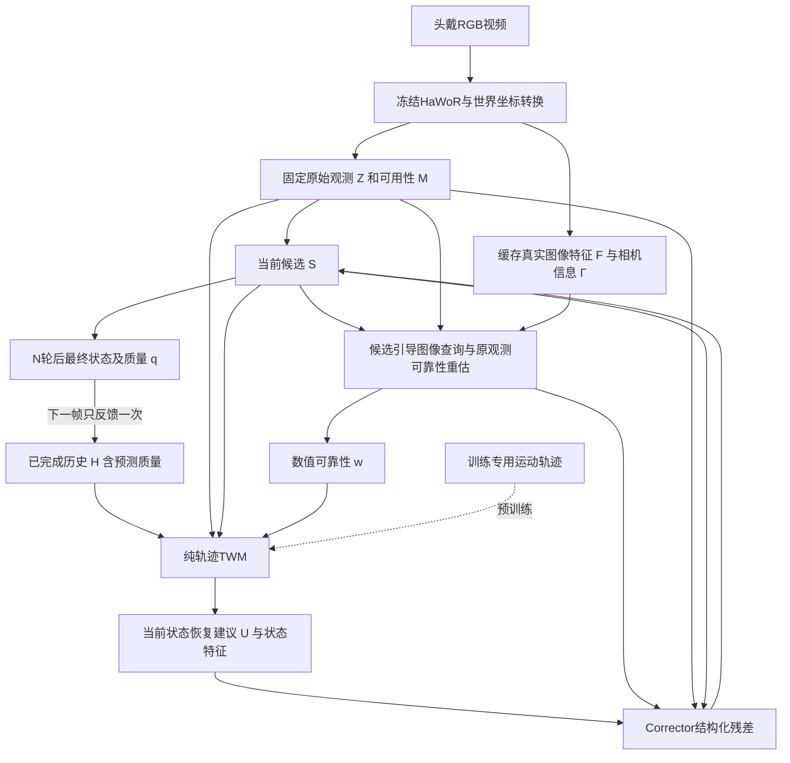

# HandLoop：完整方法框架

整理日期：2026-10-13。目标是将已讨论的研究方案组织为可实现、可写成Method、可逐项验证的框架。依据为[现行原始方案](../HandLoop_Project/START_HERE.md)、[方法记忆](../memory/01_METHOD.md)及此后用户决定；尚无模型代码或实验结果。

状态标记：**已定**指用户决定/现行设计；**建议契约**指本次为消除接口歧义提出的实现方案，尚未通过代码和实验验收。本文不改写原始档案。

## 1. 研究问题与核心假设

**已定目标：** 从高质量手部轨迹学到结构与运动规律，帮助头戴RGB系统恢复当前真实的手部状态。部署只需相机，训练可使用glove/MoCap等参考轨迹。

视觉重建给出一个初始状态，但局部遮挡、深度歧义、整手漏检和错误高置信会使部分关节或腕位姿不可靠。TWM利用历史和当前可信部分推断其他部分；图像证据检验这个建议是否符合当前真实动作；最终校正状态参与下一帧推断。

研究假设是：**当前部分状态条件恢复、候选引导的图像取证与带质量的状态反馈，可以互相补足，并降低真实几何误差。** 短期预测是学习时间规律的辅助任务。TWM不含真实控制action，不能据此宣称学到力学、人的动作意图或唯一未来。

## 2. 总体结构：三个主体、两个闭环

三个主体是HaWoR视觉前端、独立预训练TWM、含图像取证与可靠性头的Corrector。可靠性头属于校正模块，不额外引入一个大型系统。

帧内闭环改变候选及图像查询；跨帧闭环更新已完成的历史。前端图像特征可缓存，无需每轮重跑整个视觉backbone。

## 3. 任务输出与统一状态

**2026-10-13用户已定：每手99D MANO动态状态。** 替代原69D关节坐标候选；69D保留为历史/可选对照，不再作为当前默认接口。99D选择不代表转换、训练或效果已经验证。数据与监督见[预训练方案](TWM_PRETRAIN_PLAN.md)。

单手物理状态定义为：

\[
S_t=(p_t^W,R_t^W,Q_{t,1:15}),\qquad Q_{t,i}\in SO(3),\quad\beta\in\mathbb R^{10}\text{另存}.
\]

| 分量 | 含义 | 已选网络编码 |
|---|---|---|
| \(p_t^W\) | 世界系腕部位置 | 3D，米 |
| \(R_t^W\) | wrist-local到world的旋转 | rotation6D |
| \(Q_{t,1:15}\) | 按MANO约定解码后的15个手指局部旋转 | 15×6D=90D |
| 单手合计 | p3＋root6＋finger90，shape不计入动态状态 | 99D |

MANO解码得到腕中心化的 \(J_{t,j}^{\mathrm{wrist}}=f_j(Q_t,\beta)\)，世界关节为 \(J_{t,j}^W=p_t^W+R_t^WJ_{t,j}^{\mathrm{wrist}}\)。同一状态解码21点和778个vertices；关节点作为数值观测、几何监督及图像查询，而非独立60D动态输出。

**99D是编码长度，不是99个物理自由度。** root与15个finger旋转均用6个数编码3DoF的SO(3)。shape为人物/序列条件，同帧迭代固定；真实视觉评测使用HaWoR或序列估计shape，不暗用评测GT β。

**HaWoR须经过adapter。** [视频源码](https://github.com/ThunderVVV/HaWoR/blob/main/scripts/scripts_test_video/hawor_video.py)逐手保存root rotation `(3,3)`、15个joint rotations `(15,3,3)`、translation `(3)`与betas `(10)`；adapter统一左右手、hand mean与root frame，将实际腕点p及16个旋转编码为99D。视频支持左右手，原infiller同时读取双手。

`p=J_world[0]`，MANO translation不直接等于J0；保存p后按同一MANO实现正确换回transl再解码。各库PCA/hand mean先按源配置解码为完整旋转，不能把45D原数组直接转6D后拼接。

**建议契约：** 第一版左右手分别维护99D状态、历史和anchor，网络参数共享并提供handedness。双手联合attention/接触约束尚未决定；使用双手数据不代表模型已具备双手协同推理。

### 固定时序参考系

世界坐标是输出/评测坐标，腕局部坐标表达手指，时序anchor用于改善网络输入条件。建议每帧选择上一完成腕位姿作为 \(A_t=(p_A,R_A)\)：

\[
\bar p_i=R_A^\top(p_i^W-p_A),\quad \bar R_i=R_A^\top R_i^W.
\]

同帧所有迭代的anchor固定，history/raw/candidate/proposal使用同一anchor；finger local rotations及β不套global anchor变换。

99D状态采用SO(3)更新，Corrector残差建议为51D（p3＋root切向量3＋15×finger切向量3），而非旧66D位置残差：

\[
\bar p^{k+1}=\bar p^k+\Delta p_A,\quad
\bar R^{k+1}=\operatorname{Exp}([\Delta\theta_A]_\times)\bar R^k,\quad
Q_i^{k+1}=\operatorname{Exp}([\Delta\phi_i]_{\times})Q_i^k.
\]

root增量在anchor中左复合，finger增量在对应MANO父关节frame中左复合；这是建议实现契约，需roundtrip验证。rotation6D只作编码，不直接向量相加。更新后通过MANO重新解码所有关节；51D残差不是用户另外选定的输出编码。

## 4. HaWoR：提供观测、真实图像特征和几何关系

\[
(Z_t,F_t,\Gamma_t,M_t)=V(I_{1:T}).
\]

- \(Z_t\)：未经自有Corrector修改的腕部/关节状态。
- \(F_t\)：来自图像的feature cache。
- \(\Gamma_t\)：相机内外参、畸变/裁剪/feature坐标转换。
- \(M_t\)：原始检测及各部分可用性；与标签是否存在、预测是否可信分开。

**已定：** 初版冻结HaWoR。建议在其motion infiller之前取原始状态，并保留camera-to-world变换。源码核验表明world转换部分位于infiller函数内，不能简单删除整函数。full HaWoR和pre-infiller都要作为对照。[源码核验记录](../memory/05_WRITING_AND_REFERENCES.md)

HaWoR自己投影得到的2D关节点不作为独立证据；取证必须依赖图像特征或由图像预测的证据信号。“独立”指不由候选自身几何输出自证，不代表误差统计完全独立，也不要求再训练一个完整视觉backbone。

HaWoR可能使用多帧/未来上下文，因此这里的递归校正不自动意味着整个系统严格在线；最终需报告chunk、lookahead和延迟。

## 5. TWM：统一的条件当前状态恢复模型

\[
(U_t^{(k)},h_t^{W,(k)})=
W_\theta(\mathcal H_t,Z_t,S_t^{(k)},M_t,w_t^{(k)};\Delta t,\beta).
\]

\(\mathcal H_t\)含过去最终状态、预测质量、有效性及时间信息；\(U\)是**当前99D状态恢复建议**，\(h^W\)是状态特征。U不是下一帧预测，也不是Corrector的51D残差。TWM不接收图像、image features或图像token，只接数值状态与质量提示。β、dt为显式条件；固定Z可同时包含raw MANO与原始3D joint观测及各自mask。

接口中的candidate是带有效性/来源字段的状态token，历史padding和有效性包含在H中；M保留原始观测可用性。TWM及Corrector都读取这些附带字段，不能将首帧缺测的数值占位当真实测量。

**作用示例：** 食指部分关节被遮挡时，当前可见指尖/其他关节、腕姿态与历史能共同限制缺失关节的合理位置。它提供条件估计；不能由少量点唯一确定所有隐藏自由度。

起步建议为wrist/joint structured tokens和小型temporal Transformer。6层、256维、4heads、历史K=8只是候选配置，采样频率变化时应以时间长度解释窗口，不把这些数值写成已验证最优。

### 消除预训练与部署接口不一致

旧稿的预训练四输入与部署五输入尚不一致。本次建议始终保留上式的history、raw、candidate、mask、reliability槽位：

1. 从完整轨迹构造带误差的历史及当前raw observation。
2. 初次候选可等于raw；其他训练样例从同一raw构造部分修复、仍有偏差的candidate，使二者统计相关，而不是任意独立噪声。
3. 包含干净输入、单点/整指/整手缺失、旋转/位移偏差、连续偏差与历史错误。
4. 质量提示包含校准误差和false-high-confidence；推理不可依赖GT误差或完美oracle quality。
5. 重复前向时raw固定、candidate变化；逐步加入自身恢复候选，模拟推理分布。

辅助预测使用未来GT作为训练target，不将其放入TWM的历史或候选输入。

这是完整接口提案，不是已实现功能。预训练的质量提示不再笼统叫最终质量q；最终q专指完整校正结果的预测质量。

## 6. Corrector：每轮按固定次序取证与更新

当前帧的 \(Z,F,\Gamma,M,\mathcal H,A\)保持不变，候选 \(S^{(k)}\)改变。

**第1步，候选引导查询。** 将candidate的世界关节投影到图像/feature空间，读取局部图像支持；同时读取原始观测附近与全手上下文。错误candidate可能投影到错误区域，不能只围绕它做局部自证。投影出界、遮挡和取证缺失需要query mask。

**第2步，原观测可靠性重估。** 用图像证据及raw/candidate关系预测 \(w_t^{(k)}\)，回答“固定原观测Z的哪些部分值得信任”。不能仅因当前动作偏离先验就压低视觉可信度。

**第3步，TWM条件恢复。** 将数值状态、历史和w送入同一TWM，获得U/hW。当前可信局部状态可以约束其他部分，高confidence不是硬锁定。

**第4步，残差校正。**

\[
\Delta S_t^{(k)}=C_\psi(S_t^{(k)},Z_t,U_t^{(k)},h_t^{W,(k)},E_t^{(k)},M_t,w_t^{(k)}),
\qquad S_t^{(k+1)}=S_t^{(k)}\oplus\Delta S_t^{(k)}.
\]

Corrector学习如何结合观测、运动建议和图像支持，输出腕部/关节的结构化更新。建议共享权重，先试2轮，对照1/3轮。改善必须来自真实证据和几何误差下降，不能默认迭代次数越多越好。

### w与q的监督语义

| 量 | 要预测谁的质量 | 是否随candidate更新 | 用途 |
|---|---|---|---|
| \(w_t^{(k)}\) | 固定原观测 \(Z_t\) | 预测可变，但GT误差标签不变 | 当前恢复与融合 |
| \(q_t\) | 最终输出 \(\hat S_t\) | 最终状态确定后计算 | 下一帧历史质量提示 |

建议最终q显式读取最终状态及其对应图像证据，不复制w或上一轮候选质量。训练用各自状态相对reference的误差监督；推理只用预测量。位置/旋转/局部关节可有不同质量分组和阈值，具体目标尚待选定。

## 7. 跨帧闭环与缺测边界

\[
\hat S_t=S_t^{(N)},\qquad
\mathcal H_{t+1}=\operatorname{Update}(\mathcal H_t,\hat S_t,q_t).
\]

每帧只提交一次最终结果。中间candidate不写历史，最终结果也不覆盖原始观测记录。固定短历史即可，不扩展long/short memory分支。

**建议初始化契约：** 有有效观测时按Z初始化；部分缺测且有历史时用上一完成状态填候选的缺测部分，但保留原始M不变并记录候选来源。原始mask、候选有效性和历史padding分别记录，零坐标不是缺失标记。

首帧没有wrist且没有历史时，单位anchor只能用于数值占位，不能凭空使全局状态变得可识别。无依据的全局输出应保持无效/未知；已有历史的暂时整手漏检可给预测并降低质量。离屏/重入、身份变化、长gap与sequence boundary需要reset策略，阈值仍待实验确定。

## 8. 三阶段训练与损失

| 阶段 | 输入数据 | 训练参数 | 核心目的 |
|---|---|---|---|
| I：TWM预训练 | 高质量手部状态序列；无需视频 | TWM | 当前条件恢复为主，短预测为辅 |
| II：视觉校正训练 | 同步video/reference、真实HaWoR输出 | evidence、w/q头、Corrector；冻结HaWoR/TWM | 对真实视觉错误做取证和恢复 |
| III：递归rollout训练 | 连续paired序列和模型自身最终历史 | 初版继续训练校正模块；必要时再研究TWM微调 | 适应反馈误差与再可见恢复 |

阶段I：

\[
\mathcal L_W=\mathcal L_{restore}+\lambda_f\mathcal L_{short\ forecast}+\lambda_v\mathcal L_{GT\ velocity}.
\]

恢复损失包含腕位置、root/finger SO(3)旋转及MANO解码后的local/world关节误差，缺失reference用监督mask。joint-only不强监督缺失的finger角度/β；MANO已耦合骨架，骨长loss不作默认项。人物形态和骨架/单位/时间规范先验收。

阶段II/III建议：

\[
\mathcal L_C=\sum_{k=1}^{N}\alpha_k\mathcal L_{state}(S_t^{(k)},S_t^*)
+\lambda_e\mathcal L_{image\ evidence}+\lambda_v\mathcal L_{velocity}+\lambda_w\mathcal L_{w}+\lambda_q\mathcal L_{q}.
\]

逐轮监督更新后的1至N轮；初始S0=Z的误差记录为基线，不要求Corrector修改固定原始输入。image evidence loss须依赖独立图像信号或reference投影且尊重可见性，不用candidate自己的投影作为自身目标。velocity比较GT速度和实际dt，不是惩罚速度本身。干净输入样例用于约束不必要的改动。

阶段III可从约16帧短unroll开始，逐步使用自身状态和预测q作历史；GT只监督输出。冻结参数与截断输入梯度是不同选择，detach/截断反传及teacher-forcing schedule需单独记录。

原始开工步骤中的“先无图像证据做一次融合”是工程中间基线，并非完整阶段II或最终方法。两者不能在论文里混为一谈。

## 9. 数据选择：采用用户最新的免申请原则

**2026-10-13用户已定：优先使用无需人工申请、已有直接下载入口的数据，并参考相关论文的实际数据用法。** 不以申请Lightwheel/商业合作为开工前置条件；GRAB/AMASS/ARCTIC与HOT3D full VRS的注册/登记路线暂降级。**HOT3D-Clips官方train直接公开，是不同发布入口，不应一并降级。** 普通登录/许可要求按实际入口分别记录，不绕过访问限制。

论文的不同训练职责应分开：

| 方法 | 已核验的数据角色 | 对本项目的启发 |
|---|---|---|
| [HMP](https://arxiv.org/html/2312.16737v1) | motion prior用GRAB/TCDHands/SAMP；HO3D/DexYCB恢复评测；当前代码train GRAB+ARCTIC，与论文版本分开 | 参考独立motion prior训练范式，不自动照搬需申请的数据组合 |
| [HaWoR](https://arxiv.org/html/2501.02973v1) | 视觉估计用HOT3D/ARCTIC/DexYCB/HO3D；motion infiller用HOT3D | 四个视觉训练集不是infiller预训练组合；基线需标清训练来源 |
| [StableHand](https://arxiv.org/html/2605.18553v1) | 八库约10M帧用于quality network；生成模型按HOT3D/ARCTIC训练，含视觉条件 | 质量学习数据与生成恢复数据分开；不是纯轨迹TWM |
| [PAD-Hand](https://arxiv.org/html/2603.26068v1) | DexYCB/HO3D训练评测，TACO为未参与训练的跨数据集测试 | 可参考直接可下载数据的恢复协议，保持TACO留出角色 |

**D18已定选库原则：纯轨迹按手姿态精度与标定选glove/MoCap，论文名单仅作参考。** v2高优先候选GRAB/ARCTIC/Oak/HOT/UmeTrack；主要glove HumanTouch/DexWild，DexCap/OpenGraph验小样本。免申请仍优先，注册资源有授权再接入；具体混合未定。[传感器证据](../memory/11_SENSOR_FIRST_PRETRAIN_2026-10-13.md)、[v2计划](TWM_PRETRAIN_PLAN.md)

glove raw人体joints/方向可以直接几何或部分旋转监督99D，不要求预先全库拟合MANO。native参数完整不等于所有角度独立精确，finger/wrist来源和转换误差分别保存。Re/EgoDex/Giga等降为后续视觉标签扩展；HumanTouch许可已核CC BY-NC4.0。HOT/Oak原split约束保留，UmeTrack真实/合成同motion去重；真实HaWoR数值适配属于后续阶段。

EgoDex、GigaHands、TACO等可作质量分层扩展/留出评测，具体角色在split确定时固定。聚合库不能用于规避原数据许可，重复轨迹与相邻窗口跨split要排除。数据访问与MANO/SMPL-X模型资产的获取条件分开核查。

## 10. 实验如何证明方法成立

| 研究主张 | 必须比较的版本 | 主要检查 |
|---|---|---|
| 轨迹恢复有用 | raw/full HaWoR、Kalman/smoothing、GRU/普通temporal模型 | 相同输入/数据条件下真实几何误差 |
| 当前部分状态条件有用 | history-only、prediction-only、current-state restoration | 缺失点恢复和真实动作突变 |
| 图像重取证有用 | 不取证、固定位置取证、candidate引导取证 | false-high-confidence修复，准确关节退化 |
| 迭代有用 | 1/2/3轮、固定gate与learned correction | 收益与计算量，不只重复前向 |
| 质量反馈有用 | 无反馈、无q、teacher-forcing-only、rollout | 连续遮挡、重入、误差累积 |

核心指标：world/camera/local joint error、wrist位置/旋转误差、速度误差；按遮挡长度、错误高置信、动作突变、再可见恢复分组。PA-MPJPE和外观平滑只能补充。数据/参考系对齐固定，不能逐帧GT对齐隐藏漂移；已有backbone训练数据重叠也要披露。

候选贡献是三种机制的配合及各自不可替代收益；尚未证明新颖性、SOTA或精度改善。长期完全遮挡存在不可辨识性，局部运动规律也不能独自消除任意世界SLAM漂移。

## 11. 当前完成度与下一步

已确定研究方向、模块分工、两闭环、三阶段训练，以及本机编辑/远程实验和免申请数据偏好。本文补充了统一TWM槽位、残差坐标、最终q、单手实例化和缺测初始化的**建议契约**。

仍需通过样本和代码确定：标准关节映射/骨长、模型资产、训练数据split、mask/quality粒度、可靠性目标、corruption分布、证据读取位置/范围、训练损失权重、历史/reset与梯度策略。

实施顺序：在hongfei完成直接可下载数据样本契约→纯轨迹restoration baseline→真实HaWoR误差上的一次校正→候选引导取证与多轮迭代→自身历史rollout及消融。代码、论文和小型结果同步GitHub，训练数据/权重不上传。
