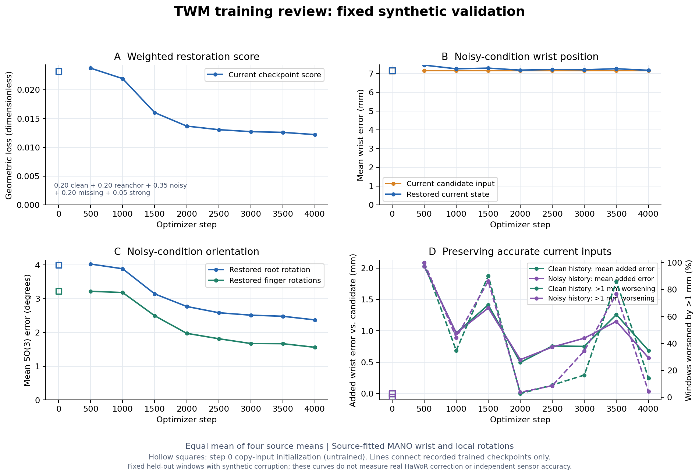

# D34：每卡512训练的4k步效果检查

检查时间：2026-10-15 05:25UTC（纽约01:25）。实际训练快照 **4,180 / 10,000步**，最新完整固定validation为 **4,000步**（05:17:22UTC）；训练继续，没有暂停、改配置或启动额外模型推理。此处不评价另一聊天D35视觉插件smoke。

源码`7d53fa4a1b14f31e08f41ba545556e59adadd31f`，13,530,032参数，原Pod两卡各512/global1024、从头10k；架构/训练目标、四库GT/split、mixed_v2、99D与β conditioning关闭策略均保持。完整resolved config、数据/source SHA和统计见[小型结果摘要](../reports/twm_b512_progress_20261015_0521.json)，启动协议见[D34运行记录](TWM_MOE_LONG_HORIZON_RUN_2026-10-15.md#d34每卡512从头训练10000步)。

## 当前恢复效果

每模式每库固定256窗，共1024窗，先按库求均值再四库等权宏平均；参考为源拟合MANO，wrist为world位置经共同anchor变换后的欧氏距离mm，root/finger为SO(3)测地角度，finger在每窗内先对15关节平均。不是MPJPE、mesh误差、独立传感器精度或真实HaWoR纠错效果。

| 4k验证条件 | 输入腕mm → 输出腕mm | 输入root° → 输出root° | 输入finger° → 输出finger° |
|---|---|---|---|
| ordinary/noisy | 7.158 → 7.180 | 3.999 → 2.373 | 3.224 → 1.561 |
| 当前/历史全clean | 0 → 0.688 | 约0 → 0.359 | 约0 → 0.188 |
| reanchor：当前clean、历史中噪 | 0 → 0.571 | 约0 → 0.471 | 约0 → 0.246 |
| 局部missing | 3.068 → 3.179 | 1.606 → 1.606 | 1.709 → 1.332 |
| 局部strong | 18.422 → 18.434 | 10.626 → 3.826 | 3.996 → 1.794 |

ordinary条件下，root/finger误差分别降低 **40.7% / 51.6%**，但腕位置尚无有效改善，missing/strong腕也未改善。准确当前输入仍会被修改：clean有14.26%窗口腕误差增加>1mm，reanchor为4.39%；这是四库比例的宏平均，分库及p50/p95都在JSON中。ordinary/noisy腕p95输入14.340mm、输出14.303mm，两个p95均为分库p95的均值，不是总体分位数。

| ordinary/noisy分库 | 腕输入→输出mm | root输出° | finger输出° |
|---|---|---|---|
| DexYCB | 7.158 → 7.214 | 2.680 | 1.825 |
| HOT3D | 7.158 → 7.179 | 2.458 | 1.477 |
| OakInk2 | 7.158 → 7.182 | 1.964 | 1.366 |
| UmeTrack | 7.158 → 7.143 | 2.390 | 1.575 |

## 同一轮曲线与预测

本轮加权当前恢复score：1k=0.021939、2k=0.013693、3k=0.012730、4k=0.012216。3k→4k下降约4.03%，仍在改善但速度放缓；不能据此宣布整体收敛。score按clean/reanchor/noisy/missing/strong以0.2/0.2/0.35/0.2/0.05加权，使用每个checkpoint实测值，不用best-so-far遮住反弹。step0是copy-input零初始化，空心点单列，不视作训练收益。旧D32的3k/batch256曲线不是这里的3k，不能混用。

ordinary/noisy未来腕误差：1s最高概率整段mode为103.568mm，restored-current hold为120.242mm，常速度为240.530mm；2s分别为150.508mm和148.162mm（hold），模型尚未优于hold。该单条mode不是GT选择的oracle，也不能由预测误差下降推出长预测已帮助当前恢复，后者仍需消融。

未来误差只统计时域有效窗：1s为Dex82/HOT193/Oak252/Ume239，共766窗、四源等权；2s为Dex0/HOT126/Oak245/Ume219，共590窗、仅三源等权。1s与2s不是相同窗口/来源集合，不能直接据两者绝对误差推断长短预测差异；每个时域与hold比较使用相同有效窗。

当前xyz预测均值标准差4.392mm；标称90%的三维Gaussian椭球覆盖率为82.03%，当前条件下存在覆盖不足，不能称已校准。该覆盖诊断与几何均值误差分别报告，不能用NLL改善代替位置纠错证据。

## 证据与后续边界

仅在远程Pod读取已经生成的`train.log`、`run_metadata.json`、`initial_validation.json`、`latest_validation.json`及`status.json`；[分析脚本](../scripts/review_probabilistic_twm_run.py)校验四库宏平均，记录原validation字节SHA和完整配置/source SHA。[绘图脚本](../scripts/plot_twm_training_review.py)在原zhou环境CPU渲染，本机只做源码/文档/静态检查与看图。没有额外模型前向/优化、test集访问、前端推理或物理正确性验证。

原始run：`/sciclone/data10/jchen57/Hand_Reconstruction/runs/twm_four_sources_moe_mixed_v2_b512_10k_20261015`；本次checks：同根`evaluations/twm_b512_progress_20261015_0521/{review.json,review_source.py,curves.png}`。所有权重与原日志保留远程，[W&B12cc0781](https://wandb.ai/black-ant/handloop-twm/runs/12cc0781)仍用于本轮跟踪。

当前结论：已经学到当前旋转去噪，但尚未验证有效的腕位置校正。保持用户要求的10k训练继续；后续按同口径检查腕位置、准确输入退化、分库与预测表现，不把加大batch/步数本身当成改进证据。

随后按用户要求完成[腕位置原因诊断](TWM_WRIST_DIAGNOSIS_2026-10-15.md)：使用冻结4,400步小样本，不是本页4k全固定验证；模型对当前位置偏移的残差响应很弱，head梯度连通，原因仍需单因素训练对照。本页验证数值保持原口径。
