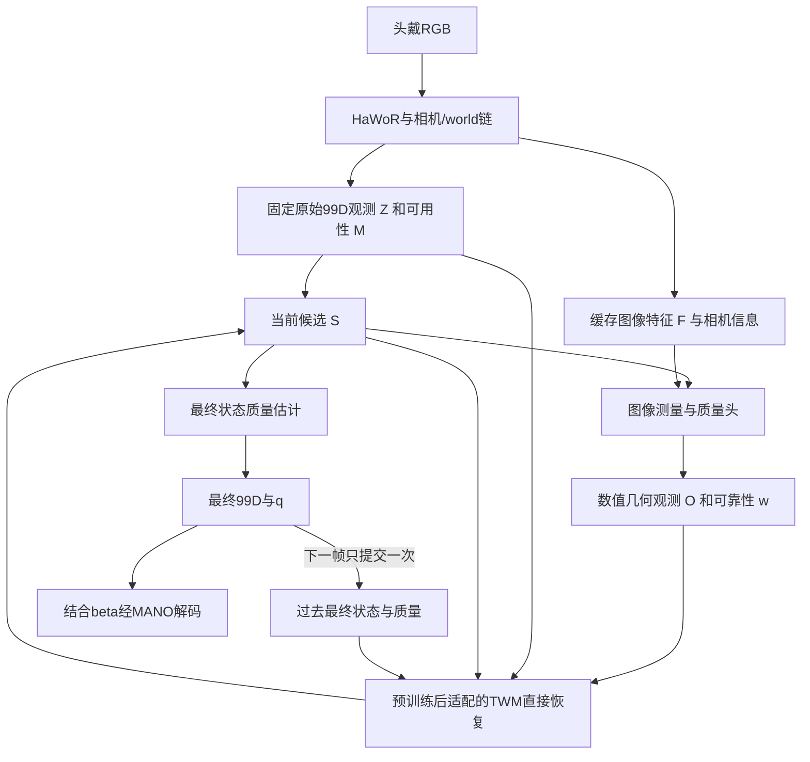

# TWM直接状态校正与联合微调方案讨论

日期：2026-10-14。用户提出评估删除独立Corrector，让预训练TWM直接修正视觉重建状态，并通过真实前端误差与多样训练样例微调。本讨论建议优先验证统一恢复模型；用户尚未最终采纳架构替代，现行框架见[METHOD_FRAMEWORK](METHOD_FRAMEWORK.md)。每手99D、shape另存、当前恢复主任务与高精度轨迹预训练保持为已定条件。

## 1. 为什么统一恢复模型成立

现行TWM已经输出完整当前状态恢复建议U。独立Corrector再结合U、原观测和图像证据输出最终候选，是一种分工方案，不是当前恢复任务的必要结构。可以直接训练同一个TWM输出修正状态，使监督损失作用于其最终99D输出，减少“恢复建议是否被后级采用”的接口。

删除独立融合网络不会免除信息融合和状态读出的学习。TWM仍需状态输出head，识别观测错误并结合历史/当前约束；该能力由共享预训练表示与下游适配承担。原Corrector还提供图像到状态的路径，因此比较两种结构时必须匹配证据输入，不能把信息缺失造成的退化归因于模块合并。

建议传入HaWoR姿态/腕位姿与原始可用性；额外的预测可靠性由待训练质量头提供，并保留来源。首个直接恢复baseline尚无质量头时，w允许显式缺省，不能依赖未建立的可靠性功能。MPJPE等评测指标需要reference，不是部署输入；检测confidence也不等于真实几何质量。

## 2. 与相关方法的证据对照

| 方法及任务 | 恢复机制与输入 | 训练和参考来源 | 可借鉴部分及范围 |
|---|---|---|---|
| [HMP，motion prior与视频拟合](https://arxiv.org/pdf/2312.16737) | MoCap训练运动先验，再优化latent及位姿匹配图像关键点 | 论文GRAB/TCDHands/SAMP训练先验，HO3D/DexYCB恢复评测；静止相机设定 | 支持轨迹知识迁移；使用测试时优化，不证明我们统一学习恢复头更好 |
| [DIP，受损运动恢复](https://arxiv.org/html/2508.01835v1) | 同一去噪恢复器读固定初始估计和变化candidate，直接恢复MANO | DexYCB train扰动GT训练，HO3Dv2 zero-shot；附录另有HaMeR预测/reference配对训练 | 支持独立状态融合网络非必要；附录不明确我们的MoCap预训练后微调初始化顺序；公开姿态恢复不等同world腕恢复 |
| [PAD-Hand，受损运动与physics variance](https://arxiv.org/html/2603.26068v2) | 原始与candidate mesh输入MeshCNN/Transformer，直接生成校正姿态 | WiLoR预测/reference配对训练；DexYCB/HO3D，TACO留出 | 支持训练真实前端错误；EL residual/variance有额外建模，不是样例数量自动带来的力学保证 |
| [HaWoR，视觉世界运动与infilling](https://arxiv.org/html/2501.02973v1) | 视觉时序估计、相机/world链与数值运动补全 | 视觉训练多库，infiller只HOT3D；marker参考与MANO转换分层 | 数值恢复有实际前例；原补全只替换missing，与修正valid但错误观测需区分，非因果上下文需匹配 |
| [StableHand，质量条件恢复](https://arxiv.org/html/2605.18553v1) | 质量条件flow直接恢复world双手状态，生成器接图像/场景/相机条件 | 八库服务QN，生成按HOT3D/ARCTIC分别训练；ARCTIC s05留出、150帧共同恢复 | 支持恢复模型自行融合观测及质量；不能据此断言无图像TWM可以利用未传入的视觉信息 |
| [JoHan，联合2D/3D恢复](https://arxiv.org/html/2610.10512v1) | 更新的2D几何在每个flow step指导3D；两分支均接video features | 六库paired训练，generator从零训练、联合微调DINOv3；HOT沿HaWoR留出原recordings | 支持具体几何条件的价值；不能当作纯轨迹TWM预训练方案，也不能把生成2D等同独立测量 |
| [Prior-First Condition-Second，身体条件手运动补全](https://arxiv.org/html/2607.05938v1) | 先训练body-hand prior，冻结后在内部加入语义adapter | MotionPersona/InterAct/BEAT与自采训练prior，少量semantic标签适配；非视觉手纠错 | 提醒适配应检验先验保持；不引入本项目未选的身体输入或语义控制 |

这些先例支持架构可行性，没有证明统一TWM必然胜过两级方案。完整既有协议、时间上下文和公开实现边界见[论文精读](WESTWORLD_AND_HAND_RECONSTRUCTION_REVIEW.md)与[数据论文依据](TWM_DATA_PAPER_EVIDENCE.md)。

## 3. 建议首先建立数值状态直接恢复

先冻结HaWoR，用其真实输出构造Z与M，保留原始confidence来源。将纯轨迹预训练TWM作为同一个恢复模型，直接输出下一候选：

\[
S_t^{(k+1)}=W_{\phi}(H_t,Z_t,S_t^{(k)},M_t,w_t^{(k)};\beta,\Delta t).
\]

对外输出完整99D，shape另存。可以保留预训练状态head直接预测姿态，也可以在模型内部以平移和SO(3)增量产生合法更新，再编码回99D；内部51D切向残差是候选实现，不额外增加独立状态融合器，也不将任务输出改成51D。

第一项实验只做一次恢复，验证纯轨迹预训练及真实误差适配是否降低joint/wrist误差。没有显式图像取证的版本，作为数值恢复baseline；输入不能区分的遮挡情况、系统性深度偏差或突发动作，不会仅由更多训练样例变得可观测。

## 4. 保留图像取证时需要传入修正方向

quality说明哪部分值得信任，却通常不能表达新的校正方向。例如原观测同样低质量，图像可能分别支持指尖向左或向右移动；两个场景若给TWM同样的Z、H、candidate和其余数值条件，它无法仅凭这些输入区分。

因此建议把图像侧保留为轻量测量与质量头E，输出具有明确几何意义的数值观测O：

\[
(O_t^{(k)},w_t^{(k)})=E(F_t,\Pi_{\Gamma_t}(\operatorname{MANO}(S_t^{(k)},\beta)),Z_t),
\]
\[
S_t^{(k+1)}=W_{\phi}(H_t,Z_t,S_t^{(k)},M_t,w_t^{(k)},O_t^{(k)};\beta,\Gamma_t,\Delta t).
\]

O可包含由图像支持的2D关键点或投影偏移、可见性、位置不确定性与query mask；相机/crop信息提供坐标语义。具体选择仍需数据验收。TWM不读取RGB、patch embeddings或appearance features；不能把任意图像特征改名“数值证据”以绕过这一边界。

式中MANO(S,β)是经过现行99D adapter解码的简写，仍需正确处理实际wrist位置p与MANO transl、hand mean与左右手约定。

这仍使用数值视觉测量，不能宣传为“推理完全没有视觉信息”。w继续评价固定原观测Z，O自身的测量有效性/不确定性另记；两者不是同一个误差目标。

图像头负责提供测量，不直接预测完整3D修正。否则只是把Corrector职责搬进E。跨多轮读取同一图像也不是获得独立新测量，不能每读一轮就累加confidence。新O与原始Z分开保存，不能用candidate自身投影自证准确。

该图是本次推荐讨论方案。维持Z/H/anchor/β同帧固定，更新candidate与本轮查询；最终q评估最终状态，可用最终对应的测量/数值残差，不复制原观测w。重复调用固定输入的确定性模型不会自动增加恢复能力；迭代需在训练中覆盖变化candidate和查询。

## 5. 预训练与下游适配的训练顺序

| 阶段 | 样例与训练对象 | 要检验的能力 |
|---|---|---|
| 轨迹预训练 | 高质量glove/MoCap；部分缺失、旋转/腕偏差、连续错误、干净输入和受损历史；训练TWM | 当前部分状态条件恢复；保持99D输出与partial监督 |
| 真实误差适配 | train split上冻结HaWoR预测/reference成对；微调TWM状态读出及必要的内部参数 | 学会当前前端的valid-but-wrong、时间相关偏差和漏检，而不只去独立高斯噪声 |
| 几何条件与递归适配 | paired视频；训练图像测量/quality与TWM内部几何输入adapter，按需要解冻部分TWM；使用自身最终状态历史 | 保留新图像支持、处理false-high-quality和反馈累积 |

“联合微调”首先可指TWM与测量/质量头联合训练，无需第一步解冻整个HaWoR。之后若研究HaWoR全链微调，需单列版本和重新检查前端误差分布，不同时更改所有因素。

纯轨迹阶段缺少2D实测条件时，O槽位使用显式missing；若用虚拟相机投影生成几何训练条件，必须有明确投影/噪声模型并标为合成观测。真实几何adapter的paired训练属于下游，不把合成投影当独立RGB证据。

下游适配可能遗忘运动先验。建议先比较有限参数适配与全TWM微调；可通过混入纯轨迹恢复样例保持能力，并在原motion留出集复测。小学习率、冻结层数、replay比例与迭代轮数均在validation确定，不预设组合必需或最优。

真误差样例按subject/recording先切split，再导出HaWoR预测；不得用test GT生成训练输入/quality。质量提示包含错误高置信、失准与缺失，推理不使用oracle error。保留准确输入、急停/急转和再可见样例，防止只学习平滑或数据中的平均姿态。

## 6. 几何约束与物理表述

后续用户要求从world model寻找数学依据，条件性证明、不可辨识性和独立验证见[物理约束与数学方案](TWM_PHYSICAL_GUARANTEES_AND_VALIDATION_2026-10-14.md)。其硬解码/确定性验收可置于统一TWM内部，尚未选定为本方案必需模块。

监督建议组合wrist位置/朝向、可用finger旋转、MANO解码local/world关节、独立图像测量一致性、GT速度与质量误差。shape来源及可用标签mask与现行99D契约一致，只有raw joints的数据不直接强监督未测角度。

MANO与SO(3)解码提供一致模型结构及合法旋转，不自动保证生理关节限位、自交避免、物体不穿透或动力学正确。运动轨迹能学习姿态分布与时间规律；没有质量/力矩/接触模型及可检验动力学条件，仅靠增广和微调不能保证遵守力学定律。PAD-Hand的physics variance也不同于本项目几何可靠性。

当前更准确的目标是提高结构与运动一致性，同时降低真实测量误差。不能把所有速度压小，或把“符合先验”替代“符合当前真实动作”；本次合并不自动加入物体物理或完整手臂模块。

## 7. 最小对照与调整条件

1. 相同数据、上下文与几何O输入，比较TWM加独立C和统一TWM，隔离模块拆分的作用；现行直接读取图像features的C另作版本报告，避免把证据压缩与模块合并混成一个因素。记录参数量、计算量、推理时间与训练预算。
2. 统一TWM比较无预训练、轨迹预训练、预训练后真实误差适配；另比较有限参数适配与全TWM微调，检查motion留出能力。
3. 比较无图像重取证、只传quality、传数值几何观测加quality；检验新增信息是否真能改变修正方向。
4. 相同几何条件下比较一次/多次更新，以及GT历史/自身历史训练和最终质量反馈。

主指标仍是wrist位置/旋转、local/world joint误差，按准确观测退化、突发动作、遮挡、重新可见和世界坐标漂移分组。配对state-only比较与带几何证据比较分别报告；短历史也不能消除HaWoR前端非因果上下文，现行W/WA协议与绝对world误差边界保持。

优先建立直接恢复baseline，再检验几何条件下的一体恢复。独立C保留为结构对照；若同输入同预算下它更有效，应据证据保留，而不是因架构更简洁提前宣称统一TWM更优。
