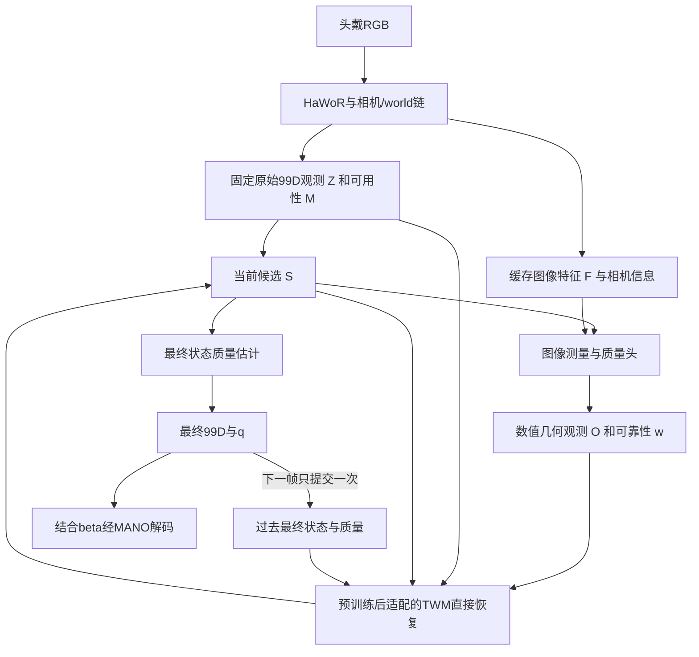

# TWM直接状态校正与联合微调方案讨论

日期：2026-10-14。用户提出评估删除独立Corrector，让预训练TWM直接修正视觉重建状态，并通过真实前端误差与多样训练样例微调。本讨论建议优先验证统一恢复模型；用户尚未最终采纳架构替代，现行框架见[METHOD_FRAMEWORK](METHOD_FRAMEWORK.md)。每手99D、shape另存、当前恢复主任务与高精度轨迹预训练保持为已定条件。

## 1. 为什么统一恢复模型成立

现行TWM已经输出完整当前状态恢复建议U。独立Corrector再结合U、原观测和图像证据输出最终候选，是一种分工方案，不是当前恢复任务的必要结构。可以直接训练同一个TWM输出修正状态，使监督损失作用于其最终99D输出，减少“恢复建议是否被后级采用”的接口。

删除独立融合网络不会免除信息融合和状态读出的学习。TWM仍需状态输出head，识别观测错误并结合历史/当前约束；该能力由共享预训练表示与下游适配承担。原Corrector还提供图像到状态的路径，因此比较两种结构时必须匹配证据输入，不能把信息缺失造成的退化归因于模块合并。

建议传入HaWoR姿态/腕位姿与原始可用性；额外的预测可靠性由待训练质量头提供，并保留来源。首个直接恢复baseline尚无质量头时，w允许显式缺省，不能依赖未建立的可靠性功能。MPJPE等评测指标需要reference，不是部署输入；检测confidence也不等于真实几何质量。

## 2. 与相关方法的证据对照

| 方法及任务 | 恢复机制与输入 | 训练和参考来源 | 可借鉴部分及范围 |
|---|---|---|---|
| [HMP，motion prior与视频拟合](https://arxiv.org/pdf/2312.16737) | MoCap训练运动先验，再优化latent及位姿匹配图像关键点 | 论文GRAB/TCDHands/SAMP训练先验，HO3D/DexYCB恢复评测；静止相机设定 | 支持轨迹知识迁移；使用测试时优化，不证明我们统一学习恢复头更好 |
| [DIP，受损运动恢复](https://arxiv.org/html/2508.01835v1) | 同一去噪恢复器读固定初始估计和变化candidate，直接恢复MANO | DexYCB train扰动GT训练，HO3Dv2 zero-shot；附录另有HaMeR预测/reference配对训练 | 支持独立状态融合网络非必要；附录不明确我们的MoCap预训练后微调初始化顺序；公开姿态恢复不等同world腕恢复 |
| [PAD-Hand，受损运动与physics variance](https://arxiv.org/html/2603.26068v2) | 原始与candidate mesh输入MeshCNN/Transformer，直接生成校正姿态 | WiLoR预测/reference配对训练；DexYCB/HO3D，TACO留出 | 支持训练真实前端错误；EL residual/variance有额外建模，不是样例数量自动带来的力学保证 |
| [HaWoR，视觉世界运动与infilling](https://arxiv.org/html/2501.02973v1) | 视觉时序估计、相机/world链与数值运动补全 | 视觉训练多库，infiller只HOT3D；marker参考与MANO转换分层 | 数值恢复有实际前例；原补全只替换missing，与修正valid但错误观测需区分，非因果上下文需匹配 |
| [StableHand，质量条件恢复](https://arxiv.org/html/2605.18553v1) | 质量条件flow直接恢复world双手状态，生成器接图像/场景/相机条件 | 八库服务QN，生成按HOT3D/ARCTIC分别训练；ARCTIC s05留出、150帧共同恢复 | 支持恢复模型自行融合观测及质量；不能据此断言无图像TWM可以利用未传入的视觉信息 |
| [JoHan，联合2D/3D恢复](https://arxiv.org/html/2610.10512v1) | 更新的2D几何在每个flow step指导3D；两分支均接video features | 六库paired训练，generator从零训练、联合微调DINOv3；HOT沿HaWoR留出原recordings | 支持具体几何条件的价值；不能当作纯轨迹TWM预训练方案，也不能把生成2D等同独立测量 |
| [Prior-First Condition-Second，身体条件手运动补全](https://arxiv.org/html/2607.05938v1) | 先训练body-hand prior，冻结后在内部加入语义adapter | MotionPersona/InterAct/BEAT与自采训练prior，少量semantic标签适配；非视觉手纠错 | 提醒适配应检验先验保持；不引入本项目未选的身体输入或语义控制 |

这些先例支持架构可行性，没有证明统一TWM必然胜过两级方案。完整既有协议、时间上下文和公开实现边界见[论文精读](WESTWORLD_AND_HAND_RECONSTRUCTION_REVIEW.md)与[数据论文依据](TWM_DATA_PAPER_EVIDENCE.md)。

## 3. 建议首先建立数值状态直接恢复

先冻结HaWoR，用其真实输出构造Z与M，保留原始confidence来源。将纯轨迹预训练TWM作为同一个恢复模型，直接输出下一候选：

\[
S_t^{(k+1)}=W_{\phi}(H_t,Z_t,S_t^{(k)},M_t,w_t^{(k)};\beta,\Delta t).
\]

对外输出完整99D，shape另存。可以保留预训练状态head直接预测姿态，也可以在模型内部以平移和SO(3)增量产生合法更新，再编码回99D；内部51D切向残差是候选实现，不额外增加独立状态融合器，也不将任务输出改成51D。

第一项实验只做一次恢复，验证纯轨迹预训练及真实误差适配是否降低joint/wrist误差。没有显式图像取证的版本，作为数值恢复baseline；输入不能区分的遮挡情况、系统性深度偏差或突发动作，不会仅由更多训练样例变得可观测。

## 4. 保留图像取证时需要传入修正方向

quality说明哪部分值得信任，却通常不能表达新的校正方向。例如原观测同样低质量，图像可能分别支持指尖向左或向右移动；两个场景若给TWM同样的Z、H、candidate和其余数值条件，它无法仅凭这些输入区分。

因此建议把图像侧保留为轻量测量与质量头E，输出具有明确几何意义的数值观测O：

\[
(O_t^{(k)},w_t^{(k)})=E(F_t,\Pi_{\Gamma_t}(\operatorname{MANO}(S_t^{(k)},\beta)),Z_t),
\]
\[
S_t^{(k+1)}=W_{\phi}(H_t,Z_t,S_t^{(k)},M_t,w_t^{(k)},O_t^{(k)};\beta,\Gamma_t,\Delta t).
\]

O可包含由图像支持的2D关键点或投影偏移、可见性、位置不确定性与query mask；相机/crop信息提供坐标语义。具体选择仍需数据验收。TWM不读取RGB、patch embeddings或appearance features；不能把任意图像特征改名“数值证据”以绕过这一边界。

式中MANO(S,β)是经过现行99D adapter解码的简写，仍需正确处理实际wrist位置p与MANO transl、hand mean与左右手约定。

这仍使用数值视觉测量，不能宣传为“推理完全没有视觉信息”。w继续评价固定原观测Z，O自身的测量有效性/不确定性另记；两者不是同一个误差目标。

图像头负责提供测量，不直接预测完整3D修正。否则只是把Corrector职责搬进E。跨多轮读取同一图像也不是获得独立新测量，不能每读一轮就累加confidence。新O与原始Z分开保存，不能用candidate自身投影自证准确。

该图是本次推荐讨论方案。维持Z/H/anchor/β同帧固定，更新candidate与本轮查询；最终q评估最终状态，可用最终对应的测量/数值残差，不复制原观测w。重复调用固定输入的确定性模型不会自动增加恢复能力；迭代需在训练中覆盖变化candidate和查询。

## 5. 预训练与下游适配的训练顺序

| 阶段 | 样例与训练对象 | 要检验的能力 |
|---|---|---|
| 轨迹预训练 | 高质量glove/MoCap；部分缺失、旋转/腕偏差、连续错误、干净输入和受损历史；训练TWM | 当前部分状态条件恢复；保持99D输出与partial监督 |
| 真实误差适配 | train split上冻结HaWoR预测/reference成对；微调TWM状态读出及必要的内部参数 | 学会当前前端的valid-but-wrong、时间相关偏差和漏检，而不只去独立高斯噪声 |
| 几何条件与递归适配 | paired视频；训练图像测量/quality与TWM内部几何输入adapter，按需要解冻部分TWM；使用自身最终状态历史 | 保留新图像支持、处理false-high-quality和反馈累积 |

“联合微调”首先可指TWM与测量/质量头联合训练，无需第一步解冻整个HaWoR。之后若研究HaWoR全链微调，需单列版本和重新检查前端误差分布，不同时更改所有因素。

纯轨迹阶段缺少2D实测条件时，O槽位使用显式missing；若用虚拟相机投影生成几何训练条件，必须有明确投影/噪声模型并标为合成观测。真实几何adapter的paired训练属于下游，不把合成投影当独立RGB证据。

下游适配可能遗忘运动先验。建议先比较有限参数适配与全TWM微调；可通过混入纯轨迹恢复样例保持能力，并在原motion留出集复测。小学习率、冻结层数、replay比例与迭代轮数均在validation确定，不预设组合必需或最优。

真误差样例按subject/recording先切split，再导出HaWoR预测；不得用test GT生成训练输入/quality。质量提示包含错误高置信、失准与缺失，推理不使用oracle error。保留准确输入、急停/急转和再可见样例，防止只学习平滑或数据中的平均姿态。

## 6. 几何约束与物理表述

后续用户要求从world model寻找数学依据，条件性证明、不可辨识性和独立验证见[物理约束与数学方案](TWM_PHYSICAL_GUARANTEES_AND_VALIDATION_2026-10-14.md)。其硬解码/确定性验收可置于统一TWM内部，尚未选定为本方案必需模块。

监督建议组合wrist位置/朝向、可用finger旋转、MANO解码local/world关节、独立图像测量一致性、GT速度与质量误差。shape来源及可用标签mask与现行99D契约一致，只有raw joints的数据不直接强监督未测角度。

MANO与SO(3)解码提供一致模型结构及合法旋转，不自动保证生理关节限位、自交避免、物体不穿透或动力学正确。运动轨迹能学习姿态分布与时间规律；没有质量/力矩/接触模型及可检验动力学条件，仅靠增广和微调不能保证遵守力学定律。PAD-Hand的physics variance也不同于本项目几何可靠性。

当前更准确的目标是提高结构与运动一致性，同时降低真实测量误差。不能把所有速度压小，或把“符合先验”替代“符合当前真实动作”；本次合并不自动加入物体物理或完整手臂模块。

## 7. 最小对照与调整条件

1. 相同数据、上下文与几何O输入，比较TWM加独立C和统一TWM，隔离模块拆分的作用；现行直接读取图像features的C另作版本报告，避免把证据压缩与模块合并混成一个因素。记录参数量、计算量、推理时间与训练预算。
2. 统一TWM比较无预训练、轨迹预训练、预训练后真实误差适配；另比较有限参数适配与全TWM微调，检查motion留出能力。
3. 比较无图像重取证、只传quality、传数值几何观测加quality；检验新增信息是否真能改变修正方向。
4. 相同几何条件下比较一次/多次更新，以及GT历史/自身历史训练和最终质量反馈。

主指标仍是wrist位置/旋转、local/world joint误差，按准确观测退化、突发动作、遮挡、重新可见和世界坐标漂移分组。配对state-only比较与带几何证据比较分别报告；短历史也不能消除HaWoR前端非因果上下文，现行W/WA协议与绝对world误差边界保持。

优先建立直接恢复baseline，再检验几何条件下的一体恢复。独立C保留为结构对照；若同输入同预算下它更有效，应据证据保留，而不是因架构更简洁提前宣称统一TWM更优。

## 8. 2026-10-14：corruption应贴近HaWoR实际误差

用户在查看HaWoR论文误差后强调，任务是纠正已有视觉估计，模拟噪声应尽可能类似其实际错误。这确立了分布匹配的目标；具体幅度、分组比例与是否修改当前run尚未定。本节是源码复核与后续校准建议，无新训练或HaWoR推理结果。

**源码事实（1f7b4b6）：** [sample_batch](../scripts/train_twm.py)对当前位置施加每轴σ25mm的独立高斯噪声，root/finger切向旋转每轴σ12°/8°，10%非clean样本将三者放大3倍；历史为每轴4mm/1.5°。15%clean同时令历史和当前无噪声，quality不依真实误差生成。新D29 [prepare_batch](../scripts/train_probabilistic_twm.py)仍调用同一函数，增加MoE/预测时域没有替换corruption。

单独对位置，三维各向同性高斯满足E‖ε‖=sqrt(8/π)σ，因此σ25mm意味着常规样本平均距离约39.9mm，混入10%的3倍样本约47.9mm，与D28实测48.70mm同量级。这是噪声模型的解析量级，不是HaWoR误差估计。HaWoR的4.79/33.20mm分别是PA/W-MPJPE，不能当成腕位置、每轴σ、finger角度或未对齐world误差。[论文数值及定义](HAWOR_DATA_AND_COMPARISON_PROTOCOL.md#2026-10-14复核的论文报告数值)。现有历史远较可靠与D28历史主导现象一致，但因果解释仍需消融。

相关训练协议的可迁移证据：

- [PAD-Hand §3.3、§4.2](https://arxiv.org/html/2603.26068v2)使用实际WiLoR估计/reference成对训练，针对前端估计到GT的分布学习恢复。
- [DIP §3、Appendix A](https://arxiv.org/html/2508.01835v1)区分随机扰动GT的model-agnostic训练与HaMeR预测/reference的model-specific训练。说明通用预训练和特定前端适配可分开；不是我们管线已验证有效的证据。
- [StableHand §3.1–3.2、Appendix E](https://arxiv.org/html/2605.18553v1)区分部件质量并在增广时更新质量标签，覆盖多类上游失效；其增广服务quality network，不能直接照搬其单位混合的54D噪声或把质量网络八库当pure-motion训练池。
- [HaWoR §3.3、§8.2](https://arxiv.org/html/2501.02973v1)infiller使用真实不可见段与连续mask、保留两端上下文；这属于非因果补全，不等同本项目因果当前纠错。

建议先对冻结HaWoR的train/calibration录制导出pre-infiller数值状态和原始有效性，再相对同帧参考统计：腕位置向量、root/finger SO(3)残差、local/world joint误差、相机深度方向与横向偏差、跨帧自相关、连续漏检长度及部件间协方差。先核wrist原点、坐标/单位、MANO mean与shape差异，不把adapter错误吸收到噪声分布；只固定必要world gauge，不靠逐帧GT对齐隐藏轨迹误差。HOT27最终留出、Dex test与TWM validation不能用于拟合噪声或混合比例。

纯轨迹阶段以高质量轨迹为目标，使用校准后的低维残差片段或参数化误差模拟作为观测；跨录制重用残差前统一参考系/左右复合约定。需分别覆盖小误差/近准确、局部手指错误、深度或整体位姿偏差、连续遮挡及少量严重失败，保留时间/部件相关性，频率从训练集统计而非任意规定。共享相机偏差应与局部关节误差分开，不能宣称运动先验能唯一消除不可观测SLAM漂移。TWM仍不接图像，视觉前端只用于离线刻画误差；后续真实预测/reference适配独立命名。

历史和当前质量还需交叉覆盖，特别是“当前准、历史错”“部分当前准、其他部分错”及再可见/突变情况，不能只在历史也准确时训练保留当前。quality若用GT误差产生训练目标，推理必须由非GT可用信息预测，并让训练条件覆盖该预测器的失准；不能将oracle quality直接当部署能力。历史最终需要自身恢复输出rollout验证。

验收建议同时报告真实HaWoR前后同协议的world/local MPJPE及腕/旋转误差、输入误差分桶、准确输入退化、历史错误时当前观测的纠正作用；合成集额外核误差分位数与时间相关性。比较当前corruption、仅减幅、校准corruption及真实误差适配，才可判断收益来自分布设计。当前没有已校准的具体σ或混合比例，也没有因此修改/恢复训练。

## 9. D31：先暂停，混合干净轨迹与适量受损条件

纽约2026-10-14、UTC10-15，用户澄清本轮不必先跑HaWoR做真实误差标定；先暂停正在运行的训练，因为另一个聊天正在修改架构。高质量纯轨迹和加噪条件可以混合，严重误差允许但不能占太多。这替代§8把真实前端统计作为当前推进前置的建议，不否定后续真实视觉验证。架构与训练启动不在本轮修改范围。

### 暂停实测

D29双卡于00:36:36 UTC（纽约20:36）共同保存停止在814步，rank4039/4040退出，STOP保留。latest814/best500各约163MB，权重322个/AdamW963个浮点张量均finite，CPU重算模型hash与两rank一致；原文件及独立备份SHA一致。原run为`/sciclone/data10/jchen57/Hand_Reconstruction/runs/twm_four_sources_moe_long_horizon_20261015`，快照在`evaluations/twm_moe_pause_20261015_v1/snapshots`。00:37:42 UTC保存核验摘要，随后nvidia-smi无计算进程；launcher僵尸不算活跃训练。详见[暂停摘要](../reports/twm_moe_pause_20261015.json)。保留原Job、旧D28权重和其他聊天架构文件，不自动恢复。

### 推荐的起始混合（尚未实施或验证）

所有目标都保持源高质量轨迹；以下比例指输入条件，不是20%的GT来自纯轨迹、其余用噪声当真值。未来GT也不加噪、不进入输入。四库split/标签来源不变，不能将所有源拟合MANO统称独立glove真值。

| 窗口占比 | 当前观测 | 已完成历史 | 训练作用 |
|---|---|---|---|
| 20% | 准确 | 准确 | 保持正确状态；clean样例仍监督未来分布 |
| 20% | 一半准确、一半近准 | 中度受损 | 当前能够纠正错误历史、覆盖再可见/重锚定 |
| 35% | 轻/中各半 | 准确/轻/中各三分之一，与当前独立 | 双方都有可能更可靠，学习条件恢复 |
| 20% | 保留部分近准/轻噪，其余缺失 | 轻/中各半 | 可信局部与历史共同恢复缺失 |
| 5% | 仅腕或一至两指强异常，其余轻噪 | 轻/中各半 | 少量失败条件，不再整手51D统一乘3 |

| 档位 | 腕位置**三维位移范数** (mm) | root**总旋转角** (deg) | 每个受损finger关节**总旋转角** (deg) |
|---|---:|---:|---:|
| 近准 | 0–1 | 0–1 | 0–1 |
| 轻 | 1–6 | 0–4 | 0–3 |
| 中 | 6–15 | 3–10 | 2–8 |
| 强 | 20–50 | 10–35 | 8–25 |

这些是有界采样范围，**不是每轴σ，也不是论文MPJPE**。建议范数/角在区间内均匀采样、方向各向同性；旋转经Exp在SO(3)复合。选择径向有界采样是为了直接控制扰动尾部：高斯每轴σ10mm时，三维范数超过20mm的概率仍约26%，把该档称“中噪”不代表大错误已稀少。5%是强异常分支概率，不保证最终candidate或所有FK关节点只有5%大误差，缺测hold、多个旋转及参考偏差会另行影响结果。

约半数受损窗口用独立抖动，半数用相关方向/偏差，latent时间尺度0.1–0.3s，按真实dt计算。方向混合后归一化，再乘本档有界幅度，避免多项叠加意外放大；归一化后实际误差自相关须实测，不等于latent的OU相关系数。“当前准/历史错”明确允许当前偏差消失；其他适用case让历史和当前同一误差过程连续。后续连续遮挡历史须由因果hold/自身输出生成，不能用未来端点插值提供隐藏信息。

缺失类内部建议70%整指、20%一至三个state groups、10%当前整手缺失，即整手缺失约占总窗口2%。缺失raw有明确availability，candidate仅从过去已完成状态填充；观测不可用与GT不可用分开。强异常类内腕位姿/一至两指各半，不破坏未选部件的轻噪条件。

当前没有可部署quality predictor，建议默认可用状态quality全部unknown（-1），缺失由availability单独表示，不用GT误差或噪声等级提示恢复器。history_quality也不默认为高置信真值。以后加入实际质量预测器时再匹配其训练/部署条件；oracle或合成提示单列消融，不作为默认能力。输入unknown不影响模型单独学习输出不确定性。

保留§8的论文依据：[DIP](https://arxiv.org/html/2508.01835v1)支持先用扰动GT做通用恢复；[PAD-Hand](https://arxiv.org/html/2603.26068v2)的真实前端配对适配留待后续；[StableHand](https://arxiv.org/html/2605.18553v1)提醒质量条件需匹配预测器、oracle另报；[HaWoR](https://arxiv.org/html/2501.02973v1)连续mask不等同因果恢复。本表具体比例/幅度是工程假设，无论文证明它们最优或对应HaWoR统计。

### 接入与验收边界

配置草案：[mixed v2](../config/twm_corruption_mixed_v2_proposal.json)，显式标记`proposal_only_not_wired_to_a_trainer`。它尚未接入任何训练入口，不覆盖另一聊天的架构；接入时另建versioned profile，保留旧sample_batch默认和旧强噪验证，避免破坏D28复现。此轮没有恢复训练或新模型实验。

固定validation至少分开：H准/C准、H错/C准、H准/C轻噪、H错/C轻噪、局部中噪、强异常、部分/整手缺失、移除当前输入控制。H错/C准是D28失败条件，不能被clean-clean替代。每项比较input、history-hold、restored，逐库给均值/中位数/P95、准确输入退化>1mm比例及误差分桶；未来按有效目标和0.1/0.5/1/2s对比hold/常速度。保留旧压力测试，不把换简单噪声后数字下降当模型变好。将来比较新旧sampler时须同新架构、数据和样本预算，避免和D28旧架构混为单因素结论。

**D32执行补充：** 用户随后明确要求按上述设置跑起。现已实现[active profile](../config/twm_corruption_mixed_v2.json)与独立sampler并从头启动双卡新run，语义、真实更新、checkpoint及在线W&B验收通过；D31的proposal保留为历史。原D29/D28仍暂停，不是恢复它们。[实际配置与验收](TWM_MOE_LONG_HORIZON_RUN_2026-10-15.md#d32混合有界噪声训练已启动)。

## 10. 2026-10-14（纽约）：TWM接入HaWoR评估与联合训练建议

**后续D33已调整本节默认建议：** 用户要求让HaWoR视觉侧实际读取TWM校正反馈，并明确不接受堆叠多项带权loss。§11给出读出侧反馈插件＋最终当前单一NLL的新推荐；本节的接口/公平评测检查保留，多项loss清单与新增独立Corrector不再作为首版默认。

用户询问TWM训练结束后如何接入视觉baseline并联合训练。本节为结合D32概率MoE模型、当前代码及官方训练/评测协议的实施建议；不代表已实现视觉闭环、已采纳删除Corrector、已解冻HaWoR或已授权本轮另启训练。D32当前训练不作修改。

### 接入点与第一组实验

推荐第一条可验收路径：`RGB → frozen HaWoR pre-infiller → 99D adapter → frozen TWM一次恢复 → 相同MANO/evaluator`。保留HaWoR相机轨迹和cam-to-world转换；官方`hawor_infiller()`里还包含world变换，不能删除整函数后丢掉参考系。固定原始Z、raw detection/availability，原infiller生成的状态不作为原始视觉观测。

接入前验收：实际解剖wrist J0与MANO transl区分，root/15局部旋转的hand mean只处理一次，6D采用前两列c0xyz+c1xyz；核左右手、米、MANO tree顺序、camera/world外参方向、crop/去畸变/图像旋转和实际时间戳。HaWoR→99D→其兼容decoder的joint/mesh应往返一致，另做投影叠图，不能只查99D维数。β另存、从视觉侧估计且同一手track/帧内固定，继续保持TWM beta conditioning关闭；不把GTβ、GT腕或GT历史送入测试输入。

TWM保留现有`history/raw/candidate`及三类mask；candidate由raw和过去自身完成状态初始化，quality无预测器时unknown。anchor来自自身完成的腕状态，同帧所有迭代固定，未来query按真实秒数。评估时只有完成输出可写回history；GT历史仅为单列oracle诊断。

| 对照 | 目的 |
|---|---|
| HaWoR pre-infiller | 固定原始视觉估计基线 |
| HaWoR full（原infiller） | 作者原有补全能力，单独标明非因果上下文 |
| pre-infiller＋冻结TWM | 测纯轨迹预训练的零下游适配迁移 |
| pre-infiller＋真实前端误差适配TWM | 测model-specific适配收益 |
| 再加入视觉取证、迭代和自身历史 | 完整方法，分项消融其增益 |

同视频、同视觉权重/crop/检测/相机轨迹、同GT-valid覆盖及evaluator；缺预测不能通过删困难帧抬指标。模型参数和额外预训练数据也需披露，不能将联合微调收益全算成motion prior收益。

### 分阶段训练与梯度路径

| 阶段 | 固定部分 | 优化部分与输入 |
|---|---|---|
| A：接入验收 | HaWoR、TWM | 不更新参数；真实视觉输出检验adapter及零适配误差 |
| B：真实误差适配 | HaWoR视觉与相机链 | train录制上缓存真实HaWoR Z/reference；先TWM状态head，再按验证需要更新后层/MoE。保留未来分布和原motion replay |
| C：视觉后端联合 | 初版仍固定HaWoR | candidate投影读取真实图像features；训练evidence、原观测w、最终q和Corrector，TWM先冻结再选择性小步微调 |
| D：自身历史rollout | 同C的视觉前端 | 连续clip中逐步以自身最终状态/q取代GT或单纯带噪GT历史；帧内展开多轮、跨帧截断反传 |
| E：可选前端联合 | 先保持ViT、检测/跟踪、SLAM固定 | 单列版本解冻HaWoR MANO head/IAM/PAM等必要部分，后端共同优化；保留原视觉输出监督并检查前端误差分布改变 |

B阶段是后续域适配，不将真实HaWoR统计重新设为当前D32开工前置。真实预测/reference的适配先例见[DIP §3.4与附录A](https://arxiv.org/html/2508.01835v1)、[PAD-Hand §3.3](https://arxiv.org/html/2603.26068v2)；先例不证明本系统必然受益。

C阶段先沿用当前方法分工：图像头输出真正图像支持的2D测量/heatmap、创新量、可见性及不确定性；Corrector结合这些证据、TWM建议、原始Z与candidate，产生51D平移/旋转增量，再复合回99D。TWM不接RGB/features。仅一个quality标量不提供修正方向。

若后续采纳§3的统一TWM直接恢复方案，应另实现数值2D测量、相机/投影等adapter，使TWM能使用这些几何条件。现有checkpoint的forward并没有这组输入；不能将RGB features改名“数值证据”塞入，也不能说独立Corrector已被删除。独立C和统一恢复应按同证据输入比较。

候选引导图像查询有[DIR](https://openaccess.thecvf.com/content/ICCV2023/html/Ren_Decoupled_Iterative_Refinement_Framework_for_Interacting_Hands_Reconstruction_from_a_ICCV_2023_paper.html)先例；最新[JoHan §2.2及Appendix A.1](https://arxiv.org/html/2610.10512v1)联合建模2D/3D，并在视频条件下训练，但其生成器从头训练、输入包含视频特征，不是本项目纯轨迹预训练接口的现成实现。[StableHand §3.2–3.3](https://arxiv.org/html/2605.18553v1)的质量监督可参考，不能照搬其image-conditioned generator边界。

HaWoR官方README仍称训练代码待发布；现`inference()`是no_grad推理与CPU导出路径，不能直接以demo/export脚本端到端反传。E阶段需要训练wrapper调用可微forward，保留Torch版MANO/99D/投影；任何解冻模块的输出都不能沿用旧缓存，仍冻结的ViT输出可缓存。冻结参数不等于对输入detach：若梯度需要穿过冻结TWM传回candidate/测量头，不能把该路径包在no_grad中。[官方README](https://github.com/ThunderVVV/HaWoR)、[模型源码](https://github.com/ThunderVVV/HaWoR/blob/66c7d4108d58a716deccd192cb7645170cdc7bd7/lib/models/hawor.py)

### 联合目标与递归训练

历史候选目标族（D33之后不再作为首版视觉反馈默认，见§11）：

\[
L=\sum_{k=1}^{N}\alpha_k L_{3D}(S_t^{(k)},S_t^*)
+\lambda_{2D}L_{image}+\lambda_vL_{GT\ velocity}
+\lambda_uL_{current\ NLL}+\lambda_fL_{trajectory\ NLL}
+\lambda_wL_w+\lambda_qL_q+\lambda_rL_{motion\ replay}.
\]

3D项包括实际腕位置、root/finger SO(3)及MANO解码的local/world joints；只监督真实可用GT，不由joint-only标签伪造twist/完整99D。图像项使用真实图像测量或reference投影及可见性，不能把candidate自己的投影当作独立监督；学习的测量头也需独立监督，避免与状态头自证。速度比较GT速度及dt，不是把速度压零。具体权重、冻结层数、replay比例和轮数均待内部val选择。

future项沿用当前整段模式边缘化：对有效future帧先累计每个mode的log density，再对4个mode做logsumexp，最后按51×有效帧数归一。训练辅助best-of-K与oracle诊断必须单列；部署不能用future GT逐帧选轨迹。

帧内固定Z/H/anchor/β，建议从2轮与1/3轮对照起步，候选间保留梯度并逐轮监督。跨帧先将过去完成状态detach作为输入，再尝试短clip截断BPTT，边界detach；约8–16帧是工程候选，非已定超参。每帧只提交最终状态一次，中间candidate与预测未来不能写入已完成history。参考只用于损失与oracle诊断，实际评估必须用自身历史。

### 长预测、不确定性与信息重复计数

长预测有两条明确路径：训练时future NLL经可微积分回传到当前恢复头及共享encoder（现代码未detach）；部署时保留过去发出的预测，待真实新帧出现后检验该时刻落点/模式，提供缺测proposal或temporal regularizer，并重预测。当前代码还未实现跨调用维护forecast分布及其视觉融合；长头存在不等于已经改善视觉。

本帧自生成未来不是本帧新增观测；不将多模态动作均值强加给当前，也不把多个重叠预测窗当独立测量相乘。HaWoR本身使用非因果时间上下文，正式离线评测须匹配；若声称真实提前预测/严格在线，视觉输入也必须截止预测起点，另设同上下文基线。

当前TWM是`q(S_t | H_t,Z_t,candidate,M,w)`，已条件当前观测。再乘同一观测的视觉likelihood不能声称是独立Bayes更新。建议先用监督的后验/状态校正；若要严格概率融合，须另定义history-only prior、测量似然及相关性。σ/κ是条件分布参数，MoE gate是路由，均非自动校准的原观测w或最终q。原始w标签取固定Z的真实误差，最终q取最终输出误差并detach标签；Corrector改变状态后，TWM前级σ/κ不自动成为最终状态不确定性。真实留出集检查NLL、coverage和误差—可靠性关系。

### 数据与评测门槛

HOT27评测源录制继续排除，Dex s0 test不用于预训练、真实误差拟合、质量标定或调参；先按原recording/subject划分再滑窗，多视角同动作不能跨split。原motion validation是独立保留的能力检查，不转成下游replay训练数据。

可先利用已有DexYCB train/val做camera-space工程接入；world主结论仍需HOT27完整录制。当前纯轨迹四库下载完整，不代表HOT27 RGB/SLAM评测资源已齐；349个相关clip只覆盖25/27个源录制且未下载，不能替代原full-recording协议。具体入口/缺口见[HaWoR对比协议](HAWOR_DATA_AND_COMPARISON_PROTOCOL.md)。

官方HOT evaluator的GT crop/visibility、右手、有效段与W/WA尺度对齐应先原样复核，再在完全相同条件比较；自动detector、双手、遮挡出视野/重入和非对齐误差另报。指标至少包含camera/world wrist与joint误差、root/finger旋转、准确输入退化、H错/C准、动作突变、遮挡长度和再可见恢复，不能以平滑度或PA指标单独证明收益。当前代码尚无HaWoR adapter、视觉baseline推理和上述联合trainer，本轮只形成可实施协议。

## 11. D33：预训练HaWoR读出侧反馈插件与单一视觉训练目标

**后续D35已搭建并验收首版：** 用户随后明确要求实现；官方HaWoR桥接/反馈插件/纯数值TWM/单NLL训练/跨帧history与RGB组合入口已完成真实接入验收，含3→20步续跑。以下保留当时建议的来源；当前代码事实和负面结果以[实现文档](VISUAL_FEEDBACK_FRAMEWORK_2026-10-15.md)与[验收摘要](../reports/visual_feedback_framework_20261015.json)为准，不能再把所有视觉模块一律称未实现。D34 pure-motion运行未改，正式性能和校准仍待验证。

纽约2026-10-14，用户进一步要求：使用HaWoR官方权重，加一个接口使视觉侧除片段图像外还读到TWM校正信息，认真检查循环和实现逻辑；不接受用许多手工权重堆叠loss。**这是用户方向与偏好；下述具体插点、单NLL及冻结方案是本轮建议，尚未实现/训练，不改变D32运行。** 本节替代§10首版多loss默认推荐，独立大Corrector是否永久删除仍未作用户决定。

### 11.1 推荐计算图：固定原视觉片段，新增分支逐帧读反馈

官方HaWoR可下载`hawor.ckpt`与配置，原路径顺序为ViT→16帧image temporal attention→逐帧MANO decoder/head→16帧pose temporal attention（PAM）；PAM不是简单identity residual。[权重入口](https://github.com/ThunderVVV/HaWoR#download-the-model-weights)、[官方代码](https://github.com/ThunderVVV/HaWoR/blob/66c7d4108d58a716deccd192cb7645170cdc7bd7/lib/models/hawor.py)

如果把同一轮逐帧最终校正立即写入这个双向模块，同时又要求整块一起更新，会形成较早/较晚状态相互依赖的隐式固定点；即使展开多轮可消除计算环，也必须另定更新顺序与延迟。首版采用更明确的有向计算图：

\[
(F_B,Z^0_B)=V_{\theta_0}(I_B),\qquad B=[b,b+15].
\]

原16帧路径不读反馈、权重固定，缓存真实patch特征F和PAM后的raw状态Z0。随后按t从b至b+15顺序计算：

\[
H_t=\{\hat S_s:s<t\}_{\rm 最近30帧},\quad
\Delta_t=A_\psi(F_t,Z_t^0,E(H_t)),\quad
C_t=Z_t^0\oplus\Delta_t,
\]
\[
(\mathcal Q_t,\mathcal P_{t+1:t+60})=W_{\phi_0}(H_t,Z_t^0,C_t,M_t,\Delta t),
\qquad \hat S_t=\operatorname{meanstate}(\mathcal Q_t).
\]

这里\(\mathcal Q_t\)表示最终当前状态分布；现有TWM输出的是mean、xyz std和rotation concentration，没有实现另一个“最终状态合格概率q”头。每帧只将最终mean state及带来源的分布描述写入历史一次，下一帧adapter再读取。新adapter可编码这些不确定性描述，但不能把σ/κ直接冒充已有接口的quality；其数值语义与校准须单独验收。首版不把当前输出送回本帧、也不将未来生成状态填成已完成历史。

**插点明确位于原双向PAM之后的新视觉读出分支。** 它读取缓存IAM图像patch/可选原pose token，输出几何candidate；这些image features不进入TWM。原ViT/IAM/PAM本身仍只处理图像，新增的HaWoR视觉输出插件同时读图像与校正历史。这让视觉侧输出真正随反馈变化，不假称官方HaWoR已内置该能力。

轻量实现可用16个joint queries，以历史状态和当前raw初始化query，再对当前图像patch做cross-attention，最后输出51D切向残差。当前IAM缓存每帧192个1280维patch；宽度/层数待实现成本验收，不为概念完整复制整套ViT或另加大Corrector。51D增量在固定anchor/父关节坐标中经SO(3)复合回99D；β保持视觉估计与该帧迭代固定。TWM现有raw/candidate分槽可直接承接Z0/C，最终读出仍由TWM给出。

一个更深的候选插点是原MANO decoder的1024维query embedding之后；但其后还有双向PAM。要逐帧反馈，必须固定其他时刻raw、只重算目标frame的必要路径，或在整个block期间固定memory，不能直接把不断变化的逐帧memory并行塞入全16帧。原`token_dim=1`的zero token入口也不能直接替换99D。本轮优先读出侧新分支，深层query hook留作后续结构对照。

### 11.2 零初始化、坐标、原始证据与缺测

- 只将adapter最后的残差输出投影和bias初始化为零，其余层正常初始化，避免门和输出同时零造成无梯度。初始化时C=Z0（以同一99D codec的数值容差验收），整个系统等价于“原HaWoR＋冻结TWM”基线；不等于整个系统回到无TWM的HaWoR。单纯添加零value token仍会改变attention softmax分母，不能用来证明严格identity。[ControlNet §3.1](https://arxiv.org/html/2302.05543v3)支持零输出连接的初始化原则，不证明训练后不退化或闭环收缩。
- Z0始终保存为原始视觉输出，C是已含反馈的candidate；C不成为第二份独立测量，不覆盖Z0，不进行独立概率乘法。相同图像/历史可能被多次使用，整个系统按一个条件网络训练，不宣称独立Bayes融合。
- 历史world腕/手先通过当前相机和crop变换形成图像查询；TWM的H/Z0/C使用同一固定anchor，finger local rotations保留父关节语义。原点J0/hand mean/列6D/左右手及shape差异按§10先验收，初版固定整段SLAM gauge。
- 无历史、身份切换与长gap需要显式mask/reset和raw暖启动；不可把占位当可靠完成状态。检测缺失与bbox插值分别记录，图像不可用时mask视觉支路，候选可用过去状态填充但不修改raw availability。
- 原HaWoR patch来自既定crop：反馈attention可重读crop内信息，不能恢复crop之外从未编码的像素。首版固定crop以检验反馈本身；若后续改crop或增加全图features，单列版本与输入覆盖，不能把额外视野收益都归因于反馈。

此调度按t递归定义，有向计算图可顺序求值。它仍有原HaWoR的16帧lookahead：H中的较早完成状态也可能看过当前/后续图像；“没有计算环”不等于严格信息因果，整条SLAM/跟踪延迟也不能由15帧上界代表。按同chunk、同相机上下文公平比较；若要求严格实时，另设尾随窗口和因果相机链。

### 11.3 先把视觉反馈训练收敛到一个最终当前NLL

旧§10把多种候选约束一起写进总loss，没有作足够取舍。首版推荐**只监督最终当前状态的proper likelihood**：

\[
L_{\rm feedback}(\psi)
=-\frac1{|\mathcal V|}\sum_{t\in\mathcal V}
\log q_{\phi_0}(S_t^*\mid H_t,Z_t^0,C_{\psi,t}),
\]
\[
q(S_t)=\mathcal N(p_t;\mu_t,\operatorname{diag}\sigma_t^2)
\prod_{j=0}^{15}\operatorname{MF}_{\rm iso}(R_{t,j};\bar R_{t,j},\kappa_{t,j}).
\]

这是当前已经实现的R³×SO(3)^16分布，监督完整51个局部自由度所对应的腕位置与16个旋转；不对冗余99D做独立Gaussian/MSE。末尾仍由TWM同时给mean和σ/κ，分布与最终状态一致，不将早期不确定性贴到后级改变后的状态上。Matrix-Fisher归一化的NLL先例见[NeurIPS2020 §3.2](https://proceedings.neurips.cc/paper/2020/file/33cc2b872dfe481abef0f61af181dfcf-Paper.pdf)。

本阶段不再并列加入2D、joint/mesh、速度、平滑、循环一致性、MoE balance、逐轮loss或额外w/q头。joint/mesh几何、覆盖率、准确输入退化与motion能力先作验证指标。σ/κ及其normalizer是模型输出分布的一部分，确实决定各残差的梯度尺度；这不是“完全没有建模权衡”，也不以自动task weighting隐藏同一串lambda。必须单独检查真实几何误差与校准，不能仅据NLL下降认定更准。

该完整state NLL仅适用于真实完整MANO/reference groups可用的样本；只有joints的样本可另作单一几何监督对照，但不能伪造twist/完整99D参数。单joint loss不能唯一识别所有局部旋转，是本轮选state NLL的理由。shape不作为消解pose误差的可调自由量。

### 11.4 参数与梯度安排，保留长预测任务边界

第一步冻结HaWoR原权重与TWM权重，只训练Aψ。虽然Wϕ参数固定，仍要保留从最终NLL经TWM到candidate/adapter的autograd；ViT/IAM/raw可以no_grad缓存。官方inference wrapper不能直接作为训练入口，需要可微Torch codec和新wrapper；训练时可增加current-only执行开关跳过不参与目标的future decoder，原60步接口保持可用。

冻结方案有明确前提：最终current读出对candidate存在可用梯度。D28旧模型曾表现出忽视当前观测，不能假定D32已解决。先检查candidate输入梯度及小规模实际误差变化；若这一通道失效，先联合微调少量current读出参数，而非继续训练一个无法影响最终输出的adapter，也不立刻堆中间监督项。

随后只有在验证需要时，才让adapter与TWM少量current readout/uncertainty参数共同优化，继续用同一个最终current NLL；核心motion encoder和future头先固定。若进一步研究原HaWoR head微调，必须保留不受反馈污染的原权重raw参考支路，缓存与可微范围重新验收，不一开始同时解冻所有层。

历史来自自身顺序输出，先在帧间detach，再尝试短clip截断BPTT；detach仅截断梯度，不消除错误反馈。用空历史/错误历史/当前准历史错等输入条件训练，允许新图像推翻先验，不另加“必须与TWM一致”的loss。第一版每帧一次视觉candidate＋一次TWM恢复，避免一开始再叠帧内多轮和逐轮权重。

60步长预测继续是TWM预训练能力，本视觉阶段先保留并独立复测，不再次叠future辅助loss。冻结参数不能保证新candidate分布下未来误差不变，须报告纯motion与视觉条件下的future指标。视觉条件已看过块尾图像，forecast尤其要区分已见图像覆盖内与覆盖外时域。如果未来决定解冻TWM并共同学习current＋future，需另定义任务侧重；把1个current和60个future合成一个公式不等于没有隐式权衡。

**当前代码事实：** D32正在使用的预训练目标仍是restore＋0.05 current NLL＋0.3 future NLL＋0.2 best-geometry＋0.05 velocity＋0.01 MoE balance，restore内部还有位置缩放与root系数。上述单NLL是新版视觉反馈阶段建议，没有静默改动当前run的目标/预算或停止实验。

### 11.5 验收只回答反馈是否帮助真实恢复

先比较同数据/预算下：原HaWoR＋TWM、同尺寸视觉插件但不给校正历史、正常校正反馈、打乱/错误反馈。初始化identity、raw分槽与mask、冻结TWM输入梯度是代码检查；主要结果是wrist/joint/旋转真实误差、准确输入退化、H错/C准、突变与再可见恢复、NLL/coverage及未来能力。未来GT不选部署mode、历史不用GT代替；“跟运动先验更一致”不能替代真实几何改善。

参考机制：[WHAM §3.2–3.3](https://arxiv.org/html/2312.07531v2)支持先学motion再融合视觉的阶段思路，[PyMAF-X §III](https://arxiv.org/html/2207.06400v3)支持候选相关图像读取；两者任务/输入不同，不是本项目闭环收益或唯一插点的证明。所有上述新反馈能力仍待代码和远程验收。
