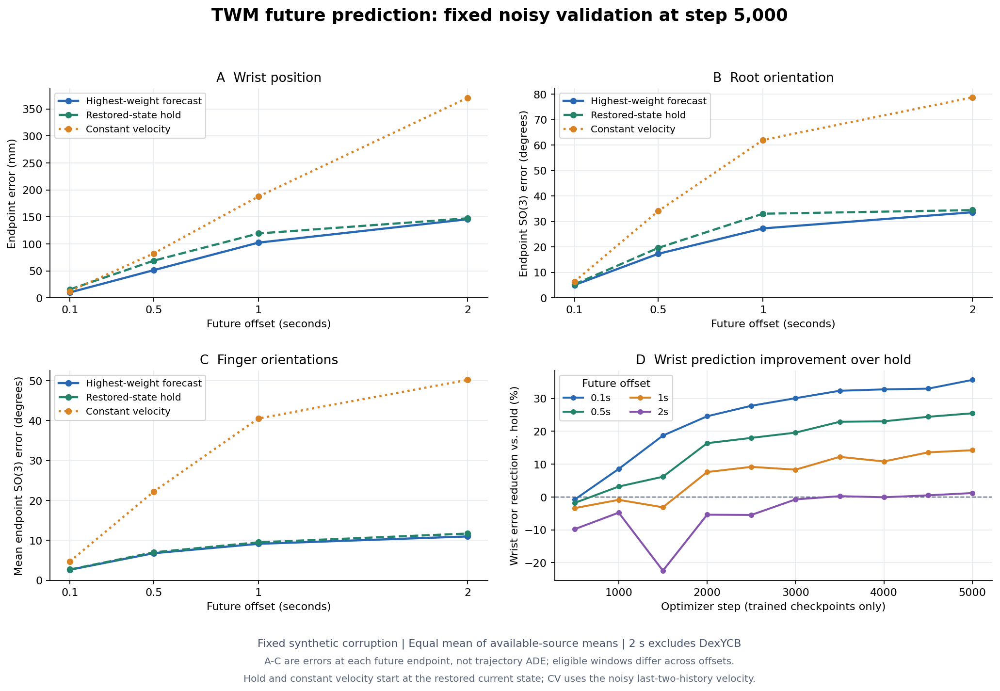

# D37未来轨迹预测：5,000步固定验证

2026-10-15 20:09UTC（纽约16:09）读取已有记录；训练快照5,150/10,000步、phase=training，最新完整验证5,000步（20:02:26UTC）。仅远程CPU汇总和绘图，没有模型推理、训练配置修改或暂停。

结论：0.1–0.5秒的腕位置预测有收益，1秒还有中等收益；2秒平均接近保持当前状态，分库收益不一致。低运动幅度窗口误差高于hold，手指预测收益明显小于腕位置。当前证据不足以称为稳定的长时动作预测。

## 协议、模型和指标

沿用[D37启动协议](TWM_TRANSIENT_10K_RUN_2026-10-15.md)：训练源码`87a2bcce50eb01075e6f5e6959ec536e26f1be58`，13,530,032参数，四库完整遍历循环、每卡512/global1024。输入30帧轨迹历史与受损当前状态，不读RGB或未来GT；输出当前99D及4个整段未来分支，最多60步、按真实秒偏移查询。shape beta10另存、conditioning关闭。模型以当前恢复为主任务，未来是辅助目标；best checkpoint按当前加权几何score选择，不按未来预测指标选择。

参考为各源拟合MANO；保持原recording-disjoint split、每源固定256个val窗口，合成扰动，四源等权。腕位置米制存储、报告mm；root/finger为SO(3)角误差，finger取15个局部关节旋转平均。这些不是joint/mesh MPJPE或独立传感器精度。坐标、单位、数据划分、manifest/config/逐源码hash见[预测摘要](../reports/twm_forecast_progress_20261015_2012.json)及[前一轮当前恢复报告](TWM_TRANSIENT_10K_PROGRESS_2026-10-15.md)。

下表的0.1/0.5/1/2秒是**该未来时刻的点误差**：取最近有效时间戳，容差不超过当前dt的0.6倍。不是从0到该时刻的整段ADE。模型轨迹是权重最大的整条分支，字段虽叫`map`，不是混合均值或用GT挑选的分支。hold和常速度都从恢复后的当前状态出发；常速度取最近两帧因果填充后的受损观测历史，可能放大噪声。

## 普通噪声：各时域与基线

| 未来时刻 | 模型腕 mm | 保持当前腕 mm | 常速度腕 mm | 模型相对保持下降 |
|---|---:|---:|---:|---:|
| 0.1s | 10.116 | 15.717 | 12.341 | 35.6% |
| 0.5s | 51.376 | 68.938 | 82.379 | 25.5% |
| 1s | 102.369 | 119.369 | 187.829 | 14.2% |
| 2s | 145.775 | 147.556 | 370.846 | 1.2% |

| 未来时刻 | 模型root / 保持 / 常速度 ° | 模型finger / 保持 / 常速度 ° |
|---|---:|---:|
| 0.1s | 5.067 / 5.359 / 6.428 | 2.624 / 2.684 / 4.710 |
| 0.5s | 17.321 / 19.638 / 34.109 | 6.772 / 6.984 / 22.188 |
| 1s | 27.288 / 33.061 / 62.014 | 9.120 / 9.500 / 40.521 |
| 2s | 33.633 / 34.480 / 78.744 | 10.975 / 11.695 / 50.205 |

1秒root相对hold下降17.5%，finger只下降4.0%；2秒腕和root收益均很小。常速度长期外推误差很大，但击败这一带噪基线不独立证明长时预测强。

## 分库与窗口覆盖

| 来源 | 0.1 / 0.5 / 1 / 2秒有效窗口 | 1秒模型 / 保持腕 mm | 2秒模型 / 保持腕 mm |
|---|---|---:|---:|
| DexYCB | 256 / 177 / 82 / 0 | 143.959 / 188.788 | 无有效窗口 |
| HOT3D | 256 / 227 / 193 / 126 | 119.081 / 124.243 | 205.257 / 204.167 |
| OakInk2 | 256 / 253 / 252 / 245 | 61.530 / 81.350 | 123.413 / 140.420 |
| UmeTrack | 256 / 245 / 239 / 219 | 84.906 / 83.095 | 108.655 / 98.083 |

2秒只对三源等权宏平均，1秒四源、且有效窗口不同。因此上述跨时域数字不是同一组样本的误差增长曲线；只在各自同一时域内作模型/基线比较。2秒宏平均的小收益掩盖了HOT/Ume退化与Oak改善，不能概括所有来源均获益。

## 干净历史、运动分组

完全干净输入时，模型/hold腕误差分别为0.1s **7.467/14.907mm**、0.5s **46.931/68.625mm**、1s **96.534/119.162mm**、2s **141.923/147.422mm**；2秒收益仍只有3.7%。0.1s腕常速度7.422mm还略优于模型7.467mm。由此可见，长时局限不能仅归因于受损输入；未做机制消融，不进一步断言具体原因。

普通噪声按未来运动幅度分组：

| 分组 | 模型 / hold腕ADE mm | 模型 / hold root平均角误差 ° | 模型 / hold finger平均角误差 ° |
|---|---:|---:|---:|
| moving | 88.381 / 104.092 | 24.280 / 27.402 | 8.451 / 8.912 |
| low_motion | 6.228 / 5.114 | 2.900 / 2.478 | 1.819 / 1.781 |

此处是每源汇总该分组所有有效未来点取平均，再对有该指标的源等权平均，非先每窗平均，也非特定时刻误差。moving定义为该窗有效未来内，腕相对干净当前最大位移≥20mm或手指平均旋转变化≥10°；low_motion不等于严格静止，纯root旋转仍可能落入该组。低运动组的三项指标均不如hold，尚不能稳定保留低运动状态；训练日志没有保存此分组样本数，本轮不编造比例或统计显著性。

## 多模态与不确定性

普通噪声最高权重轨迹的腕ADE为75.625mm（所有有效future点加权），GT从4分支中挑最好整段的oracle minADE为47.452mm（先每窗平均再选分支，之后按窗平均）。两者权重不同，不能把差值全部解释为模式选择失误；oracle也不能当部署精度。需要匹配窗口权重的分支诊断或单模态对照，才能量化多模态的实际价值，本次尚未做这些模型评测。

轨迹混合权重平均熵1.315nat，四分支上限ln4约1.386；权重较分散并不能证明分支合理、多样或无塌缩，它也不是MoE路由熵。

标称90%的未来xyz逐坐标边缘区间覆盖95.09%；混合分布xyz三轴std的均值在1s为94.620mm、2s127.241mm，对应mode内std86.346/114.935mm。较高覆盖伴随较宽区间，不能仅看覆盖率就说不确定性精确；这不是三维联合90%、整轨迹联合90%或旋转覆盖。

## 随训练的变化

| 更新步数 | 1秒模型腕 mm | 2秒模型腕 mm | future NLL / DoF |
|---:|---:|---:|---:|
| 1,000 | 120.901 | 155.019 | -2.6683 |
| 2,000 | 110.310 | 155.744 | -2.7540 |
| 3,000 | 109.566 | 148.871 | -2.8100 |
| 4,000 | 106.587 | 147.831 | -2.8658 |
| 4,500 | 103.236 | 146.895 | -2.9132 |
| 5,000 | 102.369 | 145.775 | -2.9388 |

预测仍在改善，长时点改善已较慢；不外推剩余训练必然取得多少收益。NLL是整轨迹共享mode的混合似然，按51×有效步数归一，负值正常，不能拿它代替mm/角误差或跨坐标密度单位随意比较。

## 产物与范围

Run：`/sciclone/data10/jchen57/Hand_Reconstruction/runs/twm_four_sources_moe_transient_v3_b512_10k_20261015`；分析产物`evaluations/twm_forecast_progress_20261015_2012/{review.json,curves.png}`。仅读取已保存`latest_validation.json`、`train.log`和metadata/status，校验所有报告future字段的可用源等权聚合、各训练点noisy/clean的分源时域计数一致；源码为[汇总脚本](../scripts/review_twm_forecast.py)与[绘图脚本](../scripts/plot_twm_forecast_review.py)。没有把新的分析脚本同步进正在训练的源码worktree。

这是一段观测历史后一次性预测完整未来的open-loop评测，不输入未来GT、不逐未来帧获得新图像，也不是自身输出不断回灌的闭环。未做真实HaWoR条件、独立MoCap精度、同一2秒公共窗口总体、更多随机种子或置信区间验证；当前结论仅适用于这组固定合成validation，训练按原10k配置继续。
