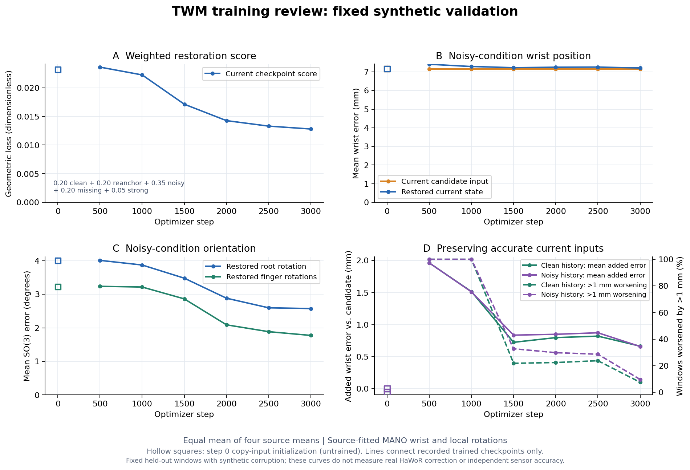

# D29：当前恢复、MoE 与长轨迹概率预测

**最新D34：** 用户要求每卡512、global1024、重新从头跑10,000步。旧D32已保存停止3,110步；7d53fa4新run在02:09:50UTC启动，实际训练/checkpoint/W&B验收已通过。当前执行见[文末D34](#d34每卡512从头训练10000步)，原架构与D33视觉讨论保持。

**D32启动历史（D34已暂停3,110步）：** 用户已要求按混合设置跑起；新run `twm_four_sources_moe_mixed_v2_20261015` 已通过双卡训练/checkpoint/W&B验收，旧D29/D28仍暂停。该次执行见[文末D32](#d32混合有界噪声训练已启动)，下文D29是架构与启动历史。

**随后D31暂停（00:36:36UTC）：** 用户要求先停当前训练，架构在另一聊天修改。已共同保存停止814步，latest814/best500原件与额外快照SHA一致，模型/AdamW finite、两rank hash一致；STOP保留不自动resume。[暂停核验](../reports/twm_moe_pause_20261015.json)、[混合训练建议](TWM_DIRECT_REFINEMENT_PROPOSAL_2026-10-14.md#9-d31先暂停混合干净轨迹与适量受损条件)。下文配置与运行快照为D29历史，不表示当前仍在跑。

日期：2026-10-15（UTC）。用户明确要求修改模型并启动训练：同时恢复当前受损手状态、预测较长未来轨迹、加入 MoE、由实现者选择时间编码，并接入在线 W&B。这里区分用户决定、源码事实、工程起始配置与实际运行结果。

## 决定与替代范围

D29 替代旧模型“仅预测 +3 帧单点、无 MoE、无输出分布”的执行设计；此前不增加 MoE 的默认约束在本次明确授权范围内被替代。保留当前恢复主任务、纯轨迹输入、99D 接口、raw/candidate/history 分离、四库 split 与源标签约定。TWM 仍不接收图像、RGB features 或机器人 action；本次没有实现视觉纠错闭环。

D28 暂停的旧双卡 run 与 checkpoint 保留，不自动恢复。新架构从头初始化，使用独立目录；不是把旧 checkpoint 无声迁移到不同目标。用户提出长预测有助于学习动态、MoE 有助于性能，是本次设计动机，收益须通过实验验证。

| 项目 | 旧四库结构化 Mamba | 本次源码与配置 |
|---|---|---|
| 当前恢复 | 99D，确定性均值 | 保留 99D 均值，增加平移尺度与旋转 concentration |
| 未来 | +3 源帧的一个状态 | 接下来最多 60 个连续源帧，约 2 秒；4 条带概率的完整轨迹 |
| 时序结构 | 6 个关节 Mamba blocks | 保留；每 block 后增加 4 个 dense MLP experts；另有未来 latent Mamba decoder |
| 时间 | relative time、dt、log1p(dt) MLP | 保留三项并增加物理秒的多频 Fourier features |
| 参数 | 6,330,892 | 远程实际 13,530,032（旧模型约2.14倍） |

源码：[模型](../src/handloop/models/probabilistic_twm.py)、[结构编码器](../src/handloop/models/structured_mamba.py)、[未来窗口](../src/handloop/data/forecast_trajectory.py)、[训练](../scripts/train_probabilistic_twm.py)、[配置](../config/twm_four_sources_moe_long_horizon.json)、[启动器](../scripts/ds_train_probabilistic_twm.py)、[W&B helper](../src/handloop/tracking.py)。

## 输入、主干与未来解码

每手状态为 wrist p3＋root rotation6D6＋15 个 finger rotation6D90；beta10 另存。6D 编码采用旋转矩阵前两列逐列展开。16 个 anatomical tokens 顺序为 wrist、index1–3、middle1–3、pinky1–3、ring1–3、thumb1–3；17 个 availability groups 分别对应平移与 16 个旋转。

历史 geometry9＋availability2＋quality2＋quality-known2 投影到 256D；当前 token 联合 raw9、candidate9、双方 availability 各 2、原始 quality2 与 known2，共 26D。joint ID、handedness、parent/finger/depth embedding 与时间信息加入特征。beta conditioning 本轮关闭，源 beta 与 validity 仍保留。

编码器为 6 blocks、d256、同帧 4-head attention、FFN512、官方 Mamba `d_state=64, d_conv=4, expand=2`；dropout0.1。每个 block 依次为 pre-LN 同帧关节 attention residual、pre-LN dense FFN residual、pre-LN 逐关节因果 Mamba residual，再接 dense expert mixture。不存在/补齐的历史帧在编码前移除，真实缺失状态以 availability 表示。每次调用重算窗口，不维护跨调用 SSM cache。

MoE 对每个 token 的归一化时序特征计算 4-way softmax，并加权 4 个独立的 256→512→256 GELU MLP，最后 residual 更新。**所有专家都计算，不是 sparse top-k**。路由不读取 dataset ID 或未来标签；它是否学到有用的动作专门化须检查负载与消融，不能由 gate 权重命名推断。每层分别计算负载均衡正则，防止相反的塌缩层在平均后看似均衡。

当前恢复头输出 p3 与 16×axis-angle3，共 51D 更新；平移缩放0.1m、旋转缩放0.5rad，再左乘 SO(3) 增量。恢复头零初始化，因此初始当前均值等于合法化 candidate。

未来解码先平均池化 16 个当前 joint features，叠加 4 个 mode embeddings 与每个未来物理时间的 encoding，形成 `[B×4,60,256]`。一层因果 latent Mamba＋FFN 解码时间，再通过 64D joint features 生成每关节速度与分布参数；不再为全部 `[B,4,60,16,256]` 建第二个大主干。未来 GT 不进入编码器或 decoder，不使用 future-state teacher forcing。

未来腕平移按 `p_f=p_(f-1)+v_f Δt_f` 累加；16 个旋转逐步左乘 `Exp(ω_f Δt_f)`，实现用归一化 quaternion products 保留不对易增量顺序。平移与 root 使用 noisy-history wrist anchor 坐标，finger 旋转保持局部 parent frame。速度头的0.5m/s、3rad/s是输出缩放，**不是物理速度上限**。

`forecast_modes` 为 `[B,4,60,99]`；`mixture_weights` 为 `[B,4]`，同一 mode 对整段固定。兼容输出 `forecast` 选概率最高 mode 的均值轨迹，不逐帧拼不同 mode；这不等同于求整个混合密度的全局 MAP。

## 物理秒时间编码与未来 mask

实际输入为 `[relative_seconds, dt, log1p(dt), sin(2πνt), cos(2πνt)]`，配置频率 ν 为0.25、0.5、1、2、4、8Hz，经 MLP 投影256D。历史相对当前为负时间，当前为0，未来为正 offset；源实际时间戳优先，不把帧号统一假设为同一 FPS。Fourier 提供多尺度特征，线性时间项避免仅用周期函数表达时间；该频带选择是待验证工程起点。

历史30帧，window stride4，最少保留3个有效未来帧；因此不因强制完整2秒未来而丢掉短 DexYCB clips。60帧是在现有约30Hz准备下的名义2秒，真实 offset 由源时间决定。

未来有效性是连续 prefix，在首个 timestamp gap 或序列边界截断；不跨 gap、不插值、不重复尾帧生成 GT。无效目标填 p0/rotation identity、GT mask false；仅 query 时间按最后有效间隔继续，使60个 query 有限且递增。NLL、几何、速度与指标均使用 `future_valid`。这些补齐 query 不代表新增观测。

loader 在初始化时只读 timestamps 审计每库每步有效窗口数，以及能到达0.1/0.5/1/2秒的窗口数，保存于 `run_metadata.json` 的 `train_forecast_contract` / `val_forecast_contract`。覆盖审计按末次有效 offset≥目标秒数计算；验证选时刻使用最近有效帧，容差为当前 dt 的0.6倍，二者定义不同，须分别报告。

## 输出概率与数学定义

状态分布定义在 `R³ × SO(3)^16`，局部维度51；没有把冗余99D编码当独立 Gaussian。给定均值状态 μ，每个 xyz 分量为独立 Normal，16个旋转分别使用 isotropic matrix Fisher：

\[
q(S\mid\mu,\sigma,\kappa)=\mathcal N(p;\mu_p,\mathrm{diag}(\sigma^2))
\prod_{j=0}^{15}\frac{\exp[-\kappa_j(3-\mathrm{tr}(M_j^\top R_j))]}{Z(\kappa_j)}.
\]

其中旋转以 unit Haar measure 为基准，`3−tr(MᵀR)=||M−R||²_F/2`。均匀旋转的 principal angle θ 密度为 `(1−cosθ)/π`，因此本项目各向同性特例有：

\[
Z(\kappa)=\frac1\pi\int_0^\pi e^{-2\kappa(1-\cos\theta)}(1-\cos\theta)d\theta
=e^{-2\kappa}[I_0(2\kappa)-I_1(2\kappa)]
=\mathrm{i0e}(2\kappa)-\mathrm{i1e}(2\kappa).
\]

代码以 float64 scaled Bessel difference 算 log normalizer，结果回 float32；避免直接指数溢出与高 concentration 下的抵消误差。一般 matrix Fisher 与 NLL 先例见 [Mohlin 等，NeurIPS2020 §3](https://proceedings.neurips.cc/paper/2020/file/33cc2b872dfe481abef0f61af181dfcf-Paper.pdf)；上述各向同性简化是本项目选择，不把原论文关于自由矩阵参数的凸性结论套到整个网络。

xyz σ clamp 至 `[0.001,1]m`，当前初值0.05m、未来0.10m；κ clamp `[0.1,10000]`、初值40。大κ时局部角度单轴 std 约 `1/sqrt(2κ)`，κ本身不是角度 std。输出 scales 是学到的 aleatoric uncertainty，没有 ensemble epistemic 保证，也未完成经验校准。

整段未来使用单一 categorical mode：

\[
p(Y_V\mid X)=\sum_{k=1}^{4}\pi_k(X)\prod_{f\in V}q(Y_f\mid\mu_{kf},\sigma_{kf},\kappa_{kf}),
\quad L_{future}=\frac1B\sum_i\frac{-\log p(Y_{V_i}\mid X_i)}{51|V_i|}.
\]

先按有效帧求和，再对 modes 做 `logsumexp(logsoftmax(logits)+component_log_prob)`，最后除51×有效帧数；不能先平均 component log-prob 再当作同一概率。给定 mode 后的时间/关节误差独立是明确近似，均值则由共享 causal decoder 和积分耦合。NLL 值依赖平移单位、Haar 基准与归一化，允许为负，不与旧回归 loss 直接比较。

## 数据、扰动与训练起始配置

沿用[四库执行协议](TWM_FOUR_SOURCE_RUN_2026-10-14.md)的 prepared collection、decoder provenance 与 recording-disjoint splits：

| 来源 | 保留的训练/验证边界与标签事实 |
|---|---|
| OakInk2 | 官方431 train/39 val；157 test不读取；源 MoCap MANO参考；frame_id/120 stride4 |
| HOT3D | 已下载有效 train Aria/Quest3；排除 HaWoR27评测来源；209/23父录制内部划分；真实ref_timestamp_ns |
| UmeTrack | real train，37/4 subjects；synthetic/test不纳入；frame_id/30名义时间，MANO/native availability分开 |
| DexYCB | 官方s0 800/40/160；固定serial836212060125；不读test labels；拟合MANO，camera frame |

仅完整17组 MANO参考进入本 trainer；native/raw joints 不被补造为99D GT。源解码/FK一致性不等于独立传感器精度；四库不能笼统宣称同等级 glove 真值。源 beta 约定仍有差异，`condition_on_beta=false` 是保留的工程隔离，不是已解决 shape harmonization。

采样为库间等概率、库内窗口均匀、有放回，两 rank 独立 seed；保留旧腐蚀与 anchor：mixed15% clean/40% missing/45% noisy；非clean历史加4mm/1.5°分量噪声，当前25mm/root12°/finger8°，10%非clean整体噪声×3；missing含20%逐组、50%整指及10%整手事件，允许重叠。quality为合成提示并含假高值/未知值，非已校准视觉误差。

总目标为：

\[
L=L_{restore}+0.05L_{current\ NLL}+0.3L_{future\ NLL}
+0.2L_{best\ trajectory\ geometry}+0.05L_{velocity}+0.01L_{MoE\ balance}.
\]

`L_restore` 保留 SmoothL1(p/0.05m,beta0.5)＋2×root chordal＋finger chordal均值。当前 NLL 除51。future geometry先对每条完整有效轨迹求平均，再选最佳 mode，不逐帧选mode。速度监督为相邻 GT 的平移差/Δt 与 SO(3) log差/Δt；按 detached trajectory responsibilities 加权，平移/角速度残差分别以0.5m/s、4rad/s归一化后 SmoothL1。均衡项为每层 `4Σ_e load_e²−1` 再平均。加入几何/速度等目标后，这是多任务优化，不能称纯 MLE。

以上 loss 权重、四个 modes/experts、频带、预测时域均是用户方向下的工程起点，尚未通过消融证明最佳。配置计划50,000步，AdamW lr2e-4、warmup500、cosine至0.1倍峰值、weight decay0.01；Mamba `_no_weight_decay` 参数保持0。BF16网络、FP32几何/损失、梯度clip1与非finite拒绝保留。

配置当前 global batch512 / 每卡256、两GPU；**已通过新模型远程 smoke/显存检查并正式采用**；每卡256的3更新短探针为230.4 samples/s，peak allocated31.85GB/reserved32.47GB，排除loader/DDP，非稳态或全局最优结论。验证batch32×最多8批/库；每500步验证、100步保存、10步记录。`stop_before_utc=2026-10-15T16:25:00Z` 触发共同保存退出，早于现有Job预期时限；50k是计划，不保证本次 allocation 内完成。

## 评价与 W&B

验证分别报告 noisy/missing/clean；当前比较 candidate、history hold、restored 的 wrist mm、root/finger geodesic degrees。future比较最高概率mode、restored-state hold、历史末两帧常速度外推，按0.1/0.5/1/2秒报告实际 eligible count；这些指标不是 MPJPE，也没有运行真实 HaWoR。

`forecast_ade` 按全部有效帧加权；`forecast_minade_wrist_mm` 先每个窗口对有效帧平均、再在4个完整mode中取最小、最后平均窗口。因此短窗口权重与 ADE 不同，不能混称相同聚合。跨库总表对有该时域目标的来源等权，缺目标不计零；同时保留分库结果。best checkpoint只按 noisy/missing 当前恢复 loss 的来源等权均值选择，clean仍单列，future未参与best score。

当前 xyz 90%椭球 coverage 用三维 Normal Mahalanobis²≤6.251389；未来用各轴混合 CDF 的 `[0.05,0.95]` coverage，后者是边缘90%而非三维联合90%。当前没有旋转 coverage。平移不确定性分别记录 within-mode与total：`Var_total=Σπ[σ²+(μ−Σπμ)²]`，包含mode均值分歧，不能以component std无权均值替代。

W&B配置 `enabled=true, mode=online, require_online=true, project=handloop-twm`，名称`twm-moe-long-horizon-v1`。仅rank0建run/上传标量，显式entity=`black-ant`，与可写的已有团队一致，`wandb_run.json` 保存id/url用于resume。记录loss分项、NLL、velocity、MoE load/balance、mode entropy、分库/分时域几何误差、coverage/std、吞吐、学习率、梯度及GPU显存；train/val使用显式optimizer_step横轴，允许同一步分别记录。

不上传数据、MANO资产、checkpoint、源码diff或console；凭据使用正常环境/netrc配置，不进入公开config。在线初始化失败明确报错，不将offline伪称可实时check。checkpoint保存在持久远程目录，保存前对两rank完整模型hash一致性审计；resume要求config、manifest与world size一致；换allocation时可显式传`--stop-before-utc 新的带时区ISO时间`（或`none`）更新本次执行deadline，不改模型/数据/损失配置，避免沿用过期deadline后立即退出。该执行参数在正式启动后的源码提交补充，当前运行仍按原16:25UTC deadline。rank RNG保留，但prefetched sampler chunk/loader cursor未保证逐样本精确重放。

## 设计证据与收益边界

- [WestWorld v2 §4.3](https://arxiv.org/html/2603.14392v2)：参考结构化时空分解、MoE与多future queries；本项目不复制机器人action条件，其结果不证明手部增益。
- [MultiPath §3](https://arxiv.org/pdf/1910.05449)：参考整段固定mode的轨迹分布；原方法固定anchors，本项目learned mode embedding，两者训练机制不同。
- [DLow §5](https://arxiv.org/pdf/2003.08386)：人体MoCap采用0.5秒历史→2秒未来，提示多模态与mode averaging问题；不据此宣称手部2秒为最优。
- [SkeletonDiffusion，CVPR2025](https://arxiv.org/html/2501.06035v3)：多样性可能被骨长/jitter伪增益误导；保留几何评价，不能只看平滑/多样性。
- [Time2Vec §4](https://arxiv.org/pdf/1907.05321)：参考线性＋周期时间特征；本项目使用固定频带与dt，不是其learned-frequency实现复刻。
- [DIP §3–4](https://arxiv.org/html/2508.01835v1)：纯运动条件受损恢复已有手部先例，本次保留恢复主任务；不额外加入其依赖contact/物体距离的物理状态标签。

未来意图无观测，长期预测应被视为条件分布而非唯一真值。合法旋转与积分保持几何约束，不证明力/力矩、contact、能量守恒或闭环稳定；scale/NLL可训练不代表已经校准。长预测能否改善当前恢复、MoE能否提升精度、真实视觉校正是否受益，均需相同数据预算与独立GT的消融/闭环评测。

## 实际运行验收

正式run使用用户随后提供的新key：仅存持久data10项目根的`private/wandb_api_key`，权限600、checkout外，启动器从文件读入child环境；未改旧netrc，未写Git或公开配置。新key的API身份与正式online init均通过。原凭据在默认yc-node/个人bioble创建run返回403；只读项目查询定位已有训练使用的black-ant团队，在该团队独立`handloop-twm`项目创建及同步成功。失败记录保留在远程checks目录，不把403当模型故障。

| 项目 | 实测记录 |
|---|---|
| 正式训练代码 | `4798b62af806f582f420849c2b2a64d90c6de884`，从头初始化，未加载旧run/smoke权重 |
| config文件SHA256 | `5a8aeca75bbf14792724e098ba33ad07ded9f2941b07cb9f4575e5ccc83f4041`；resolved config SHA及8份关键源码SHA见JSON |
| 运行环境 | 既有Pod `jchen57-debug-mpd5p`，GPU0/1；独立Torch2.10/cu130＋官方Mamba runtime，新增wandb0.30.0，zhou未改 |
| 模型与batch | 13,530,032参数；2卡，每卡256/global512；32/64/128/256/384单卡完整3更新均finite，256短探针吞吐最高 |
| 概率/因果检查 | unit-Haar SO(3)密度积分最大绝对差4.480e-7，导数差1.035e-7；encoder/future causal与padding compaction最大差0 |
| FP32/BF16/完整mask | 两精度321个parameter张量均有finite梯度、输出合法旋转；修改228个无效future标签后inputs、outputs、完整objective与所有分项最大差0 |
| 双卡smoke与resume | global16，真实四库3步后保存，再严格resume至5步；checkpoint322个model浮点张量/963个AdamW浮点张量finite，CPU hash与两rank相同 |
| 正式checkpoint | 已只读检查step10，Adam step10，322/963个浮点张量finite；模型SHA `303f23ae189a3c46e819324ba2233ddccf92599f3a06e1a7564f6b57fdeafc3d` 与两rank一致；不与更晚running步数混用 |
| 正式启动 | 2026-10-15 00:19:13 UTC（纽约10-14 20:19），launcher4034/ranks4039/4040 |
| 运行快照 | 2026-10-15T00:22:37.091785+00:00：step120、四源累计61440样本；loss/grad finite，双卡实际更新，尚非50k完成 |
| W&B服务器验证 | [正式run943f9c0c](https://wandb.ai/black-ant/handloop-twm/runs/943f9c0c)，API state=running，server optimizer_step=110，已收到train/loss、grad与初始validation标量 |

正式输出：`/sciclone/data10/jchen57/Hand_Reconstruction/runs/twm_four_sources_moe_long_horizon_20261015`。运行时进度读`status.json`；上述为带时间的验收快照。完整小型记录见[启动JSON](../reports/twm_moe_long_horizon_20261015.json)。远程原始检查在data10项目根`evaluations/moe_long_horizon_checks_20261015`：data_contract.json、batch_probe.json、ddp_smoke.log、ddp_resume_smoke.log、smoke_checkpoint_audit.json、formal_checkpoint_audit.json。模型归一化/因果检查是7126dd8远程stdout，JSON保留其小型数值摘要；不伪称另有原始报告文件。

| 数据源 | train/val窗口 | train/val完整60步标签窗口 | train/val可达1秒窗口 | train/val可达2秒窗口 |
|---|---|---|---|---|
| oakink2 | 346860/27728 | 334558/26616 | 341036/27210 | 334558/26616 |
| hot3d | 132008/15240 | 65950/7620 | 101166/11684 | 51528/5600 |
| umetrack | 151390/18008 | 126567/15125 | 139478/16628 | 126567/15125 |
| dexycb | 6352/394 | 0/0 | 1263/124 | 0/0 |

HOT3D的60帧offset有微小时间抖动，因此完整60步计数与严格“达到2秒”计数不同；固定验证最近帧容差另见前文。Dex本准备中train最大1.5秒、val最大1.433秒，没有2秒监督，不能报告Dex2秒GT误差；模型仍输出60个queries，尾部不进入loss。四库验证各固定256窗口、noisy/missing/clean独立固定RNG；新协议不是旧dense评测的3466固定窗/61370全量窗，不将二者直接当公平容量消融。

## D32：混合有界噪声训练已启动

用户在D31讨论后明确要求“按照你目前的设置，跑起来”。本轮实际模型架构仍为13,530,032参数的6层结构化Mamba＋4个dense experts、当前99D恢复＋4模式×60步分布；没有发现随后落地的其他架构改动，因此仅接入用户刚采纳的训练输入方案，保持原四库GT/split、β另存/conditioning关闭、未来mask与loss权重。旧D29已暂停814步、旧D28暂停32,783步，其STOP和checkpoint均保留。

### 实现与配置

- 实际训练源码`0d83a5478bc261fe138c43b109f7621206d34e4a`；[sampler](../src/handloop/data/corruption.py)、[active profile](../config/twm_corruption_mixed_v2.json)、[训练配置](../config/twm_four_sources_moe_mixed_v2.json)、[接入](../scripts/train_probabilistic_twm.py)。原sample_batch及D31 proposal文件保留，legacy评测显式选择，不无声改旧实验。
- 输入混合20%全净、20%当前准确/近准而历史中噪、35%当前轻/中与历史准确/轻/中独立、20%局部缺失、5%局部强异常。具体范数/角度范围沿[讨论§9](TWM_DIRECT_REFINEMENT_PROPOSAL_2026-10-14.md#9-d31先暂停混合干净轨迹与适量受损条件)，是用户采纳的起始配置，仍非最优或HaWoR标定结论。
- 位置按实际三维范数、旋转按SO(3)总角采样，方向归一化；约一半独立、一半按真实dt的OU相关方向，latent τ0.1–0.3s。quality可用部分为unknown，missing另由availability表示。所有监督GT/future不加噪，future状态不参与输入。
- profile的完整解析内容和原文件SHA进入resolved config、run metadata与checkpoint；active profile SHA=`6ad627319fc09b2651c89f9d562e0909e4ba82429127524e4a9f6c959b3e3518`。现有strict resume校验包含它，后续改profile需显式新实验，不覆盖原协议。
- 工程选择**新run从头训练**，不将已暂停814步的旧目标训练状态冒充新分布的精确resume。global512/每卡256、原AdamW与50k计划不变，16:25UTC共同保存早于现有Job16:37UTC到期；本allocation可能无法完成50k，不自动重建Job。

### 分层验证与best选择

每库固定最多32×8=256窗口，四库初始验证均256；12种条件为noisy、missing、clean、reanchor、light_clean_history、light_noisy_history、medium、strong、history_only与三种legacy。noisy/history_only使用同seed、同历史与anchor，只移除当前输入；reanchor为准确当前＋中噪历史，独立于clean-clean。

best score按当前恢复loss的clean/reanchor/noisy/missing/strong以0.2/0.2/0.35/0.2/0.05加权。这里固定reanchor只用clean当前，不等于mixed训练内clean/near各半的精确风险估计；未来、准确输入退化和其他诊断仍单列，best不代表所有指标赢家。新增每库腕/root/finger p50、p95和腕误差增加>1mm比例，四库宏平均分位数不能称总体分位数。

legacy保持原强噪、质量提示和anchor过程，作为历史压力参考；新旧评测batch/RNG切分及quality条件不同，不能直接把更轻输入产生的更低误差当作模型提升，更不能与真实HaWoR MPJPE拼表。未来时域、MAP/GT挑选minADE、有效样本数等D29口径保留。

### 远程验收与实际启动

所有Torch运算均在原Pod的项目runtime Torch2.10/cu130执行；本机仅源码、JSON/AST和文档。原始检查在data10项目根`evaluations/twm_mixed_v2_checks_20261015`，小型摘要为[启动验收JSON](../reports/twm_mixed_v2_20261015_launch.json)。

| 项目 | 实际记录 |
|---|---|
| 合成语义 | 4096窗通过真实几何界、同seed、源不变、future不泄漏、当前准/历史错、局部异常、missing因果fill、unknown质量和物理dt相关性；实际五类19.75/19.65/34.79/20.95/4.86% |
| 双卡smoke | `runs/twm_moe_mixed_v2_smoke_20261015_v1`，global512三次AdamW更新、12模式初始验证完成，四库与五类均参与，loss/梯度finite；峰值allocated约32.09GB/卡，非最优batch或稳态吞吐结论 |
| smoke checkpoint | step3，模型322/AdamW963浮点张量finite，CPU完整模型hash与两rank一致 |
| 正式启动 | 00:54:45 UTC（纽约10-14 20:54），launcher4496、ranks4501/4502，GPU0/1；独立新run从头 |
| 正式运行快照 | 00:57:06UTC实际50步，四源累计25,600样本：Dex6320/HOT6403/Oak6425/Ume6452；loss=-0.3916746、原始grad norm1.146734，均finite |
| 正式五类抽取 | clean5044/reanchor5160/ordinary9001/missing5098/strong1297，合计25,600；这是本次进程计数，resume后重计，不是跨checkpoint终身累计 |
| 正式checkpoint审计 | 检查的是step10，模型322/AdamW963浮点张量finite，Adam step10，两rank完整hash与CPU一致，SHA=d4255a88873b51248d9811575fef5a70e951446e17ab9c96c2f1e7639c12be10；不混为更晚step50权重检查 |
| W&B服务端 | [cd487764](https://wandb.ai/black-ant/handloop-twm/runs/cd487764)，state=running，已收到optimizer_step40及train/loss、grad；不是仅生成URL或offline |

正式目录：`/sciclone/data10/jchen57/Hand_Reconstruction/runs/twm_four_sources_moe_mixed_v2_20261015`。D32启动时helper默认曾指此run；D34后默认已指另一新run，查询此历史run须明确output。每100步checkpoint、500步验证、10步记录；私有W&B key仍只在远程600文件经child环境传入，不进入Git/config。本段为D32启动快照；随后D34已STOP保存本run，不恢复。

以上证明新混合数据路径和实际训练已跑通，**尚无训练后最终精度、同架构噪声消融、真实HaWoR纠错或物理正确性结果**。初始validation为step0，不能把零初始化的准确输入保持当成训练后验收。

## D34：每卡512，从头训练10,000步

2026-10-15UTC（纽约10-14），用户要求查看约3k步训练、把每卡batch翻倍到512，重新跑10k。此次只替代D32执行配置，不改变D33视觉侧反馈讨论、纯轨迹任务、模型或数据。新权重与AdamW从头初始化、新W&B；不从3,110步续训。

### 旧曲线、停止与保留

分析直接读取旧run记录的固定validation，重算每个checkpoint的加权当前恢复score，**没有用best-so-far冒充收敛曲线**。每模式每库256窗，四库等权宏平均；wrist为源MANO腕位置欧氏距离mm，root/finger为SO(3)测地角度。step0的准确当前输入来自零初始化copy-input，图中空心点单列，不当成训练收益。

| 优化步 | 加权恢复score | noisy腕mm | noisy root° | noisy finger° | clean腕退化mm | reanchor腕退化mm |
|---|---|---|---|---|---|---|
| 1000 | 0.022255 | 7.287 | 3.871 | 3.215 | 1.515 | 1.511 |
| 2000 | 0.014270 | 7.250 | 2.882 | 2.089 | 0.796 | 0.848 |
| 3000 | 0.012810 | 7.210 | 2.573 | 1.773 | 0.663 | 0.658 |

1k→3k的score下降约42.4%，说明仍在学习，不能仅凭总loss未到0判断未收敛：目标含可为负的NLL。noisy腕输入固定为7.158mm，3k输出7.210mm，尚未纠正腕位置；加大batch/步数是否解决仍须实测。3k的clean/reanchor超过1mm退化比例分别7.52%/9.67%；missing腕3.068→3.233mm，strong腕18.422→18.482mm。noisy未来1s MAP腕112.304mm，restored hold120.156mm、常速度240.424mm；不是最终精度或真实HaWoR评测。

旧D32于02:02:24.032654UTC共同保存停止3,110步，两rank4501/4502退出，launcher僵尸不当活跃训练。latest的322个model/963个AdamW浮点张量finite，CPU完整hash与两rank保存hash一致。原latest/best及额外快照文件SHA一一相同；快照在data10项目根`evaluations/twm_batch512_10k_20261015/previous_snapshots/`。D32/D29/D28的STOP均保留，不自动resume。

### 新配置和启动验收

配置为[twm_four_sources_moe_mixed_v2_b512_10k.json](../config/twm_four_sources_moe_mixed_v2_b512_10k.json)。四库GT、recording split、99D、β conditioning关闭、模型13,530,032参数、混合profile和12条件validation都不变。`batch_size=1024`表示global，两rank各512，目标10,000次优化更新。LR峰值2e-4、warmup500保持，cosine总长度改为10k，末端2e-5，不按batch线性放大LR。目标10,240,000次样本抽取，有放回；这比旧已完成3,110×512=1,592,320抽取多，但不是把旧计划50k延长：旧计划预算25.6M，新预算10.24M。

`benchmark_probabilistic_twm.py`修复了此前没有读取mixed profile的问题：解析并嵌入active profile及SHA，完整更新/未来mask检查均使用相同profile；训练模型源码未改。GPU1实际512样本、3次完整objective/backward/AdamW通过，梯度/模型/optimizer finite，扰乱无效future标签后输入、输出与完整目标差均0；峰值allocated63.482GB（59.12GiB）、reserved64.123GB。这是单卡probe，不当正式吞吐或最优batch结论。

| 启动验收 | 实际证据 |
|---|---|
| 正式代码/时间 | 7d53fa4a1b14f31e08f41ba545556e59adadd31f；02:09:50.156267UTC（纽约22:09），from scratch，无resume |
| 进程 | 原Pod `jchen57-debug-mpd5p`，launcher4672，rank4677/4678，GPU0/1；未创建/删除Job |
| 实际更新 | 02:12:13UTC验收时status20步，20,480抽取：Dex5092/HOT5110/Oak5100/Ume5178 |
| 五类计数 | clean3988/reanchor4143/ordinary7179/missing4148/strong1022，合计20,480 |
| 训练数值/显存 | step20 loss=-0.2482218、未裁剪grad norm7.76085，finite；rank峰值allocated63.916/63.907GB，reserved64.697/64.691GB |
| 保存checkpoint | 单独审计的是step10，322model/963AdamW浮点张量finite、Adam step10；完整模型CPU hash与两rank一致，SHA=e6ce7cbc0dd3b437fe4e6de18b0f47e045e7845aafdb0325eb6a7e8622a314ce |
| W&B服务器 | [12cc0781](https://wandb.ai/black-ant/handloop-twm/runs/12cc0781)，state running、optimizer_step20、loss及grad已收到；不是仅有本地URL |
| 配置/数据审计 | config SHA9fc566ab…；profile SHA6ad62731…、manifest SHAf733aa15…与D32相同；完整SHA见JSON |

新run在`/sciclone/data10/jchen57/Hand_Reconstruction/runs/twm_four_sources_moe_mixed_v2_b512_10k_20261015`。helper默认status/stop已指该run；每100步checkpoint、500步验证、10步记录。执行cutoff仍为16:25UTC，早于原Pod约16:37UTC时限；10k为训练目标，未完成不能宣称完成，不自动新建Job。

小型可复核记录：[启动、旧曲线、有限性与SHA摘要](../reports/twm_batch512_10k_20261015.json)。完整checks在data10项目根`evaluations/twm_batch512_10k_20261015`，含`launch_audit.py`、`formal_checkpoint_audit.json`、`batch512_probe.json`、`previous_run_review.json`及图。权重、原始logs、MANO资产与私有key均不入Git。此次证明训练确实启动且数值/同步正常，未证明已收敛、增加batch有效、真实HaWoR纠错或物理正确。

### D34中途检查：纽约10月15日01:25

训练快照4,180/10,000步，最新完整fixed validation为4k；ordinary/noisy腕7.158→7.180mm、root3.999→2.373°、finger3.224→1.561°。旋转改善但腕位置尚无改善，clean仍引入0.688mm；训练继续，没有改配置。完整同轮曲线、分库/预测/覆盖率及限制见[中途效果检查](TWM_B512_PROGRESS_2026-10-15.md)和[小型摘要](../reports/twm_b512_progress_20261015_0521.json)。

### D34腕位置原因检查：纽约01:37

冻结4,400步、32窗的位置扰动响应和梯度检查见[诊断记录](TWM_WRIST_DIAGNOSIS_2026-10-15.md)。位置读出近似保留输入，非断梯度；输入尺度、mixed的保留当前倾向与future牵制是优先假设。纯轨迹共同bias还有条件性不可辨识边界，但不解释全部独立噪声失败。归一化/current-only对照尚未实施，正式10k训练继续。
