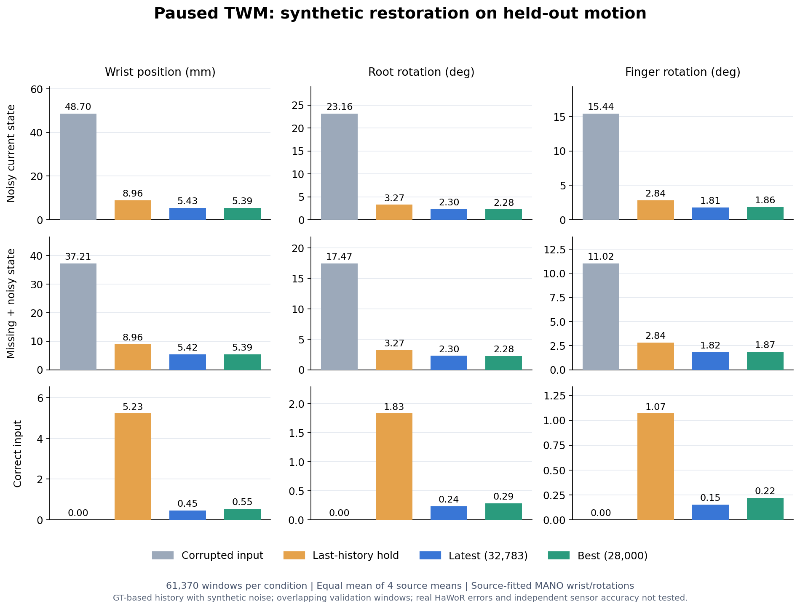

# 四库TWM暂停与冻结checkpoint效果验证

纽约日期2026-10-14。用户要求暂停当前运行、保留checkpoint并先验证效果。本报告只评测D27的**6,330,892参数、六层dense结构化Mamba TWM**，不代表其他并行开发的模型或完整视觉系统。

结论：人工受损状态恢复明显优于直接保持上一历史状态；但当前观测干预显示历史先验占主导，尤其不能在“历史有噪声、当前完全正确”时保留准确当前状态。因此目前只能确认受控轨迹恢复能力，不能认定已实现可靠的视觉当前状态纠错。

## 暂停与产物

通过`ds_train_twm_ddp.py stop`写STOP，两rank在共同边界保存并于23:53:53 UTC（纽约19:53）停止在**32,783步**；训练rank2968/2969退出。原checkpoint与独立快照均保留，模型和AdamW状态finite，2份rank状态存在；没有resume或更新权重。

远程共同根目录`/sciclone/data10/jchen57/Hand_Reconstruction`：

| 内容 | 路径 / 版本 |
|---|---|
| 暂停的原run | `runs/twm_four_sources_structured_mamba_ddp_20261014`，STOP保留 |
| latest | 原run `latest.pt`，step32,783；SHA256 `43d789c5b88c24ea9697790cbf22194bee9c173ac1ac75ae94407f891a31913e` |
| 已选best | 原run `best.pt`，step28,000；SHA256 `b2319b8399bcc8a073d64b1e185aae21e20848136e73871d4ec82a1f97be6298` |
| 冻结快照与评测根 | `evaluations/twm_paused_20261014_v1`；`snapshots/{latest,best}.pt` |
| 具体结果 | 评测根`{latest,best}/{report.json,controls.json}`；`pause_and_launch.json`；`completion_verification.json` |
| 训练源码 | checkpoint均为`10aa98327eeaa3ff0afb49eef1e6ff73879c7d22` |
| 常规评测源码 | `c8e9a8db533233321d27ab3a1d3543f0f60c45ee`，[evaluate_twm_checkpoint.py](../scripts/evaluate_twm_checkpoint.py) |
| 干预/绘图源码 | `9b204935a840112b05cfb6239e94b9e15fab7e26`，[controls](../scripts/evaluate_twm_controls.py)、[plot](../scripts/plot_twm_validation.py) |
| 精简指标、hash与复现证据 | [评测JSON](../reports/twm_paused_eval_20261014.json) |

计算仍在既有Pod与项目Torch2.10/cu130 runtime，两个checkpoint各用一张GPU独立推理，不运行optimizer或backward；绘图使用既有zhou的Matplotlib，只读汇总JSON、不改环境。初次启动包装器因评测父目录不存在在mkdir处失败，未创建快照或启动推理；改为创建父目录后仅启动一次。全部评测进程已退出，00:12:06 UTC（纽约20:12）复核原latest/best与快照hash都未改变，训练仍stopped32,783、STOP存在，GPU无活跃计算进程。

## 协议与证据边界

数据仍用原四库collection，SHA256 `f733aa15cd18ed6f57ee0f16ebdadb3bd0d52924c7d99d08cea988544710b26f`。每手99D为实际wrist p3＋root6＋15×finger6，β另存且conditioning关闭；源GT/split未变。

- 固定验证：每库最多64×16窗；Oak/HOT/Ume各1,024、Dex394，共3,466窗/模式。best step28,000原训练日志中被检查的fixed loss/腕/旋转指标与重算结果最大差**0**，复现通过。
- 全量验证：Oak27,728、HOT15,240、Ume18,008、Dex394，共**61,370窗/模式/模型**；noisy、missing、clean各测一次，两模型使用相同窗口和相同corruption流，paired baseline完全一致。窗口可重叠，属于原内部validation，不是独立test或置信区间。
- 指标：source实际腕欧氏距离mm、root与15个local finger rotation测地角度deg；在共同固定anchor下计算，刚体变换不改变这些误差。不是MPJPE、mesh、native marker真值精度或物理正确性。
- 每库内部按样本平均，再四库等权平均。样本总数是覆盖量；宏平均比例不是全库pooled比例，宏平均p95/median是各库分位数的平均，不是全局分位数。
- 仍为人工corruption及GT加人工噪声的历史；没有真实HaWoR输入、自身预测历史反馈、视觉取证或独立传感器验证。full与fixed选窗不同，不能把两套结果解释成逐帧同噪声对照。

## 全量验证结果

下表为**latest32,783**，四库等权平均，输入是corrupted candidate；hold使用同一输入中的上一历史状态。

| 模式 | 腕mm：输入 / hold / TWM | root deg：输入 / hold / TWM | finger deg：输入 / hold / TWM |
|---|---:|---:|---:|
| noisy | 48.703 / 8.961 / **5.435** | 23.162 / 3.270 / **2.302** | 15.444 / 2.839 / **1.808** |
| missing＋noisy | 37.210 / 8.961 / **5.420** | 17.470 / 3.270 / **2.303** | 11.022 / 2.839 / **1.822** |
| clean，历史也准确 | 0 / 5.232 / **0.454** | 约0 / 1.830 / **0.235** | 约0 / 1.068 / **0.153** |

noisy腕相对人工输入降低约88.8%，相对上一帧保持降低约39.4%；finger相对hold降低约36.3%。这说明收益不只是直接复制上一帧，但尚未比较Kalman、恒速或普通时序网络，也没有证明所有输入中的当前视觉证据都得到有效利用。

latest clean的腕退化均值0.454mm；四库平均**6.89%**窗口比准确输入多出超过1mm腕误差。不能用小均值覆盖这部分退化。

| 来源 | 窗数 | latest noisy腕mm | latest root deg | latest finger deg |
|---|---:|---:|---:|---:|
| OakInk2 | 27,728 | 4.142 | 1.562 | 1.352 |
| HOT3D | 15,240 | 6.129 | 2.542 | 1.693 |
| UmeTrack | 18,008 | 5.693 | 2.236 | 1.866 |
| DexYCB | 394 | 5.775 | 2.867 | 2.320 |

best28,000的全量noisy腕/root/finger为5.389mm/2.277°/1.863°；clean为0.545mm/0.285°/0.219°，clean超过1mm的宏平均比例10.99%。其noisy/missing selection loss均值0.012194，略低于latest的0.012394；latest的平均finger与clean误差更小。两者有取舍，不能将best文件名当作所有几何指标上的统一赢家。

## 关键干预：当前观测是否被有效利用

在同一固定3,466窗、同一noisy历史和同一seed上，比较三种输入；没有读未来状态作为条件：

1. normal：原noisy当前输入及原质量提示。
2. history only：整手当前availability设false、quality0，candidate由上一历史状态填充；仍保留当前时间与手别等非观测条件。
3. correct current / noisy history：当前raw与candidate替换为GT，availability true、quality1，但历史仍有同一份噪声。这是特意提供理想当前观测的诊断干预，非部署可用GT，也不同于训练clean模式中历史同时准确的条件。

| latest32,783诊断 | 当前输入腕误差mm | 输出腕mm | 输出root deg | 输出finger deg |
|---|---:|---:|---:|---:|
| 原noisy当前 | 49.542 | **5.476** | 2.283 | 1.803 |
| 不提供当前观测 | 不适用，candidate hold为9.061 | **5.451** | 2.280 | 1.828 |
| 当前完全正确、历史仍带噪 | **0** | **5.317** | 2.233 | 1.679 |

best对应三项腕误差为5.446、5.434、5.268mm，出现相同限制。controls正常分支与独立fixed评测逐库指标一致，排除换窗口或corruption造成的差异。

这些结果提示：当前模型已学到有用的时序先验，但对可靠当前观测的利用不足，不能保证在历史有误时保留准确当前状态。不能说模型完全不看当前输入：去掉当前后latest输出相对normal仍变化1.123mm、root0.446°、finger0.726°；只是对GT平均误差几乎没有收益。该受控干预也不是训练分布上的普遍风险定理或物理保证的反例。

## 解释与后续边界

代码事实：`sample_batch`中的历史噪声为位置σ4mm、旋转σ1.5°；当前位置σ25mm、rootσ12°、fingerσ8°，10% severe再乘3。clean15%时历史与当前噪声同时清零；quality约0.55–0.95、20%置1及部分unknown，不按真实误差校准。这些设置使历史通常远比当前可靠，可能促成历史主导；这是有代码依据的原因假设，尚未通过改训练与消融证明。

下一步值得复查历史/当前误差的独立组合及可靠性提示，尤其覆盖“当前准、历史错”条件，再验真实HaWoR errors。此轮只报告验证发现，**未改训练目标/架构、未重新训练、未自动resume**。所有原checkpoint与失败/成功记录保留。
