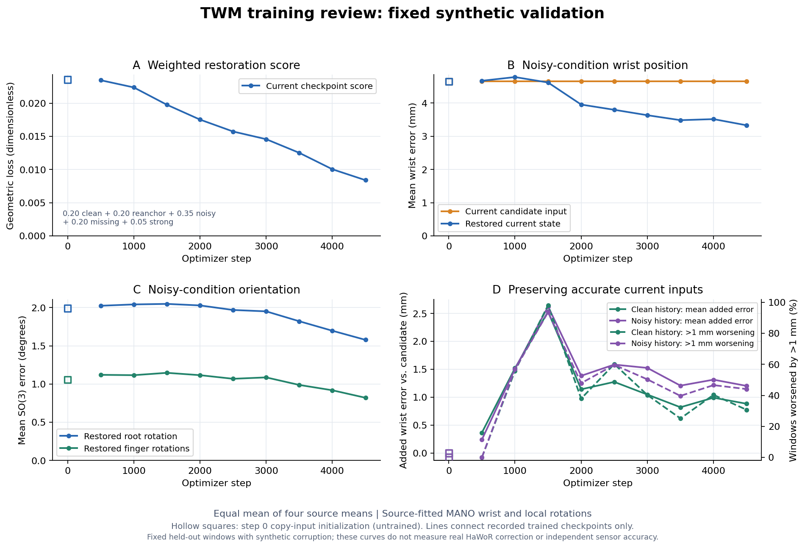

# D37训练中途效果：4,500步固定验证

2026-10-15 19:48UTC（纽约15:48）只读检查。训练快照为4,700/10,000步、phase=training；最近完整验证为4,500步。没有暂停、恢复、改配置或另做模型推理；分析和绘图均在新Pod的zhou CPU环境中读取已有记录。

当前结论：腕位置已学到部分纠错，旋转也开始改善，验证曲线仍在下降；连续异常恢复及正确输入保护仍不充分。不能把这些合成条件下的收益当作真实HaWoR修复或闭环成功。

## 协议与来源

- Run：`/sciclone/data10/jchen57/Hand_Reconstruction/runs/twm_four_sources_moe_transient_v3_b512_10k_20261015`；[W&B a9cb4888](https://wandb.ai/black-ant/handloop-twm/runs/a9cb4888)。训练源码`87a2bcce50eb01075e6f5e6959ec536e26f1be58`，13,530,032参数，每卡512/global1024，完整遍历循环；[配置及启动协议](TWM_TRANSIENT_10K_RUN_2026-10-15.md)不变。
- OakInk2/HOT3D/UmeTrack/DexYCB的recording-disjoint train/val保持；train窗口346,860/132,008/151,390/6,352，共636,610，按自然样本量遍历。验证每源固定256窗、每模式1,024窗，四源等权宏平均；不是按训练样本占比加权。
- 参考为各源拟合MANO，非独立传感器或真实视觉预测误差。每手99D为腕位置＋root rotation6D＋15个finger rotation6D，beta10另存、conditioning关闭；模型不读取图像。腕位置米制存储、指标mm；当前指标在带噪历史腕锚点参考系下计算。root/finger为SO(3)角误差，finger为15个局部关节旋转平均，不能称joint/mesh MPJPE。
- manifest SHA256 `f733aa15cd18ed6f57ee0f16ebdadb3bd0d52924c7d99d08cea988544710b26f`；配置文件SHA256 `7e912b8764a334f36d2691952e42938937514155548efc123c816551912154dc`。resolved配置、实际源码逐文件hash、运行状态、完整14模式及分源指标见[小型摘要](../reports/twm_transient_v3_progress_20261015_1944.json)。
- 远程分析产物：`evaluations/twm_transient_v3_progress_20261015_1944/{review.json,curves.png}`；独立分析源码在同级`*_review.py`，不改正在训练的源码目录。原始依据为run的`train.log`、`latest_validation.json`与`status.json`。

## 当前恢复：输入与输出同时报告

下表为4,500步，单位mm。single/burst/scattered/ramp是完整状态受损场景，可能包含仅手指受损、腕本来正确的窗口；position_burst4才是腕位置专门的四帧事件诊断。

| 合成验证条件 | 当前输入腕误差 | 恢复后腕误差 | 腕误差下降 | 腕退化超过1mm窗口 |
|---|---:|---:|---:|---:|
| 普通混合噪声 | 4.652 | 3.331 | 28.4% | 8.59% |
| 部分缺失 | 7.236 | 3.722 | 48.6% | 9.18% |
| 少量严重异常 | 16.787 | 6.774 | 59.6% | 12.01% |
| 单帧事件 | 5.042 | 2.922 | 42.1% | 8.89% |
| 三帧连续事件 | 5.042 | 3.861 | 23.4% | 13.48% |
| 四帧连续事件 | 5.042 | 4.046 | 19.8% | 13.67% |
| 仅腕位置四帧事件 | 6.520 | 5.244 | 19.6% | 8.79% |
| 三帧分散事件 | 5.042 | 3.475 | 31.1% | 10.35% |
| 四帧渐变事件 | 3.317 | 3.156 | 4.9% | 11.13% |
| 全部干净 | 0.000 | 0.884 | 引入误差 | 30.66% |
| 当前近准、历史受损 | 0.267 | 1.471 | 引入误差 | 44.04% |

普通噪声root **1.990→1.578°**、finger **1.058→0.821°**，三类指标均有改善。干净输入仍引入root0.349°、finger0.160°；当前近准/历史受损时root0.262→0.666°、finger0.258→0.374°。部分缺失的finger也由0.685→0.741°，不能只凭腕位置改善概括为所有状态改善。

普通噪声分源结果：

| 来源 | 腕输入→输出 mm | root输入→输出 ° | finger输入→输出 ° |
|---|---:|---:|---:|
| DexYCB | 4.652→3.810 | 1.990→1.789 | 1.058→0.951 |
| HOT3D | 4.652→3.565 | 1.990→1.626 | 1.058→0.778 |
| OakInk2 | 4.652→2.636 | 1.990→1.318 | 1.058→0.692 |
| UmeTrack | 4.652→3.315 | 1.990→1.580 | 1.058→0.861 |

四源均有普通噪声纠错收益，强弱不同；自然训练量、运动难度和源拟合差异均可能影响结果，尚不能归因为某一个因素。

## 训练趋势

| 更新步数 | 加权当前几何score ↓ | 普通腕 mm ↓ | 普通root ° ↓ | 普通finger ° ↓ | 干净腕 mm ↓ | 位置四帧腕 mm ↓ |
|---:|---:|---:|---:|---:|---:|---:|
| 1,000 | 0.022376 | 4.784 | 2.042 | 1.116 | 1.521 | 6.761 |
| 2,000 | 0.017529 | 3.956 | 2.029 | 1.116 | 1.143 | 6.031 |
| 3,000 | 0.014577 | 3.635 | 1.951 | 1.087 | 1.049 | 5.680 |
| 3,500 | 0.012521 | 3.486 | 1.822 | 0.988 | 0.822 | 5.470 |
| 4,000 | 0.010047 | 3.517 | 1.698 | 0.919 | 0.993 | 5.500 |
| 4,500 | 0.008403 | 3.331 | 1.578 | 0.821 | 0.884 | 5.244 |

3,500→4,500步的score下降32.9%，未见明显验证平台；腕指标有波动，干净保护也没有单调改善。该score是归一化位置/旋转几何误差，并按clean/reanchor/noisy/missing/strong =20/20/35/20/5加权，不是mm，也不等同真实视觉错误分布的风险。图使用每个checkpoint实测score，未以历史best的累计最小值代替。

## 辅助预测及不确定性

普通噪声下，最高混合权重模式的1s腕误差103.236mm，优于从恢复后当前状态保持不动的119.462mm和常速度187.836mm。2s为146.895mm，对应hold147.650mm，差距很小，不能称显著优势；2s root35.014°反而略差于hold34.490°。最高权重模式字段虽叫`map`，实际是argmax mixture logits，不是保证的连续分布全局MAP，也不是GT选取的oracle模式。

未来各时间点只统计有效窗口：1s四源依次Dex82/HOT193/Oak252/Ume239；2s为Dex0/HOT126/Oak245/Ume219，故2s宏平均仅三源，不能把1s与2s当相同样本总体作纵向比较。hold和常速度均从恢复后的当前状态出发，后者速度来自最近两帧观测。

当前腕xyz的标称90%椭球覆盖：普通噪声75.98%，位置四帧事件46.39%，干净100%。说明不确定性仍随条件失配；这些数值不是旋转覆盖或整条未来轨迹的联合覆盖。

## 结论的边界与后续

所有这些验证都读取合成观测历史，不是将TWM已完成输出不断回灌的闭环。burst3/4在每个窗口随机取事件当前相位评一次当前状态，不等于“十步中三/四步异常”的逐帧滚动恢复，更不是只在异常帧上的均值。此前64clip受控漂移诊断尚未在D37复跑。

本轮固定验证0至4,500所有点、14模式的candidate腕/root/finger误差在浮点容差内保持一致；分源宏平均也已重新校验，曲线具有本轮内部可比性。D36两轮与本轮学习率日程不同，D34的噪声/训练采样也不同；不能把跨run差异写成仅噪声修复或仅增加步数的因果效果。

按既有10k预算继续训练，当前仍有下降空间。后续需独立检查受控短片段、正确当前/错误历史、实际HaWoR误差及自身历史回灌；这不是本次已经完成的验证。
