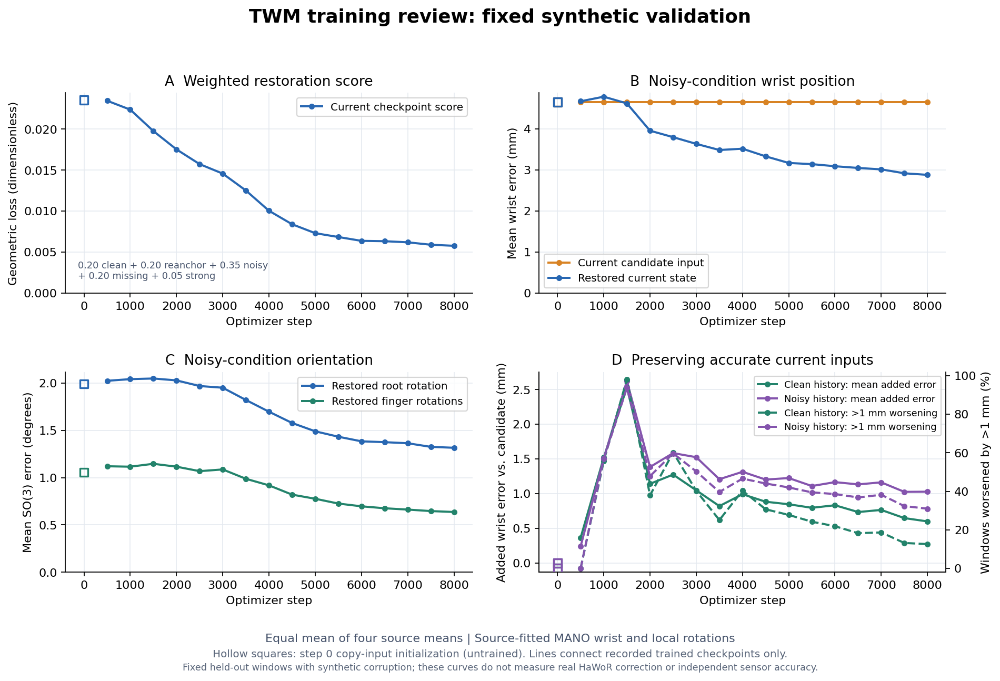
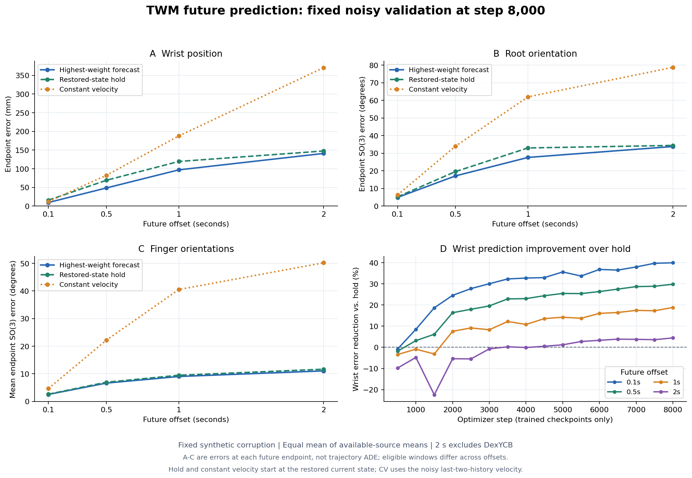

# D37：8,000步完整验证与原配置训练进度

2026-10-15 22:22UTC（纽约18:22）。用户明确损失调整放到下个版本，本次只读检查当前效果；D37保持原六项损失、v3输入、每卡512/global1024及从头10k预算。该延后决定不等于已选择下一版具体loss或启动新训练。

运行状态快照22:22:49UTC：**8,010/10,000步（80.1%）**、phase=training、累计8,198,424次窗口使用。最近完整验证为**8,000步，22:22:19UTC**。当前与未来两份汇总的原始validation文件SHA一致，没有混用不同验证时点。

训练源码`87a2bcce50eb01075e6f5e6959ec536e26f1be58`，13.53M参数；四库train/val、坐标与源拟合MANO参考、99D/shape契约及manifest/config/source hashes和前次一致。每源固定256val窗、每模式1024窗、四源等权宏平均；这不是实际HaWoR错误或独立传感器GT评测。[运行协议](TWM_TRANSIENT_10K_RUN_2026-10-15.md)、[完整小型汇总](../reports/twm_transient_v3_progress_20261015_2220.json)、[当前/未来对照摘要](../reports/twm_progress_comparison_20261015_2220.json)。

## 当前恢复

单位mm；5k与8k使用同一run、固定输入与窗口。

| 条件 | 输入腕误差 | 5k恢复后 | 8k恢复后 | 8k比输入下降 | 8k腕退化超过1mm窗口 |
|---|---:|---:|---:|---:|---:|
| 普通噪声 | 4.652 | 3.170 | 2.881 | 38.1% | 4.30% |
| 部分缺失 | 7.236 | 3.615 | 3.199 | 55.8% | 4.30% |
| 单帧事件 | 5.042 | 2.772 | 2.289 | 54.6% | 4.20% |
| 三帧事件 | 5.042 | 3.725 | 3.136 | 37.8% | 5.96% |
| 四帧事件 | 5.042 | 3.916 | 3.323 | 34.1% | 5.37% |
| 仅腕位置四帧事件 | 6.520 | 5.046 | 4.539 | 30.4% | 3.81% |
| 少量严重异常 | 16.787 | 6.101 | 5.134 | 69.4% | 3.91% |
| 四帧渐变事件 | 3.317 | 3.071 | 2.895 | 12.7% | 4.79% |
| 全部干净 | 0.000 | 0.848 | 0.601 | 引入误差 | 12.60% |
| 当前近准、历史受损 | 0.267 | 1.493 | 1.296 | 引入误差 | 30.96% |

普通噪声root **1.990→1.316°**、finger **1.058→0.637°**。分源恢复后腕为Dex3.417/HOT3.198/Oak2.138/Ume2.768mm，各源都优于4.652mm输入。旋转是SO(3)角误差、finger平均15个局部关节，不是joint/mesh MPJPE。

正确输入保护改善但未解决：4.5k→8k，clean腕0.884→0.601mm，额外退化>1mm比例30.66→12.60%；reanchor比例44.04→30.96%，其腕仍由输入0.267变为1.296mm。部分缺失的finger仍0.685→0.709°轻微退化；position-only事件还引入root0.473°/finger0.128°，不能把腕收益概括为所有状态均改善。

## 趋势与收敛边界

| step | 加权当前几何score ↓ | 普通腕 mm ↓ |
|---:|---:|---:|
| 5,000 | 0.00731648 | 3.170 |
| 6,000 | 0.00637840 | 3.091 |
| 7,000 | 0.00620117 | 3.014 |
| 7,500 | 0.00590599 | 2.919 |
| 8,000 | 0.00577622 | 2.881 |

5k→8k score下降21.05%，仍在改善，速度比前半程慢；不由此保证最终10k达到特定精度。score沿用clean/reanchor/noisy/missing/strong的20/20/35/20/5诊断权重，是归一化几何量，不是mm或总NLL。曲线显示实测checkpoint值而非best累计最小值。

## 未来腕位置预测

以下为最高混合权重整段分支在指定时刻的点误差，非整段ADE。hold/CV从恢复后的当前状态出发，CV速度取最近两帧观测历史。

| 预测时长 | 5k模型腕 mm | 8k模型腕 mm | 8k hold mm | 8k CV mm | 相对hold下降 |
|---|---:|---:|---:|---:|---:|
| 0.1s | 10.116 | 9.444 | 15.731 | 12.111 | 40.0% |
| 0.5s | 51.376 | 48.451 | 69.032 | 82.222 | 29.8% |
| 1s | 102.369 | 96.954 | 119.461 | 187.711 | 18.8% |
| 2s | 145.775 | 140.930 | 147.506 | 370.669 | 4.5% |

腕位置预测继续改善，2秒优势仍小。并非所有未来指标同步改善：1s root为27.612°，较5k27.288°略退；2s finger11.039°，较5k10.975°也略退。

2s只含HOT126/Oak245/Ume219个有效窗，无Dex；模型/hold腕分别202.721/204.085、120.302/140.407、99.765/98.028mm。HOT此时已略优于hold，仍退化的是Ume，不能沿用5k的“HOT/Ume均退化”。1s四源与2s三源的有效总体不同。

## 不确定性、时间及范围

标称90%的当前xyz椭球覆盖，普通噪声仅78.81%、位置四帧事件54.49%；不能称已校准。未来逐轴边缘90%覆盖为93.62%，与当前椭球/旋转/整轨迹联合覆盖不同。

按最近7,010→8,010更新的实际墙钟时间（包含定期验证），平均2.799秒/步；还剩1,990步，估计约93分钟，在**纽约19:55左右／23:55UTC**结束。这个估计以当前吞吐持续为条件，不是保证。

Run：`/sciclone/data10/jchen57/Hand_Reconstruction/runs/twm_four_sources_moe_transient_v3_b512_10k_20261015`。远程分析产物：`evaluations/twm_transient_v3_progress_20261015_2220/{restoration.json,forecast.json,comparison.json,current_curves.png,forecast_curves.png}`。本轮复用已有只读汇总/绘图脚本，在Pod的zhou CPU环境执行；未进行额外模型推理、训练改动或checkpoint加载数值审计。

14模式candidate输入跨验证保持不变，来源宏平均与各时域样本计数核验通过。burst场景只是随机当前相位的单次恢复，不等于十步受控序列的逐帧恢复；尚未完成新checkpoint的自身历史回灌、真实HaWoR或独立GT验证。新loss仅下版本候选，本轮继续原10k。
