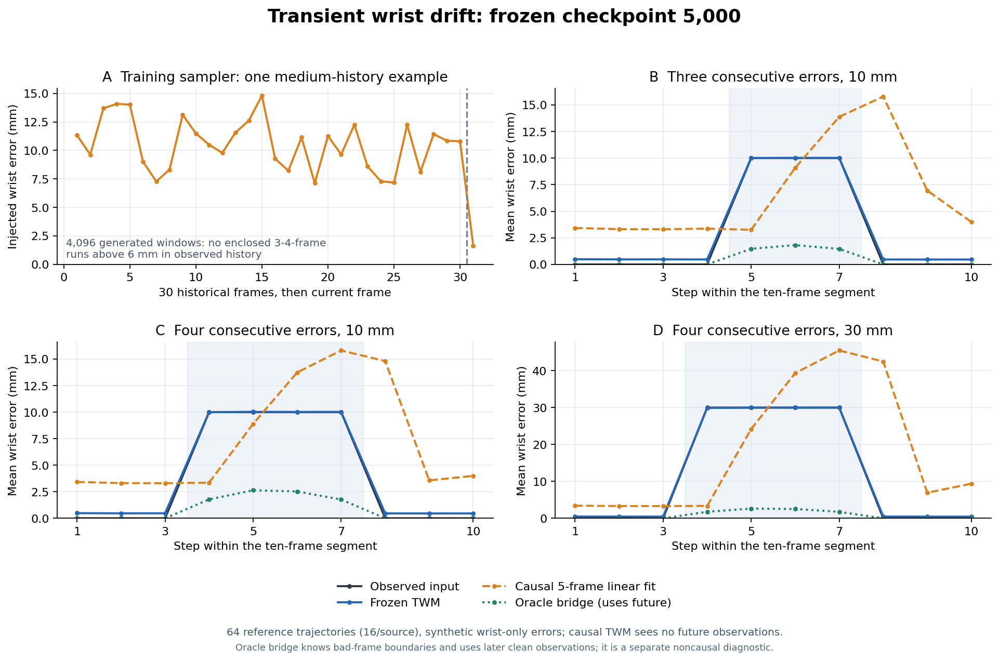

# 短时腕漂移恢复：训练分布与因果评测审计

2026-10-15纽约02:11的冻结实验。用户明确区分整段共同偏移与十帧中局部三四帧异常，要求仔细分析数据。**共同常偏移的不可辨识性不能解释所有短时恢复失败。**本次检查实际sampler及其同分布样本，并直接测试短时异常；未改正式10k训练。

## 协议与产物

冻结原run latest **5,000步**，训练源码`7d53fa4a1b14f31e08f41ba545556e59adadd31f`；使用前次Git archive独立快照，逐项匹配原metadata source SHA，CPU模型hash与两rank保存hash一致。四库val各16窗，共64条连续参考片段，每条30帧初始历史＋10个逐帧当前状态；所有窗口有连续9帧后续参考，按实际dt形成片段。窗口/GT/split/99D与原数据契约一致，GT仍为源拟合MANO。

人为仅在腕位置加入固定方向、10/30mm偏移，其他姿态保持参考值。测试单帧、三帧分散、连续三/四帧、四帧ramp，以及整段含初始历史共同偏移。当前raw/candidate相同，available=true、quality=unknown；没有把异常区间告知TWM。每个时刻只读过去30帧＋当前观测，不读未来状态；批量计算不产生样本间注意力。另对clean/block4测试最终99D回灌历史。这里是受控合成诊断，不是实际HaWoR漂移评测。

模型及buffer前后逐项相等，无optimizer，额外GPU峰值allocated1.583GB。模型hash=`886cfad3893db5323247b9798d41120f8d5a8d80d6f78bd4162fecfad98b8744`。完整指标与索引见[摘要](../reports/twm_transient_drift_20261015.json)，[冻结诊断脚本](../scripts/diagnose_twm_transient_drift.py)、[汇总绘图脚本](../scripts/summarize_twm_transient_drift.py)。原始参考/预测坐标只留远程，不进入Git。

## 训练数据究竟覆盖了什么

当前[sampler](../src/handloop/data/corruption.py)为每窗抽取一个`history_level`并扩展到全部30帧历史，半数方向独立、半数方向经OU相关；每帧半径仍在所选档内独立抽样。strong与missing作用于当前帧，没有显式的历史异常起止mask。相关方向的0.1–0.3s时间常数，不等于生成一个同等时长的“正常→持续偏移→正常”事件；重叠窗口的corruption也独立重抽，未维护同一片段的异常过程。

在四库真实train参考窗口上，以同一profile独立生成4,096窗（不是生产训练batch回放）：

| 按腕参考误差>6mm计数 | 0帧 | 1帧 | 9帧 | 10帧 |
|---|---|---|---|---|
| 每窗最后十帧的异常帧数分布 | 1,781窗 | 503窗 | 1,549窗 | 263窗 |

历史30帧的>6mm帧数只有0（2,284窗）或30（1,812窗），没有三四帧、两侧正常的局部run。这与history_level整窗一致的实现相符。

**不能把一个阈值的零计数推广到所有短异常。**补做1/6/10/15mm阈值敏感性：>10mm时，最后十帧有三帧超阈值201窗、四帧362窗；历史内部至少一个三四帧run有1,419窗。它们是中噪6–15mm档中随机半径形成的阈值run，两侧仍可能有6–10mm误差，不等于带干净边界的局部共同偏移事件。>1mm与>15mm也没有历史内部三四帧run。补查使用同随机draw schedule和dummy reference，幅度分布不依赖姿态，case计数和6mm分布与真实参考审计完全一致。

因此确认的是**缺少显式事件建模及相位覆盖**，不是“完全没见过任何三四帧较大误差”，更没有证明事件增广一定解决全部失败。阈值审计初次dummy batch漏`forecast_dt`被接口拒绝，补齐正时间戳后重跑；失败与修正保存在摘要。

## 短时异常到底能否修复

以下均是**只在被注入异常的帧上**求平均腕误差，64窗等源数；不是全部十帧平均。因果线性基线每次拟合过去五个观测位置及实际时间，不使用异常标签或未来。

| 模式 | 注入误差mm | TWM输出mm | 过去五帧线性外推mm |
|---|---:|---:|---:|
| 单帧30mm | 30.000 | 29.913 | 3.327 |
| 十帧中三帧分散30mm | 30.000 | 29.924 | 5.856 |
| 连续三帧30mm | 30.000 | 29.963 | 22.414 |
| 连续四帧30mm | 30.000 | 29.972 | 28.097 |
| 连续三帧10mm | 10.000 | 10.017 | 8.740 |
| 连续四帧10mm | 10.000 | 10.019 | 10.453 |
| 四帧ramp，峰值30mm | 平均18.750 | 18.740 | 13.617 |

结果显示，当前网络连有充分干净过去的单帧/分散异常也几乎保留原偏移，不能只用连续异常的信息不足作解释。连续段越长，普通外推也越容易被进入历史的坏观测污染；这不是“套一个平滑就解决”。在全clean片段上，线性外推仍有3.119mm误差，TWM引入0.469mm，而输入误差0；任何基线都须同时检查准确输入退化。

将TWM最终状态回灌历史，连续四帧30mm异常段为29.971mm，观测历史控制为29.972mm，未实质改善。异常结束后的原输入已恢复0mm，模型约0.47–0.48mm；不能把这次跟随输入恢复当成模型主动修复旧错误。标准当前恢复接口也不会在第十步自动回头重估前面四步。

## 离线可恢复性与因果边界

额外做已知异常起止、允许读取之后干净观测的frame-index线性插值：单帧0.685mm、三帧分散0.663mm、连续三帧1.582mm、连续四帧2.182mm。这个**oracle边界＋未来观测**诊断显示短时段有很大的恢复空间，但不是公平的实时基线，也不是TWM已达到的精度；第一坏帧到来时，当前TWM还拿不到后面的干净点。它也不保证任意真实动作可精确补回。

另外，按GT为每条十帧预测拟合一个最小二乘常平移，仅作误差分解：整段10mm偏移的model RMSE10.052→0.149mm；局部四帧10mm偏移的RMSE6.352→4.883mm。共同常数与局部事件确实不同；不能拿GT对齐结果当可部署的无参考修正。

这批参考片段本身也有快速位移：Dex/HOT/Oak/Ume逐帧位移p95分别30.882/20.750/15.140/16.360mm，>10mm比例37.7%/15.5%/12.5%/19.6%。这些是本次每源16窗的拟合参考统计，不是全库/真实物理速度界。幅度阈值无法独自区分漂移和有效快速运动。

## 解释的更新与待验证建议

相比前次只测当前偏移，本次直接证实：**局部三四帧异常没有被当前TWM有效修复；全局偏移不可辨识不是这些失败的主要解释。**已查到的协议缺口是没有显式短时漂移过程，模型实际又表现为位置近似identity。输入位置尺度、future梯度牵制、全关节共享噪声档与腕单独异常的分布差异，仍是并行假设，不能把这次结果唯一归因于某一个。

建议下一步在连续clip上生成一致的异常时间线，覆盖起始/持续/结束、三四帧及分散异常，raw/候选/已完成历史仍分开，监督对应的当前真实状态，测试输出回灌。为隔离时间结构，比较同一批误差向量/帧总数/幅度的随机排列与成段排列；保留原mixed_v2、位置归一化和current-only单因素对照。异常mask不默认作为部署oracle输入；若使用实际可靠性预测，应另验错误检测与误检代价。暂不指定新混合比例、时长分布或启动新训练。

以上只读诊断与建议不修改当前10k配置，也不改变D35视觉反馈框架。Checks在data10项目根`evaluations/twm_transient_drift_20261015/`：`probe_v1.json`（含原始坐标，仅远程）、`summary.json`、`threshold_sensitivity.json`、三个诊断/汇总/阈值源码及`curves.png`；plot在zhou环境CPU绘制。

后续用户已明确授权修复并重跑，见[D36两轮训练执行](TWM_TRANSIENT_EPOCH_RUN_2026-10-15.md)。上文“未改训”仅指本次冻结诊断的执行范围，不能解释成后续禁止修改。
