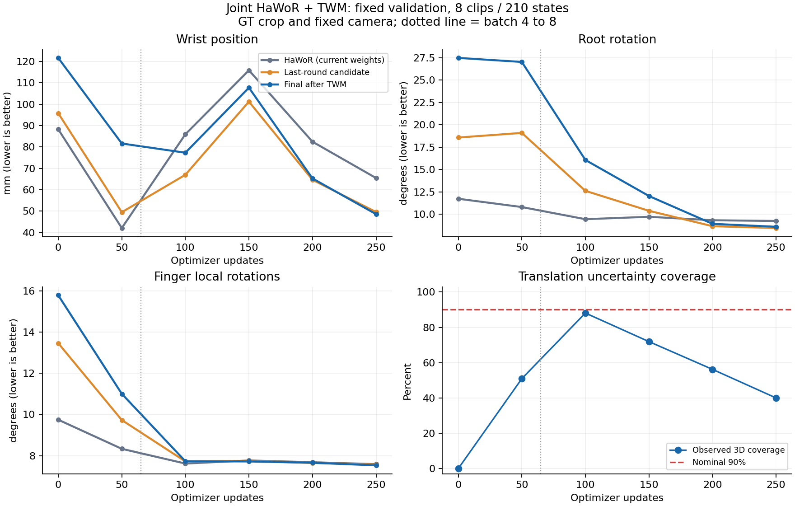

# HaWoR／TWM 联合微调效果快照：step 250

记录时间：**2026-10-16 01:32:54.759202 UTC／纽约 2026-10-15 21:32:54**。本次只读既有训练日志、验证记录与 checkpoint 元数据，并在远程 CPU 汇总及绘图；**没有新增模型推理，没有暂停或修改训练、权重、loss、batch 或 schedule**。完整数值见[小型结果摘要](../reports/visual_joint_progress_20261016_0132.json)，执行协议见[联合微调协议](VISUAL_JOINT_FINETUNE_2026-10-16.md)。

## 当前判断

**固定小验证集上的视觉腕位置已明显改善，但仍存在训练波动、局部退化和不确定性失配；纯轨迹当前恢复及 2 秒预测也出现退化，不能称所有能力已保持。** 这一结论针对同一固定验证集的平均误差，不代表统计显著性、完整数据上的泛化或正式 benchmark 结果。

最新完整固定验证是 **step 250**。最终腕误差为 **48.598 mm**，相比训练前官方 HaWoR 的 **88.250 mm** 下降 **44.93%**；相比同一 checkpoint、已共同微调的 HaWoR raw **65.478 mm** 下降 **25.78%**。最终 root／finger 旋转误差也低于当前 raw，但手指的额外收益仅 **0.78%**。同时，**37.14%** 的有效 states 中，最终腕误差比当前 raw 多超过 **1 mm**。

## 训练状态与来源

- 快照时状态为 `training`，**253／1,000 optimizer updates**；完整视觉和 motion 验证均停留在 **250**，不能将随机训练 batch 的 step 253 指标作为固定验证效果。
- 执行源码：`eb8d0b98f5e2e27fae9ed6f664399d1eca6f2dae`。双 GPU；视觉每卡 **8 clips × 32 帧**，motion replay 每卡 **32 windows**。训练末批有效样本量受 loader 与 mask 影响，不能将每次更新一概写成 512 个有效视觉 states。
- HaWoR／TWM／插件目标学习率仍分别为 **`1e-6`／`1e-5`／`1e-4`**，配合原 warmup／cosine schedule；每四次更新 **3 次视觉、1 次 motion replay**，总预算仍为 **1,000 次**。本次没有调整这些设置。
- TWM 初始化来自已完成 **10,000 步**预训练的 D37 best：`model_assets/twm_d37_final_20261016/best.pt`，SHA256 为 `9f500a283109fbad75f380281808b16781a335550b99853d66832cb120bef76c`。原预训练源码为 `87a2bcce50eb01075e6f5e6959ec536e26f1be58`，保留完整模型配置，包括 `position_feature_scale=0.05`。
- 当前 run：`/sciclone/data10/jchen57/Hand_Reconstruction/runs/visual_feedback_joint_v2_20261016`；[W&B 3abfc864](https://wandb.ai/black-ant/handloop-twm/runs/3abfc864) 服务端状态为 `running`。
- 当前 `best.pt` 与 `latest.pt` 都保存于 **step 250**，混合几何选择分数为 **0.38365256459940045**，配置 batch 为 8。两个 rank 的完整模型 hash 一致：`f48fb4d2e204c31d99d0efd6aba6add5fcdce0d90b5f4f5e033b49b835ee7873`。这证明该保存点的副本一致，不能替代几何效果或校准验证。

训练每卡 batch 4→8 的历史恢复点为 step 65，optimizer／scheduler／RNG 已恢复，loader cursor 重建；step 50 属于 batch 4 阶段，step 100 起属于 batch 8 阶段。本次曲线**不能将后续变化单独归因于 batch 增大**，因为模型持续训练且没有控制变量对照。

## 固定视觉验证与四层比较

数据来自 DexYCB 官方 **s0 recording split**，两名主体共 **16 个 train／8 个 val 录制**。当前 RGB 源池有 train 1,128 帧／val 577 帧；32 帧分段后为 46 train／24 val clips。验证固定从 24 个 val clips 中选择索引 **`[0, 3, 7, 10, 13, 16, 20, 23]`**，合计 **8 clips／210 个有效完整 states／3,150 个 finger rotations**。验证 batch 始终为 1；训练 batch 改变没有改变该采样。相同源 manifest、clip length、固定索引及有效计数已经核对。

源 manifest SHA256：`67462dced45615c9e0ea8d761da58094d03f8b8cadc47370c06f126751259d3e`。训练／验证录制在窗口化前分开，本次不使用 test。

| 输出 | 腕位置误差（mm）↓ | Root 旋转误差（°）↓ | Finger 旋转误差（°）↓ |
|---|---:|---:|---:|
| 训练前固定官方 HaWoR raw | 88.250 | 11.729 | 9.747 |
| Step 250 当前 HaWoR raw | 65.478 | 9.243 | 7.589 |
| Step 250 最后一轮视觉候选 | 49.590 | 8.452 | 7.561 |
| Step 250 联合 final | **48.598** | 8.591 | **7.530** |

“原始观测不可覆盖”指一次 forward 的帧内 raw 固定，不代表 HaWoR 权重冻结。因此，训练中的 `validation/raw` 已随 HaWoR 微调改变，不能继续把它称作固定官方基线。上表同时保留训练前 raw、当前 raw、当前 candidate 和当前 final，避免混淆视觉主干适配与后续校正收益。

相对训练前 raw，final 的腕／root／finger 平均误差分别下降 **44.93%／26.75%／22.75%**；相对当前 raw，分别下降 **25.78%／7.04%／0.78%**。手指从原始基线到 final 的整体改善较大，但当前 raw 后的追加改善较小。

`candidate` 是第二轮视觉插件生成、交给最后一次 TWM 前的候选；`final` 是第二轮 TWM 的恢复结果。candidate→final 腕误差再下降 **0.991 mm，约 2.00%**；root 误差增加约 **1.65%**，finger 误差下降约 **0.42%**。**candidate 已以第一轮 TWM 恢复和此前帧的最终历史为条件，因此这些差值只衡量最后一次 TWM 的追加作用，不能解读为整个 TWM 仅贡献 2%，也不能替代移除 TWM 的消融。**

## 验证曲线：几何改善仍有波动

| Step | Final 腕（mm）↓ | Final root（°）↓ | Final finger（°）↓ | 视觉 current NLL↓ | 90% xyz 椭球覆盖 | Anchor 平均轴 std（mm） |
|---:|---:|---:|---:|---:|---:|---:|
| 0 | 121.616 | 27.489 | 15.793 | 5705.766 | 0.00% | 11.879 |
| 50 | 81.610 | 27.036 | 11.006 | -96.185 | 50.95% | 33.077 |
| 100 | 77.304 | 16.066 | 7.730 | 14.403 | 88.10% | 52.880 |
| 150 | 107.707 | 12.034 | 7.720 | 26.486 | 71.90% | 69.129 |
| 200 | 65.280 | 8.923 | 7.656 | 102.171 | 56.19% | 35.420 |
| 250 | **48.598** | **8.591** | **7.530** | 108.340 | 40.00% | 32.622 |

初始化两轮系统 final 的 **121.616 mm** 明显差于当时 raw 的 **88.250 mm**，这一负面基线保留。训练后 final 大幅改善，但腕误差在 step 150 曾回升至 **107.707 mm**，不能称已稳定收敛。step 250 是现有已验证训练点中混合几何分数最好的 checkpoint，并非所有指标都达到最好。

当前均值改善没有消除局部失败：step 250 有 **37.14% states** 的 final 腕误差比同 checkpoint raw 多超过 **1 mm**。该比例针对当前 raw 的逐 state 对照，不是相对训练前 raw 的退化比例，也不是整段录制失败率。

几何误差改善与 NLL／coverage 的变化并不一致。视觉 NLL 在 step 50 为 **-96.185**，后续升至 **108.340**；coverage 在 step 100 达 **88.10%**，step 250 降至 **40.00%**，明显低于名义 90%。同时平均轴 std 从 step 100 的 **52.880 mm** 降至 **32.622 mm**。这些记录支持当前分布拟合与校准仍不稳定；**不能仅由该快照确定是哪个 loss 项、batch、均值或尺度参数导致，也不能将 coverage 改善或变差直接等同几何改善或变差。** 本轮未实现独立可靠性 w／q 的校准。

## 同集纯轨迹能力保持

motion retention 在原四库 val 分区中，按来源各取固定等间隔 **16 窗**，分别施加 **noisy／clean** 条件；每次验证使用相同 seed 和相同窗口。下面比较的是**初始化 D37 best 与 step 250 TWM 在这套相同小集上的结果**，不是此前 D37 每源 256 窗大验证的数值。统计对有目标的来源逐项等权宏平均，不按全池数据量加权；源内按该指标真实有效数归约。

| 条件／当前指标 | 初始化 D37 best | Step 250 | 变化 |
|---|---:|---:|---:|
| Noisy 腕（mm）↓ | 2.959 | 3.514 | 增加 18.78% |
| Noisy root（°）↓ | 1.446 | 1.458 | 增加 0.84% |
| Noisy finger（°）↓ | 0.696 | 0.896 | 增加 28.77% |
| Clean 腕（mm）↓ | 0.611 | 1.008 | 增加 65.06% |
| Clean root（°）↓ | 0.462 | 0.418 | 下降 9.54% |
| Clean finger（°）↓ | 0.149 | 0.276 | 增加 85.19% |

这些当前指标均为 **4 源 × 16 窗**。clean 的百分比因初始误差很小而较大，需同时看绝对值；它表示干净输入经过模型后产生的误差，并非合成 clean 输入本身存在同样误差。结果显示当前恢复没有整体保持原有精度，但不能说所有任务、所有旋转项都退化。

### 未来腕预测

| 条件／未来指标 | 初始化 D37 best（mm）↓ | Step 250（mm）↓ | Step 250 恢复后 hold（mm）↓ | 有效目标 |
|---|---:|---:|---:|---|
| Noisy 整段腕 ADE | 78.887 | 82.451 | 见完整摘要 | 4 源，各源有效帧数见下表 |
| Clean 整段腕 ADE | 72.951 | 73.809 | 见完整摘要 | 同上 |
| Noisy 1 秒腕 | 100.370 | 94.874 | 122.445 | 4 源／47 targets |
| Clean 1 秒腕 | 93.279 | 84.612 | 见完整摘要 | 4 源／47 targets |
| Noisy 2 秒腕 | 152.983 | 172.615 | 169.452 | 3 源／37 targets，Dex 无有效目标 |
| Clean 2 秒腕 | 146.759 | 163.826 | 169.338 | 同上 |

| 指标计数 | DexYCB | HOT3D | OakInk2 | UmeTrack |
|---|---:|---:|---:|---:|
| 当前恢复／0.1 秒 | 16 | 16 | 16 | 16 |
| 0.5 秒 | 11 | 14 | 15 | 15 |
| 1 秒 | 5 | 12 | 15 | 15 |
| 2 秒 | 0 | 8 | 15 | 14 |
| 整段 ADE 有效未来 states | 362 | 728 | 903 | 898 |

同一时域的 noisy／clean 与初始化／step 250 使用相同有效计数。1 秒 noisy 腕误差下降 **5.48%**、clean 下降 **9.29%**；2 秒 noisy 增加 **12.83%**、clean 增加 **11.63%**。当前 noisy 2 秒预测还差于恢复后 hold，因此不能声称已稳定保住长预测优势。整段腕 ADE 也分别增加 **4.52%／1.18%**。这些统计不等于所有未来指标同步变化：例如 noisy 1 秒 root 误差从 **25.125°** 增至 **33.440°**，不能仅用该时域腕误差改善代表完整未来状态改善。

这里的 `map` 是选取**混合 logits 最大的一个整段模式**，不是逐时挑选最接近 GT 的模式，也不是 oracle minADE。hold 是保持**恢复后的当前 state**，不是保持 GT 或 raw。ADE 在源内按所有有效未来 state 平均，较长有效轨迹贡献更多帧；1／2 秒则取与所需物理时间最近、且距离不超过 **0.6 × 当前 dt** 的有效目标，再按来源宏平均。2 秒缺 Dex，不能当作四源统一结论。

该部分仅检测**纯数值轨迹输入下的能力保持**，没有评估真实 RGB 条件下的未来预测；目前没有因此新增视觉长预测收益断言。

## 指标与适用范围

- 每手状态仍为 **99D**：腕位置 3、root rotation6D 6、15 个 finger rotation6D 90；shape β10 另存。TWM 仍不读取 RGB 或图像 features。
- 位置监督与输出以**米**存储，表中腕误差为 L2 欧氏距离转成**毫米**。world 是固定相机 **`836212060125`** 的明确 gauge，未做 Procrustes／similarity 对齐。root 是全局旋转误差，finger 是 15 个局部关节旋转的 SO(3) 测地角平均，单位为**度**；**不是 MPJPE、关节点／网格毫米误差**。
- 当前视觉参考是 DexYCB 官方 **fitted MANO／joint annotation**，不是独立 glove／MoCap 真值。当前采用 **GT 关节点投影 crop、固定相机和标称 frame index／30 时间戳**，不代表自动 detector、移动头戴相机 SLAM 或完整 HaWoR benchmark。
- `current_nll` 为完整有效 state 的连续密度 NLL，视觉目标未除以 51；负值合法。motion replay 中原六项目标的 NLL 缩放不同，不能把两类任务的 loss 数值直接比较。
- `geometry_score` 由 `smoothL1(p/0.05) + 2 × root chordal + mean(finger chordal)` 构成，是混合无量纲选择分数，不是 mm。best 只在已训练 checkpoint 中选择，初始化 step 0 另存，不因文件名 best 自动证明优于官方 HaWoR。
- coverage 是固定 anchor 中三维 Gaussian 的 **90% 椭球覆盖**，采用 χ²₃ 阈值 **6.2514**；`xyz_std_mm` 是该 anchor 三轴标准差的均值。不能当成逐轴 90% 边缘覆盖或已校准可靠性。
- 每个固定 val clip 都从空历史重新开始，最多处理 32 帧，只有最终轮状态进入后续帧历史；这不等于整段录制的长期闭环。HaWoR 保留原 16 帧双向上下文及 lookahead，不能称严格因果在线预测。
- 本次只汇总单 run 的已有快照，尚无控制变量消融、独立测试集、置信区间或多次种子实验。不能据此确定波动、局部失败或能力退化的具体原因。

## 证据与产物

- [完整小型 JSON 摘要](../reports/visual_joint_progress_20261016_0132.json)：配置、数据与资产 SHA、验证历史、各来源 motion 指标／计数、初始化与 step 250 对照、checkpoint 元数据和范围说明。
- [曲线 PNG](../reports/figures/visual_joint_progress_20261016_0132.png)。
- 远程证据目录：`/sciclone/data10/jchen57/Hand_Reconstruction/evaluations/visual_joint_v2_20261016/progress_20261016_0130/`，其中 `evidence.json` 保留读取证据，`report.json` 为 CPU 汇总，`validation_curves.png` 为绘图产物。
- 源码口径：[固定 RGB 验证](../scripts/train_visual_joint.py#L195)、[motion retention](../scripts/train_visual_joint.py#L224)、[腕／旋转／覆盖指标](../scripts/train_visual_feedback.py#L92)、[混合几何选择分数](../scripts/train_probabilistic_twm.py#L63)。

训练按现有设置继续运行。本报告保留视觉收益与失败结果，不修改用户已延后到下一版本的 loss 设计，也不把尚未验证的原因或改进方案写成实验结论。
